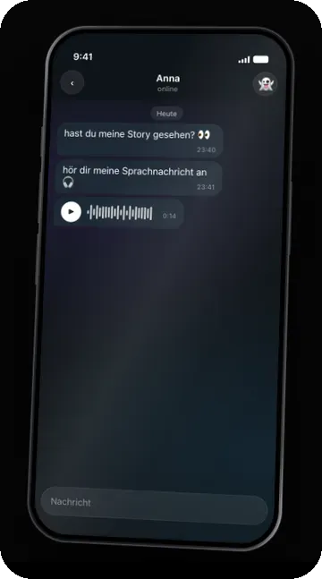
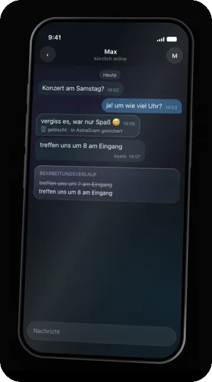
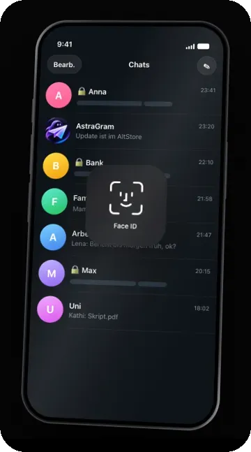
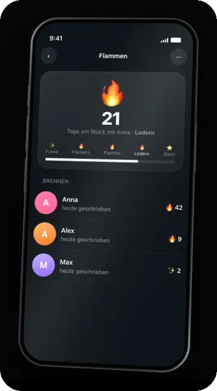
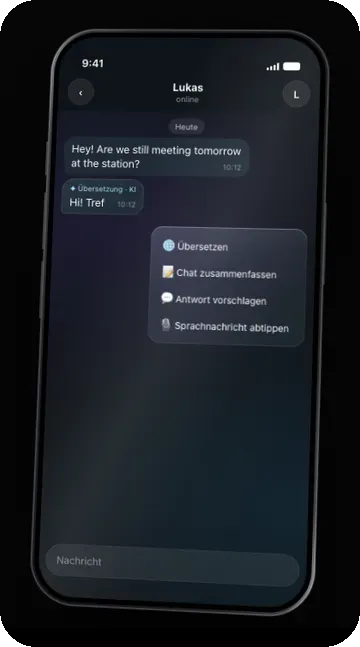
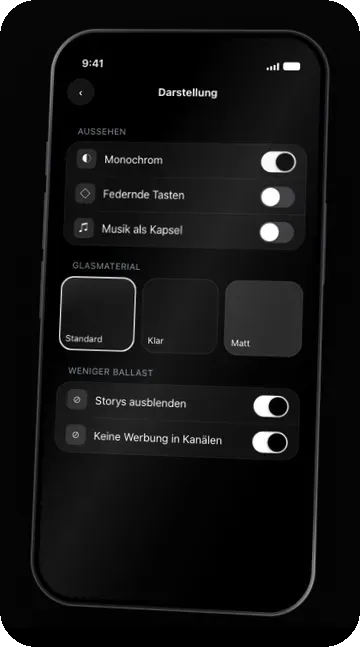
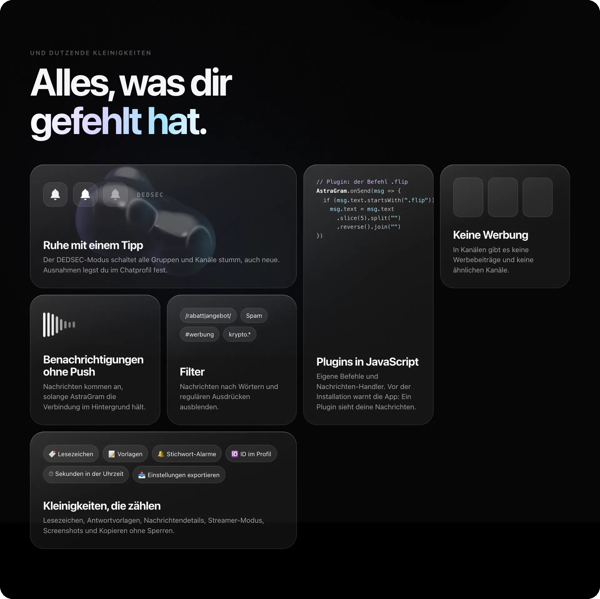

<a href="https://dedsec-reth0.github.io/astragram/?lang=de"></a>

<p align="center"><a href="README.md">English</a> · <a href="README.ru.md">Русский</a> · <a href="README.uk.md">Українська</a> · <a href="README.es.md">Español</a> · <a href="README.pt.md">Português</a> · <b>Deutsch</b> · <a href="README.fr.md">Français</a> · <a href="README.tr.md">Türkçe</a></p>

<p align="center">
  <a href="https://dedsec-reth0.github.io/astragram/install/?lang=de"></a>
  <a href="https://dedsec-reth0.github.io/astragram/?lang=de"></a>
  <a href="https://t.me/astragram_news"></a>
</p>

<p align="center">
  <a href="https://github.com/dedsec-reth0/astragram/releases/latest"></a>
  <a href="https://github.com/dedsec-reth0/astragram/releases"></a>
  <a href="https://github.com/dedsec-reth0/astragram/stargazers"></a>
  
  <a href="LICENSE"></a>
</p>

<br>

<p align="center">AstraGram ist ein inoffizieller Open-Source-Telegram-Client für das iPhone: Geistmodus, gelöschte Nachrichten, Chats mit Face ID, Flammen, KI und Plugins. Kostenlos über AltStore und SideStore.</p>

<h3 align="center">Wir haben Telegram genommen und alles <b>entfernt,</b> was <b>stört.</b> Du entscheidest, ob <b>„online“</b> und <b>„gelesen“</b> gesendet werden. Gelöschtes <b>bleibt</b> bei dir. Überflüssiges <b>verschwindet.</b> Und der ganze Code liegt <b>offen.</b></h3>

<br>

## Funktionen

<table>
<tr><td width="42%" align="center"><a href="https://dedsec-reth0.github.io/astragram/?lang=de#features"></a></td><td width="58%" valign="middle"><sub><code>01 / 06</code></sub><h3>Geist- modus</h3><p>Lies, hör und schau Storys, ohne „online“, „gelesen“ oder „schreibt“ zu senden. Ein Tipp auf den Geist über der Chatliste schaltet ihn ein.</p><ul><li>Keine Lesebestätigung für Storys, Sprach- und Videonachrichten</li><li>Gelesen erst, wenn du selbst antwortest</li><li>Telegrams Server sieht deine Verbindung trotzdem: keine Unsichtbarkeit</li></ul></td></tr>
<tr><td width="58%" valign="middle"><sub><code>02 / 06</code></sub><h3>Gelöschtes bleibt</h3><p>Nachrichten, die dein Gegenüber löscht, bleiben mit Markierung im Chat. Jede Nachricht behält ihren Bearbeitungsverlauf.</p><ul><li>Auch in Kanälen</li><li>Einmal-Fotos und -Videos verschwinden nicht</li><li>Ein Protokoll aller gelöschten Nachrichten</li></ul></td><td width="42%" align="center"><a href="https://dedsec-reth0.github.io/astragram/?lang=de#features"></a></td></tr>
<tr><td width="42%" align="center"><a href="https://dedsec-reth0.github.io/astragram/?lang=de#features"></a></td><td width="58%" valign="middle"><sub><code>03 / 06</code></sub><h3>Chats mit Face ID</h3><p>Ausgewählte Chats öffnen sich nur mit deinem Gesicht. Ihr Text ist schon in der Chatliste verborgen, und der App-Umschalter zeigt ein Deckblatt.</p><ul><li>Face ID für die AstraGram-Einstellungen</li><li>Tastaturen von Drittanbietern sperren</li><li>Die Zwischenablage leert sich nach einer Minute</li></ul></td></tr>
<tr><td width="58%" valign="middle"><sub><code>04 / 06</code></sub><h3>Flammen mit Freunden</h3><p>Schreibt euch jeden Tag, und die Flamme wächst: Funke, Flackern, Flamme, Lodern, Stern. Der Zähler ist auf all deinen Geräten gleich.</p><ul><li>Ein Begleiter mit Kleiderschrank</li><li>Einen verpassten Tag wiederherstellen</li><li>Ein AstraGram-Abzeichen, das Freunde mit AstraGram sehen</li></ul></td><td width="42%" align="center"><a href="https://dedsec-reth0.github.io/astragram/?lang=de#features"></a></td></tr>
<tr><td width="42%" align="center"><a href="https://dedsec-reth0.github.io/astragram/?lang=de#features"></a></td><td width="58%" valign="middle"><sub><code>05 / 06</code></sub><h3>KI mit eigenem Schlüssel</h3><p>Übersetzen, Chat zusammenfassen, Antwort vorschlagen, Sprachnachrichten abtippen und Text aus Fotos lesen — über jede OpenAI-kompatible API.</p><ul><li>Text geht nur auf deinen Befehl an den Dienst</li><li>Ohne Schlüssel: ein kostenloser Dienst mit Limit</li><li>Plugins in JavaScript</li></ul></td></tr>
<tr><td width="58%" valign="middle"><sub><code>06 / 06</code></sub><h3>Monochrom und Glas</h3><p>Ein Look nur in Schwarz, Weiß und Grau. Wähle das Glasmaterial: Standard, klar oder matt.</p><ul><li>Federnde Tasten</li><li>Profilmusik als Kapsel</li><li>Keine Storys und keine Werbung in Kanälen</li></ul></td><td width="42%" align="center"><a href="https://dedsec-reth0.github.io/astragram/?lang=de#features"></a></td></tr>
</table>

## Alles, was dir gefehlt hat.

<a href="https://dedsec-reth0.github.io/astragram/?lang=de#more"></a>

Ein Plugin schreiben: [astragram/plugins/README.md](astragram/plugins/README.md) · [examples](astragram/plugins/examples)

## Installieren

Ein Tipp, und AltStore bietet an, die AstraGram-Quelle hinzuzufügen. Dort kommen dann auch die Updates an.

<p><a href="https://dedsec-reth0.github.io/astragram/install/?lang=de"></a> <a href="https://dedsec-reth0.github.io/astragram/install/?lang=de"></a> <a href="https://github.com/dedsec-reth0/astragram/releases/latest"></a></p>

<table><tr>
<td width="33%" valign="top"><h1>01</h1><b>AltStore oder SideStore installieren</b><br><sub>Sie signieren die App mit deiner Apple-ID. Kein Jailbreak nötig.<br><a href="https://altstore.io">AltStore laden</a> · <a href="https://sidestore.io">SideStore</a></sub></td>
<td width="33%" valign="top"><h1>02</h1><b>AstraGram-Quelle hinzufügen</b><br><sub>Der Button „In AltStore öffnen“ erledigt das. Oder füge die Adresse von Hand ein.</sub></td>
<td width="33%" valign="top"><h1>03</h1><b>Auf Free tippen</b><br><sub>AltStore installiert AstraGram. Beim ersten Start gibst du deine API ID und deinen Hash von my.telegram.org ein.</sub></td>
</tr></table>

**Von Hand** — Adresse der Quelle:

```
https://github.com/dedsec-reth0/astragram/releases/download/sidestore-source/source.json
```

1. Öffne AltStore → **Browse** → **Sources** → **+**.
2. Füge die kopierte Adresse ein.
3. Such AstraGram und tippe auf **Free**.

> [!NOTE]
> Die eigenen Bildschirme von AstraGram sind auf Russisch und Englisch; der Rest der App ist die Telegram-Oberfläche in jeder ihrer Sprachen.

### Welche IPA passt

| | IPA | App ID |
| --- | --- | --- |
| **Standard** | `AstraGram-<version>-<build>.ipa` | Kostenlose Apple-ID. Ohne Erweiterungen — keine Widgets, kein Teilen. Braucht 1 App ID. |
| **Full** | `AstraGram-<version>-<build>-full.ipa` | Bezahlter Entwickler-Account. Mit allen Erweiterungen. Braucht 7 App IDs. |

### Alle Versionen

Alle Builds liegen unter [Releases](https://github.com/dedsec-reth0/astragram/releases), und die AltStore-Quelle listet sie alle, nicht nur den neuesten: Ein neuer Build kommt als Update, ältere bleiben im Versionsverlauf.

### Fragen

<details><summary><b>Brauche ich einen Jailbreak?</b></summary>

Nein. AstraGram wird über AltStore oder SideStore installiert, wie jede App aus einer Quelle.

</details>
<details><summary><b>Warum alle 7 Tage?</b></summary>

Mit einer kostenlosen Apple-ID gilt die Signatur 7 Tage. Tippe einmal pro Woche in AltStore auf „Refresh All“.

</details>
<details><summary><b>Bleiben meine Daten beim Update?</b></summary>

Ja. Beim Update über AltStore bleiben Daten und Anmeldung erhalten.

</details>
<details><summary><b>Woher bekomme ich API ID und Hash?</b></summary>

Auf my.telegram.org unter API development tools. Später änderst du sie unter Einstellungen → AstraGram → API ID und Hash.

</details>
<details><summary><b>Warum kommen keine Push-Benachrichtigungen?</b></summary>

Telegrams Server senden Push nur an Apps mit einem ihnen bekannten Zertifikat. „Benachrichtigungen ohne Push“ in den AstraGram-Einstellungen hilft teilweise.

</details>

## Glaub uns nicht einfach. Prüf es selbst.

<table><tr>
<td width="33%" valign="top"><b>Der Code ist offen. Komplett</b><br><sub>Der Quellcode liegt auf <a href="https://github.com/dedsec-reth0/astragram">GitHub</a> unter der GPL-2.0, auf Basis des offenen Codes von Telegram-iOS.</sub></td>
<td width="33%" valign="top"><b>GitHub baut es, nicht wir</b><br><sub>Jeder Build läuft auf GitHub Actions, das Protokoll ist öffentlich. Jedes Release ist mit dem Commit getaggt, aus dem es gebaut wurde.</sub></td>
<td width="33%" valign="top"><b>Die API-Schlüssel gehören dir</b><br><sub>Beim ersten Start gibst du deine eigene API ID und deinen Hash von my.telegram.org ein.</sub></td>
</tr></table>

```console
$ git clone https://github.com/dedsec-reth0/astragram
$ gh release view --repo dedsec-reth0/astragram --json tagName,targetCommitish
# das Release wurde aus diesem Commit gebaut — prüf es selbst
```

### Aus dem Quellcode bauen

Die App wird mit Bazel aus dem Telegram-iOS-Quellcode gebaut; jedes Release ist auf dem Commit getaggt, aus dem es gebaut wurde.

[astragram/INSTALL.md](astragram/INSTALL.md) — Bauen und Veröffentlichen (auf Russisch) · [docs/telegram-ios-build.md](docs/telegram-ios-build.md) — die Originalanleitung von Telegram

### Lizenz

Basiert auf [Telegram-iOS](https://github.com/TelegramMessenger/Telegram-iOS), veröffentlicht unter GPL-2.0. Die Änderungen in diesem Repository stehen unter derselben Lizenz: [LICENSE](LICENSE); Komponenten Dritter: [THIRD-PARTY-NOTICES.md](THIRD-PARTY-NOTICES.md).

---

<p align="center"><a href="https://dedsec-reth0.github.io/astragram/?lang=de"></a></p>

<p align="center"><sub>AstraGram ist ein inoffizieller Telegram-Client und nicht mit Telegram verbunden; Name und Logo von Telegram gehören ihrem Inhaber.<br>Builds aus dem AltStore erhalten keine Push-Benachrichtigungen; der Geistmodus verbirgt deine Verbindung nicht vor Telegrams Server.</sub></p>
