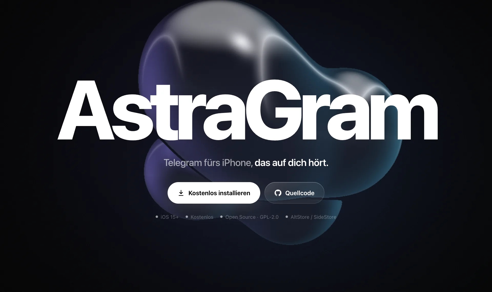
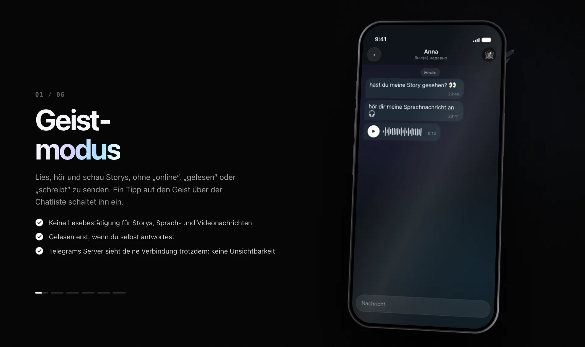
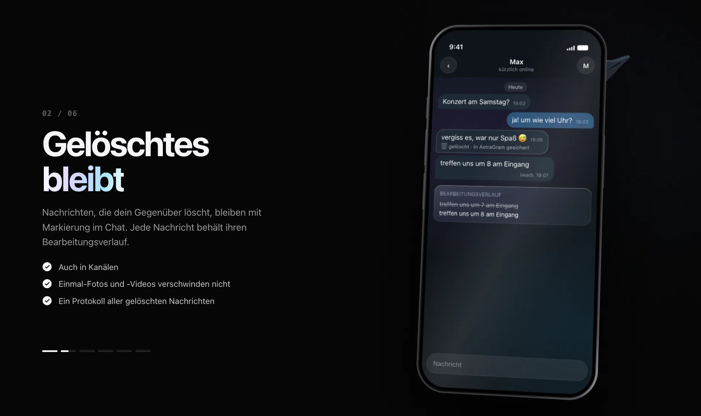
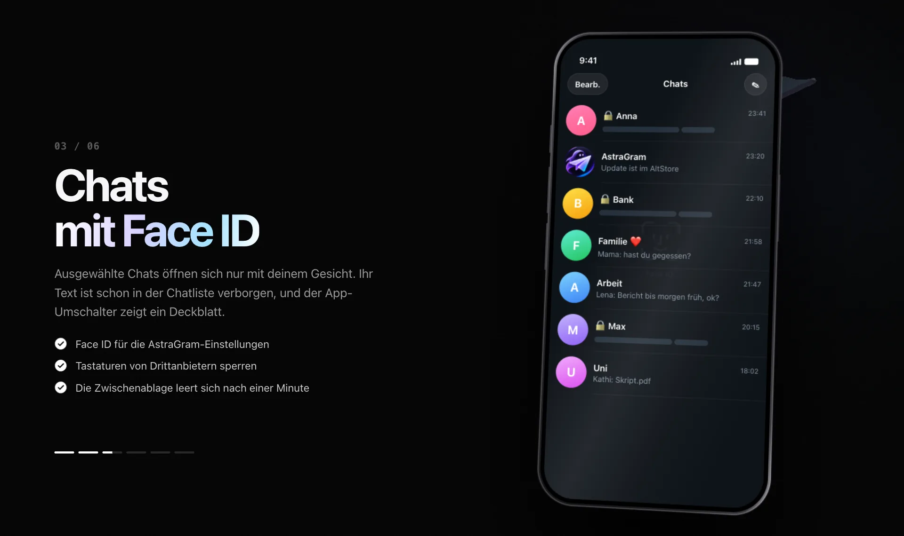
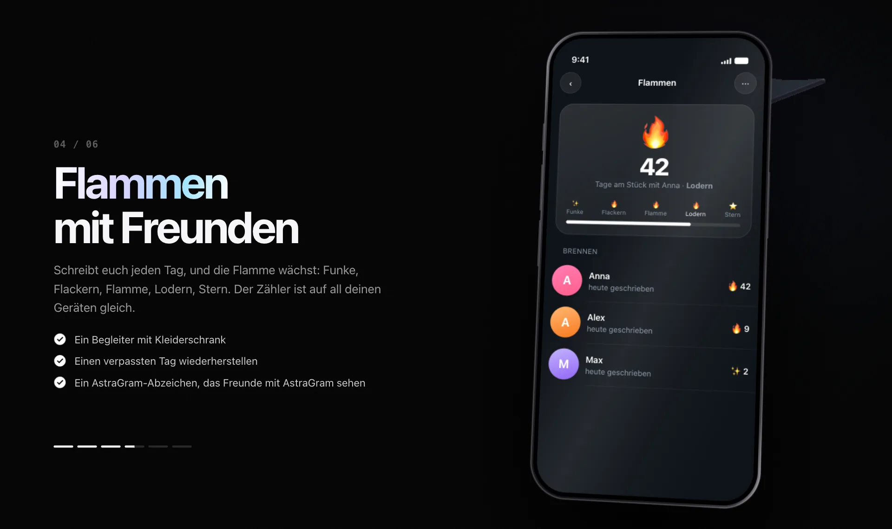
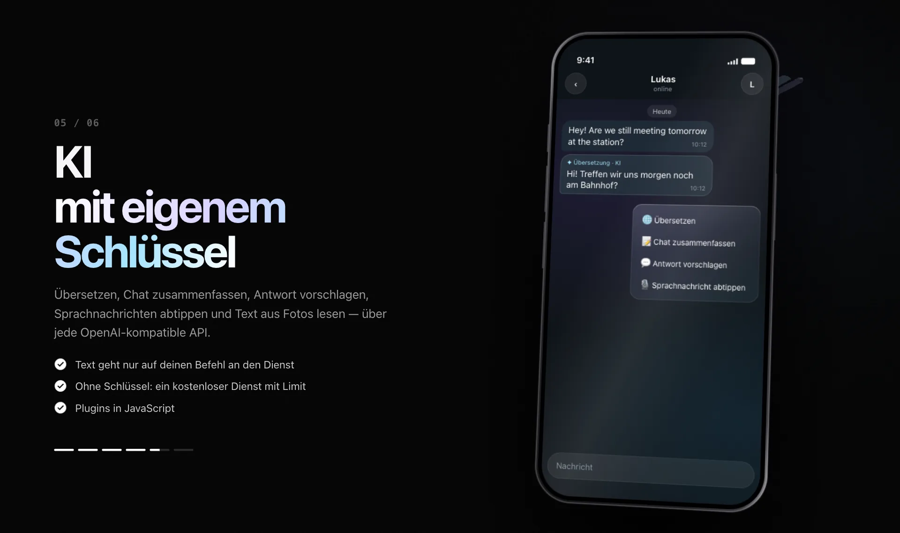
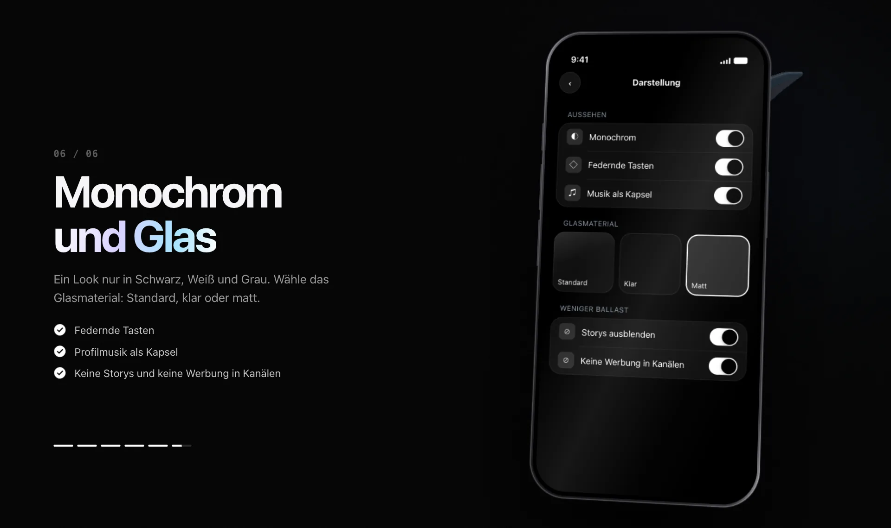

<a href="https://dedsec-reth0.github.io/astragram/?lang=de"></a>

<p align="center"><a href="README.md">English</a> · <a href="README.ru.md">Русский</a> · <a href="README.uk.md">Українська</a> · <a href="README.es.md">Español</a> · <a href="README.pt.md">Português</a> · <b>Deutsch</b> · <a href="README.fr.md">Français</a> · <a href="README.tr.md">Türkçe</a></p>

<h1 align="center">AstraGram</h1>

<p align="center"><b>Telegram fürs iPhone, das auf dich hört.</b><br>AstraGram ist ein inoffizieller Open-Source-Telegram-Client für das iPhone: Geistmodus, gelöschte Nachrichten, Chats mit Face ID, Flammen, KI und Plugins. Kostenlos über AltStore und SideStore.</p>

<p align="center">
  <a href="https://dedsec-reth0.github.io/astragram/install/?lang=de"></a>
  <a href="https://github.com/dedsec-reth0/astragram/releases/latest"></a>
  <a href="https://github.com/dedsec-reth0/astragram/releases"></a>
  
  <a href="LICENSE"></a>
</p>

<p align="center"><a href="https://dedsec-reth0.github.io/astragram/install/?lang=de"><b>Kostenlos installieren</b></a> · <a href="https://dedsec-reth0.github.io/astragram/?lang=de"><b>Website</b></a> · <a href="https://t.me/astragram_news"><b>Telegram-Kanal</b></a> · <a href="https://github.com/dedsec-reth0/astragram/releases/latest"><b>IPA herunterladen</b></a></p>

> Wir haben Telegram genommen und alles **entfernt,** was **stört.** Du entscheidest, ob **„online“** und **„gelesen“** gesendet werden. Gelöschtes **bleibt** bei dir. Überflüssiges **verschwindet.** Und der ganze Code liegt **offen.**

## Funktionen

<a href="https://dedsec-reth0.github.io/astragram/?lang=de#features"></a>

<a href="https://dedsec-reth0.github.io/astragram/?lang=de#features"></a>

<a href="https://dedsec-reth0.github.io/astragram/?lang=de#features"></a>

<a href="https://dedsec-reth0.github.io/astragram/?lang=de#features"></a>

<a href="https://dedsec-reth0.github.io/astragram/?lang=de#features"></a>

<a href="https://dedsec-reth0.github.io/astragram/?lang=de#features"></a>

## Alles, was dir gefehlt hat.

<a href="https://dedsec-reth0.github.io/astragram/?lang=de#more"></a>

Ein Plugin schreiben: [astragram/plugins/README.md](astragram/plugins/README.md) · [examples](astragram/plugins/examples)

## Installieren

Ein Tipp, und AltStore bietet an, die AstraGram-Quelle hinzuzufügen. Dort kommen dann auch die Updates an.

<p><a href="https://dedsec-reth0.github.io/astragram/install/?lang=de"></a> <a href="https://dedsec-reth0.github.io/astragram/install/?lang=de"></a> <a href="https://github.com/dedsec-reth0/astragram/releases/latest"></a></p>

1. **AltStore oder SideStore installieren** — Sie signieren die App mit deiner Apple-ID. Kein Jailbreak nötig. [AltStore laden](https://altstore.io) · [SideStore](https://sidestore.io)
2. **AstraGram-Quelle hinzufügen** — Der Button „In AltStore öffnen“ erledigt das. Oder füge die Adresse von Hand ein.
3. **Auf Free tippen** — AltStore installiert AstraGram. Beim ersten Start gibst du deine API ID und deinen Hash von my.telegram.org ein.

**Von Hand** — Adresse der Quelle:

```
https://github.com/dedsec-reth0/astragram/releases/download/sidestore-source/source.json
```

1. Öffne AltStore → **Browse** → **Sources** → **+**.
2. Füge die kopierte Adresse ein.
3. Such AstraGram und tippe auf **Free**.

> [!NOTE]
> Die eigenen Bildschirme von AstraGram sind auf Russisch und Englisch; der Rest der App ist die Telegram-Oberfläche in jeder ihrer Sprachen.

### Welche IPA passt

| | IPA | App ID |
| --- | --- | --- |
| **Standard** | `AstraGram-<version>-<build>.ipa` | Kostenlose Apple-ID. Ohne Erweiterungen — keine Widgets, kein Teilen. Braucht 1 App ID. |
| **Full** | `AstraGram-<version>-<build>-full.ipa` | Bezahlter Entwickler-Account. Mit allen Erweiterungen. Braucht 7 App IDs. |

### Alle Versionen

Alle Builds liegen unter [Releases](https://github.com/dedsec-reth0/astragram/releases), und die AltStore-Quelle listet sie alle, nicht nur den neuesten: Ein neuer Build kommt als Update, ältere bleiben im Versionsverlauf.

### Fragen

<details><summary><b>Brauche ich einen Jailbreak?</b></summary>

Nein. AstraGram wird über AltStore oder SideStore installiert, wie jede App aus einer Quelle.

</details>
<details><summary><b>Warum alle 7 Tage?</b></summary>

Mit einer kostenlosen Apple-ID gilt die Signatur 7 Tage. Tippe einmal pro Woche in AltStore auf „Refresh All“.

</details>
<details><summary><b>Bleiben meine Daten beim Update?</b></summary>

Ja. Beim Update über AltStore bleiben Daten und Anmeldung erhalten.

</details>
<details><summary><b>Woher bekomme ich API ID und Hash?</b></summary>

Auf my.telegram.org unter API development tools. Später änderst du sie unter Einstellungen → AstraGram → API ID und Hash.

</details>
<details><summary><b>Warum kommen keine Push-Benachrichtigungen?</b></summary>

Telegrams Server senden Push nur an Apps mit einem ihnen bekannten Zertifikat. „Benachrichtigungen ohne Push“ in den AstraGram-Einstellungen hilft teilweise.

</details>

## Glaub uns nicht einfach. Prüf es selbst.

- **Der Code ist offen. Komplett** — Der Quellcode liegt auf [GitHub](https://github.com/dedsec-reth0/astragram) unter der GPL-2.0, auf Basis des offenen Codes von Telegram-iOS.
- **GitHub baut es, nicht wir** — Jeder Build läuft auf GitHub Actions, das Protokoll ist öffentlich. Jedes Release ist mit dem Commit getaggt, aus dem es gebaut wurde.
- **Die API-Schlüssel gehören dir** — Beim ersten Start gibst du deine eigene API ID und deinen Hash von my.telegram.org ein.

### Aus dem Quellcode bauen

Die App wird mit Bazel aus dem Telegram-iOS-Quellcode gebaut; jedes Release ist auf dem Commit getaggt, aus dem es gebaut wurde.

[astragram/INSTALL.md](astragram/INSTALL.md) — Bauen und Veröffentlichen (auf Russisch) · [docs/telegram-ios-build.md](docs/telegram-ios-build.md) — die Originalanleitung von Telegram

### Lizenz

Basiert auf [Telegram-iOS](https://github.com/TelegramMessenger/Telegram-iOS), veröffentlicht unter GPL-2.0. Die Änderungen in diesem Repository stehen unter derselben Lizenz: [LICENSE](LICENSE); Komponenten Dritter: [THIRD-PARTY-NOTICES.md](THIRD-PARTY-NOTICES.md).

---

<p align="center"><a href="https://dedsec-reth0.github.io/astragram/?lang=de"></a></p>

<p align="center"><sub>AstraGram ist ein inoffizieller Telegram-Client und nicht mit Telegram verbunden; Name und Logo von Telegram gehören ihrem Inhaber.<br>Builds aus dem AltStore erhalten keine Push-Benachrichtigungen; der Geistmodus verbirgt deine Verbindung nicht vor Telegrams Server.</sub></p>
