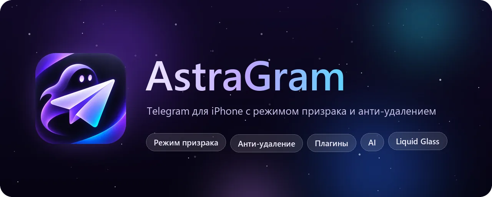
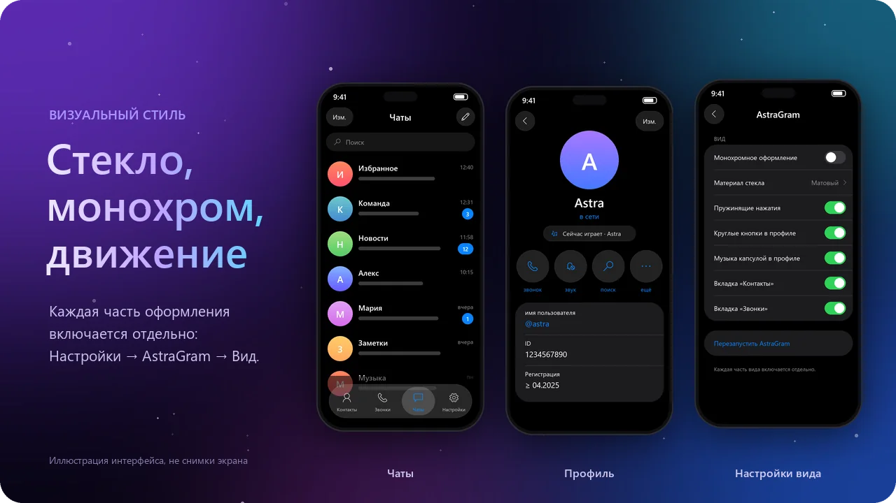

<p align="center">
  
</p>

<h1 align="center">AstraGram for iOS</h1>

<p align="center">
  <a href="README.md">Русский</a> · <b>English</b>
</p>

<p align="center">
  Telegram for iPhone with ghost mode, saved deleted messages and plugins.<br>
  Built from the Telegram-iOS sources, installed through AltStore, no jailbreak.
</p>

<p align="center">
  <a href="https://github.com/dedsec-reth0/astragram/releases/latest"></a>
  <a href="https://github.com/dedsec-reth0/astragram/actions/workflows/build.yml"></a>
  <a href="https://github.com/dedsec-reth0/astragram/releases"></a>
  
</p>

<p align="center">
  <a href="#installation"><b>Installation</b></a> ·
  <a href="#features"><b>Features</b></a> ·
  <a href="#all-versions"><b>All versions</b></a> ·
  <a href="#first-launch"><b>First launch</b></a> ·
  <a href="#limitations"><b>Limitations</b></a> ·
  <a href="#building-from-source"><b>Building</b></a>
</p>

<p align="center">
  
</p>

> [!NOTE]
> The project is in development. Builds come out often and are checked automatically (build, IPA integrity), but not
> on every device and iOS version. This is an unofficial client: it is not affiliated with Telegram.

> AstraGram's own screens are in Russian and English and follow the app's Telegram language setting; the rest of
> the app is Telegram's own interface in any language it supports.

## Installation

You need an iPhone with iOS 15 or later and [AltStore](https://altstore.io).

1. Open AltStore → **Browse** → **Sources** → **+**.
2. Paste the source address:

   ```
   https://github.com/dedsec-reth0/astragram/releases/download/sidestore-source/source.json
   ```

3. Open **AstraGram** in the list and tap **Free**. AltStore signs the app with your Apple ID.
4. Updates arrive in the same place: when a new build is out, AltStore shows an **Update** button.

You can also install it by hand: download the IPA from the [latest release](https://github.com/dedsec-reth0/astragram/releases/latest)
and open it in AltStore through **My Apps** → **+**.

| File | For | App IDs |
| --- | --- | --- |
| `AstraGram-<version>-<build>.ipa` | Free Apple ID. No extensions (widgets, Share). | 1 |
| `AstraGram-<version>-<build>-full.ipa` | Paid developer account. All extensions. | 7 |

## All versions

The AltStore source lists every released build, not only the latest one: each has its own number, date and list of
changes. A new build arrives as an update, and the earlier ones stay in the version history on the app's page.

You can install any build by hand too:

1. Open the [list of releases](https://github.com/dedsec-reth0/astragram/releases) and pick the build you want.
2. Download its IPA.
3. In AltStore: **My Apps** → **+** → choose the file. Updating keeps your data and login; going back to an earlier build on the device has not been tested.

Builds before 103756 came as a single file with extensions: they need 7 App IDs.

## First launch

The build has no Telegram API keys: everyone uses their own.

1. Open [my.telegram.org](https://my.telegram.org), sign in with your number and choose **API development tools**.
2. Create an application and copy **api_id** and **api_hash**.
3. Enter them in AstraGram on first launch. You can change them later: **Settings → AstraGram → API ID and Hash**.

All AstraGram features live in **Settings → AstraGram**. Each one is turned on separately.

## Features

<table>
<tr>
<td width="50%" valign="top">

**Ghost mode**

- don't send "online", read receipts and "typing"
- don't mark stories as viewed, voice and video messages as played
- mark as read when you reply, react or vote
- also toggles from the Home Screen icon

</td>
<td width="50%" valign="top">

**Message history**

- keep deleted messages, in channels too
- leave them in the chat with a label
- edit history of every message
- don't burn view-once photos and videos
- a log of everything deleted across all chats

</td>
</tr>
<tr>
<td valign="top">

**Chats**

- filters by words and regular expressions
- hide other people's stickers and GIFs, messages from blocked users
- confirm before sending stickers, GIFs and messages
- bookmarks, templates, keyword notifications
- message details, ID in profiles, seconds in timestamps

</td>
<td valign="top">

**Less clutter**

- no ads in channels
- no stories above the chat list
- no similar channels and no counters on folders
- DEDSEC: silence every group and channel with one button
- streamer mode, screenshots and copying without restrictions

</td>
</tr>
<tr>
<td valign="top">

**AI and plugins**

- AI through any OpenAI-compatible API with your own key: translation, chat summary, reply, voice transcription, text from photos
- JavaScript plugins: [how to write them](astragram/plugins/README.md), [examples](astragram/plugins/examples)

</td>
<td valign="top">

**Look**

- monochrome theme: only black, white and greys
- glass material: standard, clear, frosted
- springy button feedback
- round buttons and profile music as a capsule
- optional Contacts and Calls tabs

</td>
</tr>
</table>

Also: update checks inside the app, settings export and import, notifications without push, restart with one button.

## Limitations

- **7-day signature.** With a free Apple ID the app has to be refreshed in AltStore once a week (**Refresh All**).
- **Push notifications.** Telegram's servers send push only to apps with a certificate they know, so notifications
  don't arrive while the app is closed. **Settings → AstraGram → Notifications Without Push** helps in part.
- **Restart.** iOS doesn't let an app reopen itself: the restart button closes AstraGram and leaves a notification
  that opens it again.
- **Ghost mode is not all-powerful.** The other person doesn't see that you've read their messages until you send
  it yourself, but Telegram's server knows you are connected.

## Building from source

Builds run on GitHub Actions: every push to `master` starts [Build AstraGram](.github/workflows/build.yml), and when it
finishes the release and the AltStore source are updated automatically.

- [astragram/INSTALL.md](astragram/INSTALL.md) — how building and publishing work (in Russian);
- [docs/telegram-ios-build.md](docs/telegram-ios-build.md) — Telegram's original guide to building in Xcode.

## License

Based on [Telegram-iOS](https://github.com/TelegramMessenger/Telegram-iOS), whose source code is published under
GPL-2.0. Changes in this repository are distributed on the same terms: the full text is in [LICENSE](LICENSE), and
third-party components and their licenses are in [THIRD-PARTY-NOTICES.md](THIRD-PARTY-NOTICES.md). Every release is
tagged on the commit it was built from, so the source code of any build can be obtained here. The Telegram name and
logo belong to their owner; AstraGram is not affiliated with Telegram.

`Random.txt` in the root came from Telegram-iOS together with the rest of the code: the same file with the same line is
there. The AstraGram build doesn't read it, and it is not a secret.
