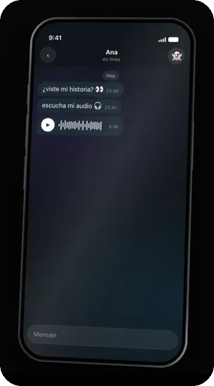
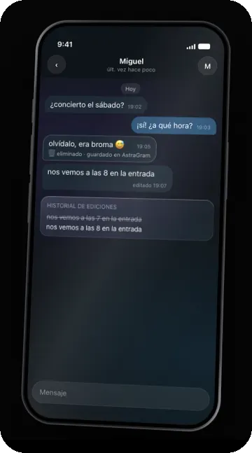
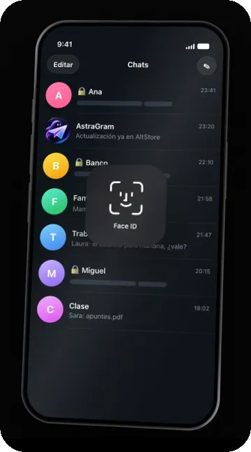
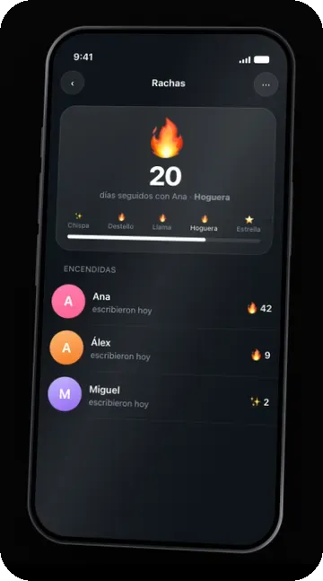
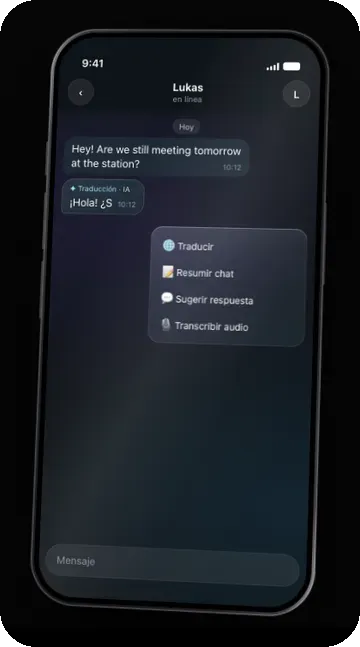
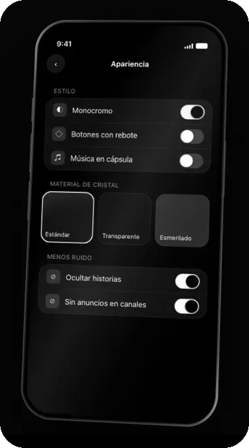
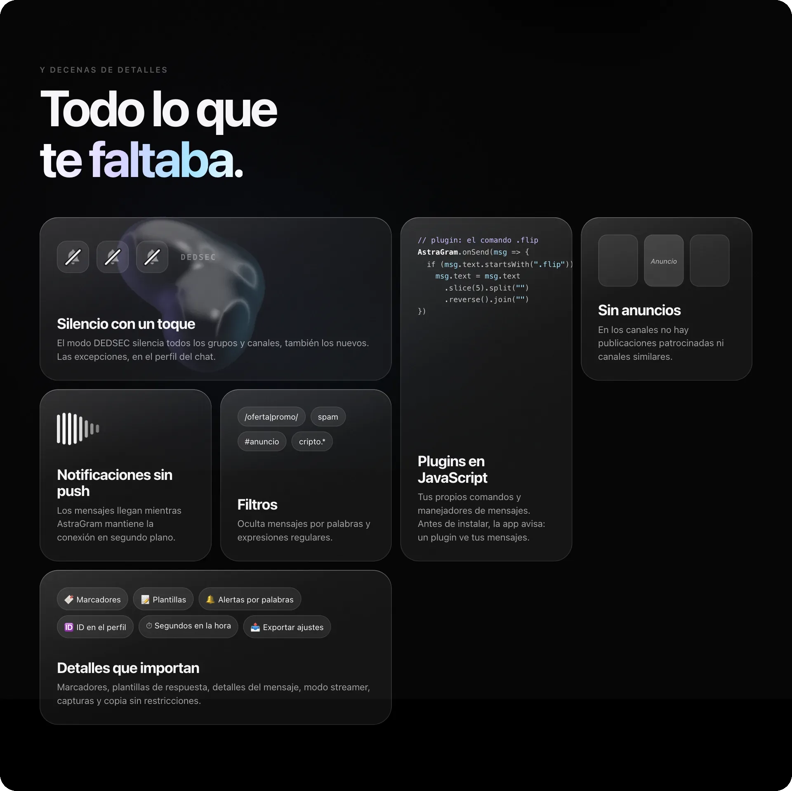

<a href="https://dedsec-reth0.github.io/astragram/?lang=es"></a>

<p align="center"><a href="README.md">English</a> · <a href="README.ru.md">Русский</a> · <a href="README.uk.md">Українська</a> · <b>Español</b> · <a href="README.pt.md">Português</a> · <a href="README.de.md">Deutsch</a> · <a href="README.fr.md">Français</a> · <a href="README.tr.md">Türkçe</a></p>

<p align="center">
  <a href="https://dedsec-reth0.github.io/astragram/install/?lang=es"></a>
  <a href="https://dedsec-reth0.github.io/astragram/?lang=es"></a>
  <a href="https://t.me/astragram_news"></a>
</p>

<p align="center">
  <a href="https://github.com/dedsec-reth0/astragram/releases/latest"></a>
  <a href="https://github.com/dedsec-reth0/astragram/releases"></a>
  <a href="https://github.com/dedsec-reth0/astragram/stargazers"></a>
  
  <a href="LICENSE"></a>
</p>

<br>

<p align="center">AstraGram es un cliente no oficial de Telegram para iPhone, de código abierto: modo fantasma, mensajes eliminados, chats con Face ID, rachas, IA y plugins. Gratis con AltStore y SideStore.</p>

<h3 align="center">Tomamos Telegram y <b>quitamos</b> todo lo que <b>estorba.</b> Tú decides si enviar <b>«en línea»</b> y <b>«leído».</b> Lo eliminado <b>se queda</b> contigo. Lo que sobra <b>desaparece.</b> Y todo el código está <b>a la vista.</b></h3>

<br>

## Funciones

<table>
<tr><td width="42%" align="center"><a href="https://dedsec-reth0.github.io/astragram/?lang=es#features"></a></td><td width="58%" valign="middle"><sub><code>01 / 06</code></sub><h3>Modo fantasma</h3><p>Lee, escucha y mira historias sin enviar «en línea», «leído» ni «escribiendo». Se activa con el botón del fantasma sobre la lista de chats.</p><ul><li>Sin avisos de vista en historias, notas de voz y videomensajes</li><li>Se marca como leído solo cuando respondes</li><li>El servidor de Telegram sigue viendo tu conexión: no es invisibilidad</li></ul></td></tr>
<tr><td width="58%" valign="middle"><sub><code>02 / 06</code></sub><h3>Lo eliminado se queda</h3><p>Los mensajes que la otra persona borra se quedan en el chat con una etiqueta. Cada mensaje guarda su historial de ediciones.</p><ul><li>También en canales</li><li>Las fotos y vídeos de una sola vista no se queman</li><li>Un registro de todo lo eliminado en todos los chats</li></ul></td><td width="42%" align="center"><a href="https://dedsec-reth0.github.io/astragram/?lang=es#features"></a></td></tr>
<tr><td width="42%" align="center"><a href="https://dedsec-reth0.github.io/astragram/?lang=es#features"></a></td><td width="58%" valign="middle"><sub><code>03 / 06</code></sub><h3>Chats con Face ID</h3><p>Los chats que elijas solo se abren con tu cara. Su texto se oculta ya en la lista de chats, y el selector de apps muestra una portada.</p><ul><li>Face ID para los ajustes de AstraGram</li><li>Bloqueo de teclados de terceros</li><li>El portapapeles se borra al minuto</li></ul></td></tr>
<tr><td width="58%" valign="middle"><sub><code>04 / 06</code></sub><h3>Rachas con amigos</h3><p>Escríbete a diario y la racha crece: Chispa, Destello, Llama, Hoguera, Estrella. El contador es el mismo en todos tus dispositivos.</p><ul><li>Una mascota con armario de ropa</li><li>Recupera un día perdido</li><li>Una insignia de AstraGram que ven tus amigos con AstraGram</li></ul></td><td width="42%" align="center"><a href="https://dedsec-reth0.github.io/astragram/?lang=es#features"></a></td></tr>
<tr><td width="42%" align="center"><a href="https://dedsec-reth0.github.io/astragram/?lang=es#features"></a></td><td width="58%" valign="middle"><sub><code>05 / 06</code></sub><h3>IA con tu clave</h3><p>Traduce, resume un chat, sugiere respuestas, transcribe notas de voz y extrae texto de fotos con cualquier API compatible con OpenAI.</p><ul><li>El texto va al servicio solo cuando tú lo pides</li><li>¿Sin clave? Un servicio gratuito con límite</li><li>Plugins en JavaScript</li></ul></td></tr>
<tr><td width="58%" valign="middle"><sub><code>06 / 06</code></sub><h3>Monocromo y cristal</h3><p>Un estilo solo en negro, blanco y grises. Elige el material de cristal: estándar, transparente o esmerilado.</p><ul><li>Botones con rebote</li><li>Música del perfil en cápsula</li><li>Sin historias ni anuncios en canales</li></ul></td><td width="42%" align="center"><a href="https://dedsec-reth0.github.io/astragram/?lang=es#features"></a></td></tr>
</table>

## Todo lo que te faltaba.

<a href="https://dedsec-reth0.github.io/astragram/?lang=es#more"></a>

Cómo escribir un plugin: [astragram/plugins/README.md](astragram/plugins/README.md) · [examples](astragram/plugins/examples)

## Instalar

Un toque y AltStore te ofrece añadir la fuente de AstraGram. Las actualizaciones también llegarán ahí.

<p><a href="https://dedsec-reth0.github.io/astragram/install/?lang=es"></a> <a href="https://dedsec-reth0.github.io/astragram/install/?lang=es"></a> <a href="https://github.com/dedsec-reth0/astragram/releases/latest"></a></p>

<table><tr>
<td width="33%" valign="top"><h1>01</h1><b>Instala AltStore o SideStore</b><br><sub>Firman la app con tu Apple ID. No hace falta jailbreak.<br><a href="https://altstore.io">Descargar AltStore</a> · <a href="https://sidestore.io">SideStore</a></sub></td>
<td width="33%" valign="top"><h1>02</h1><b>Añade la fuente de AstraGram</b><br><sub>El botón «Abrir en AltStore» lo hace por ti. O pega la dirección a mano.</sub></td>
<td width="33%" valign="top"><h1>03</h1><b>Toca Free</b><br><sub>AltStore instala AstraGram. En el primer inicio, introduce tu API ID y Hash de my.telegram.org.</sub></td>
</tr></table>

**A mano** — Dirección de la fuente:

```
https://github.com/dedsec-reth0/astragram/releases/download/sidestore-source/source.json
```

1. Abre AltStore → **Browse** → **Sources** → **+**.
2. Pega la dirección copiada.
3. Busca AstraGram y toca **Free**.

> [!NOTE]
> Las pantallas propias de AstraGram están en ruso e inglés; el resto de la app es la interfaz de Telegram en cualquiera de sus idiomas.

### Qué IPA elegir

| | IPA | App ID |
| --- | --- | --- |
| **Estándar** | `AstraGram-<version>-<build>.ipa` | Apple ID gratuito. Sin extensiones: sin widgets ni Compartir. Necesita 1 App ID. |
| **Full** | `AstraGram-<version>-<build>-full.ipa` | Cuenta de desarrollador de pago. Con todas las extensiones. Necesita 7 App ID. |

### Todas las versiones

Todas las compilaciones están en [Releases](https://github.com/dedsec-reth0/astragram/releases), y la fuente de AltStore las muestra todas, no solo la última: la nueva llega como actualización y las anteriores quedan en el historial de versiones.

### Preguntas

<details><summary><b>¿Hace falta jailbreak?</b></summary>

No. AstraGram se instala con AltStore o SideStore, como cualquier app de una fuente.

</details>
<details><summary><b>¿Por qué cada 7 días?</b></summary>

Con un Apple ID gratuito la firma dura 7 días. Una vez por semana, toca «Refresh All» en AltStore.

</details>
<details><summary><b>¿Conservo mis datos al actualizar?</b></summary>

Sí. Al actualizar con AltStore se conservan los datos y la sesión.

</details>
<details><summary><b>¿Dónde consigo el API ID y el Hash?</b></summary>

En my.telegram.org, en API development tools. Luego puedes cambiarlos en Ajustes → AstraGram → API ID y Hash.

</details>
<details><summary><b>¿Por qué no llegan las notificaciones push?</b></summary>

Los servidores de Telegram solo envían push a apps con un certificado que conocen. «Notificaciones sin push» en los ajustes de AstraGram ayuda en parte.

</details>

## No te fíes de palabra. Compruébalo.

<table><tr>
<td width="33%" valign="top"><b>El código es abierto. Todo</b><br><sub>El código fuente está en <a href="https://github.com/dedsec-reth0/astragram">GitHub</a> bajo GPL-2.0, basado en el código abierto de Telegram-iOS.</sub></td>
<td width="33%" valign="top"><b>Lo compila GitHub, no nosotros</b><br><sub>Cada compilación se ejecuta en GitHub Actions y su registro es público. Cada versión tiene una etiqueta en el commit del que se compiló.</sub></td>
<td width="33%" valign="top"><b>Las claves API son tuyas</b><br><sub>En el primer inicio introduces tu propio API ID y Hash de my.telegram.org.</sub></td>
</tr></table>

```console
$ git clone https://github.com/dedsec-reth0/astragram
$ gh release view --repo dedsec-reth0/astragram --json tagName,targetCommitish
# la versión se compiló desde este commit — compruébalo
```

### Compilar desde el código

La app se compila con Bazel a partir del código de Telegram-iOS; cada versión lleva una etiqueta en el commit del que se compiló.

[astragram/INSTALL.md](astragram/INSTALL.md) — compilación y publicación (en ruso) · [docs/telegram-ios-build.md](docs/telegram-ios-build.md) — la guía original de Telegram

### Licencia

Basado en [Telegram-iOS](https://github.com/TelegramMessenger/Telegram-iOS), publicado bajo GPL-2.0. Los cambios de este repositorio tienen la misma licencia: [LICENSE](LICENSE); componentes de terceros: [THIRD-PARTY-NOTICES.md](THIRD-PARTY-NOTICES.md).

---

<p align="center"><a href="https://dedsec-reth0.github.io/astragram/?lang=es"></a></p>

<p align="center"><sub>AstraGram es un cliente no oficial de Telegram y no está afiliado a Telegram; el nombre y el logotipo de Telegram pertenecen a su propietario.<br>Las versiones de AltStore no reciben notificaciones push; el modo fantasma no oculta tu conexión al servidor de Telegram.</sub></p>
