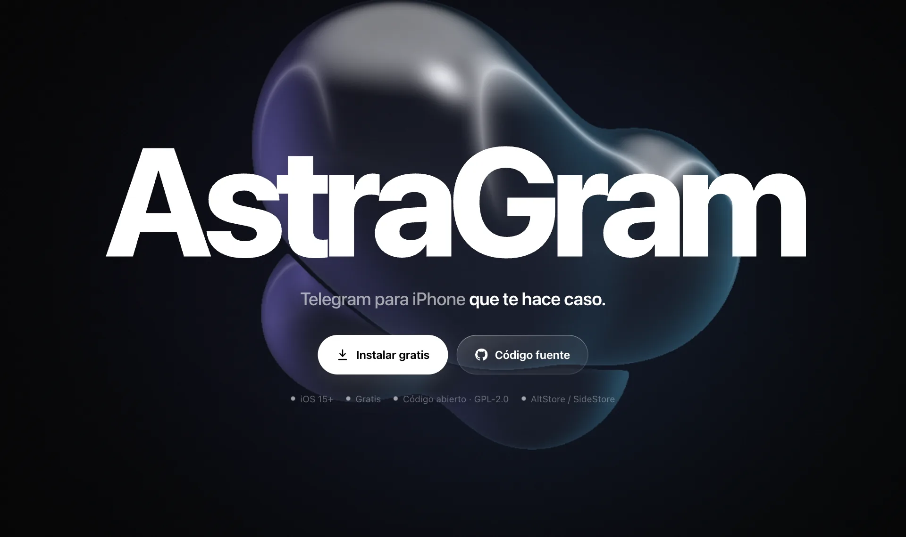
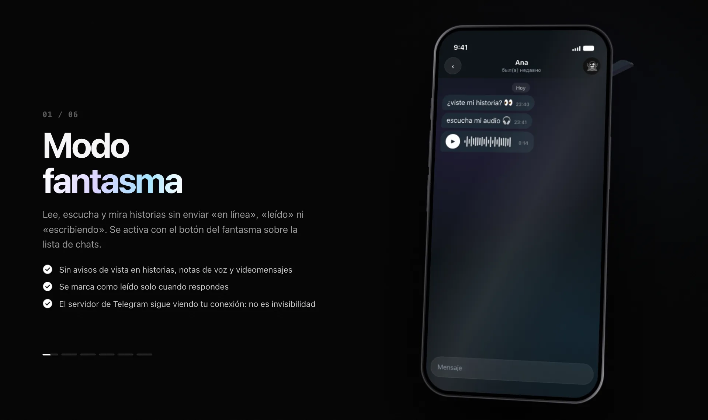
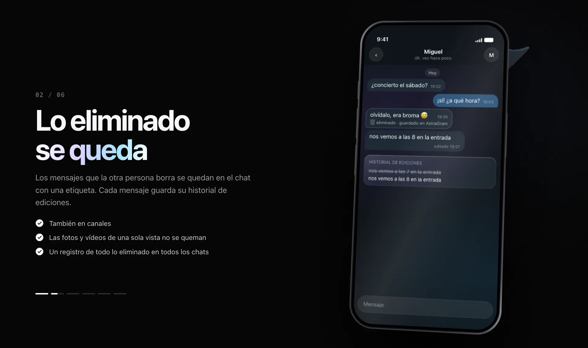
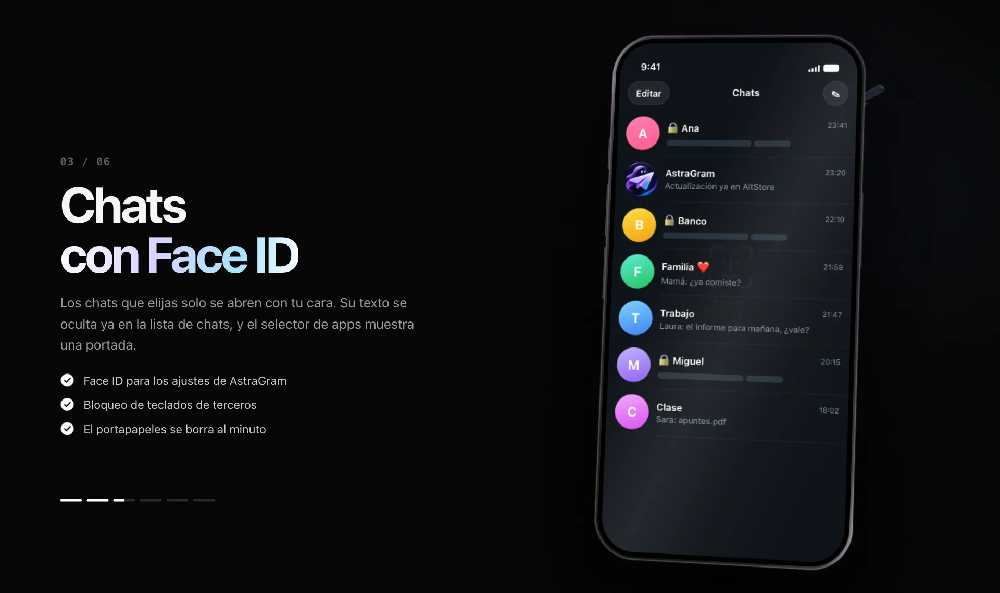
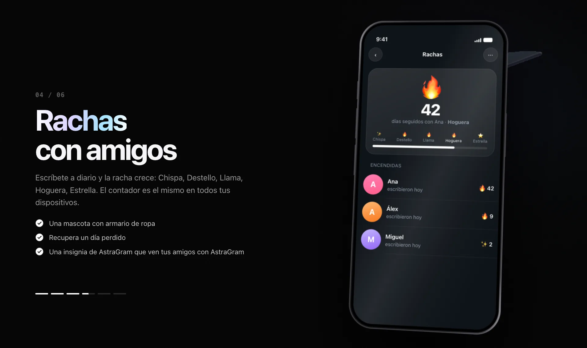
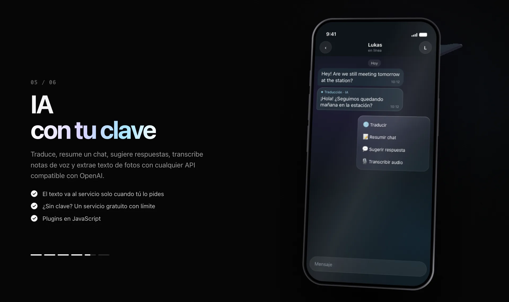
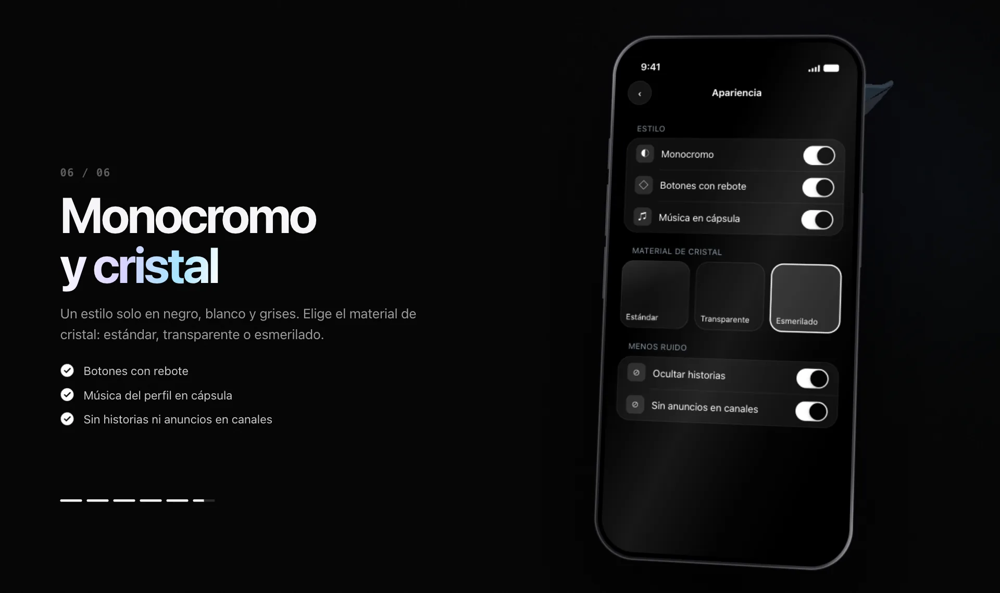
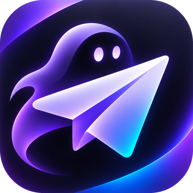

<a href="https://dedsec-reth0.github.io/astragram/?lang=es"></a>

<p align="center"><a href="README.md">English</a> · <a href="README.ru.md">Русский</a> · <a href="README.uk.md">Українська</a> · <b>Español</b> · <a href="README.pt.md">Português</a> · <a href="README.de.md">Deutsch</a> · <a href="README.fr.md">Français</a> · <a href="README.tr.md">Türkçe</a></p>

<h1 align="center">AstraGram</h1>

<p align="center"><b>Telegram para iPhone que te hace caso.</b><br>AstraGram es un cliente no oficial de Telegram para iPhone, de código abierto: modo fantasma, mensajes eliminados, chats con Face ID, rachas, IA y plugins. Gratis con AltStore y SideStore.</p>

<p align="center">
  <a href="https://dedsec-reth0.github.io/astragram/install/?lang=es"></a>
  <a href="https://github.com/dedsec-reth0/astragram/releases/latest"></a>
  <a href="https://github.com/dedsec-reth0/astragram/releases"></a>
  
  <a href="LICENSE"></a>
</p>

<p align="center"><a href="https://dedsec-reth0.github.io/astragram/install/?lang=es"><b>Instalar gratis</b></a> · <a href="https://dedsec-reth0.github.io/astragram/?lang=es"><b>Sitio web</b></a> · <a href="https://t.me/astragram_news"><b>Canal de Telegram</b></a> · <a href="https://github.com/dedsec-reth0/astragram/releases/latest"><b>Descargar IPA</b></a></p>

> Tomamos Telegram y **quitamos** todo lo que **estorba.** Tú decides si enviar **«en línea»** y **«leído».** Lo eliminado **se queda** contigo. Lo que sobra **desaparece.** Y todo el código está **a la vista.**

## Funciones

<a href="https://dedsec-reth0.github.io/astragram/?lang=es#features"></a>

<a href="https://dedsec-reth0.github.io/astragram/?lang=es#features"></a>

<a href="https://dedsec-reth0.github.io/astragram/?lang=es#features"></a>

<a href="https://dedsec-reth0.github.io/astragram/?lang=es#features"></a>

<a href="https://dedsec-reth0.github.io/astragram/?lang=es#features"></a>

<a href="https://dedsec-reth0.github.io/astragram/?lang=es#features"></a>

## Todo lo que te faltaba.

<a href="https://dedsec-reth0.github.io/astragram/?lang=es#more"></a>

Cómo escribir un plugin: [astragram/plugins/README.md](astragram/plugins/README.md) · [examples](astragram/plugins/examples)

## Instalar

Un toque y AltStore te ofrece añadir la fuente de AstraGram. Las actualizaciones también llegarán ahí.

<p><a href="https://dedsec-reth0.github.io/astragram/install/?lang=es"></a> <a href="https://dedsec-reth0.github.io/astragram/install/?lang=es"></a> <a href="https://github.com/dedsec-reth0/astragram/releases/latest"></a></p>

1. **Instala AltStore o SideStore** — Firman la app con tu Apple ID. No hace falta jailbreak. [Descargar AltStore](https://altstore.io) · [SideStore](https://sidestore.io)
2. **Añade la fuente de AstraGram** — El botón «Abrir en AltStore» lo hace por ti. O pega la dirección a mano.
3. **Toca Free** — AltStore instala AstraGram. En el primer inicio, introduce tu API ID y Hash de my.telegram.org.

**A mano** — Dirección de la fuente:

```
https://github.com/dedsec-reth0/astragram/releases/download/sidestore-source/source.json
```

1. Abre AltStore → **Browse** → **Sources** → **+**.
2. Pega la dirección copiada.
3. Busca AstraGram y toca **Free**.

> [!NOTE]
> Las pantallas propias de AstraGram están en ruso e inglés; el resto de la app es la interfaz de Telegram en cualquiera de sus idiomas.

### Qué IPA elegir

| | IPA | App ID |
| --- | --- | --- |
| **Estándar** | `AstraGram-<version>-<build>.ipa` | Apple ID gratuito. Sin extensiones: sin widgets ni Compartir. Necesita 1 App ID. |
| **Full** | `AstraGram-<version>-<build>-full.ipa` | Cuenta de desarrollador de pago. Con todas las extensiones. Necesita 7 App ID. |

### Todas las versiones

Todas las compilaciones están en [Releases](https://github.com/dedsec-reth0/astragram/releases), y la fuente de AltStore las muestra todas, no solo la última: la nueva llega como actualización y las anteriores quedan en el historial de versiones.

### Preguntas

<details><summary><b>¿Hace falta jailbreak?</b></summary>

No. AstraGram se instala con AltStore o SideStore, como cualquier app de una fuente.

</details>
<details><summary><b>¿Por qué cada 7 días?</b></summary>

Con un Apple ID gratuito la firma dura 7 días. Una vez por semana, toca «Refresh All» en AltStore.

</details>
<details><summary><b>¿Conservo mis datos al actualizar?</b></summary>

Sí. Al actualizar con AltStore se conservan los datos y la sesión.

</details>
<details><summary><b>¿Dónde consigo el API ID y el Hash?</b></summary>

En my.telegram.org, en API development tools. Luego puedes cambiarlos en Ajustes → AstraGram → API ID y Hash.

</details>
<details><summary><b>¿Por qué no llegan las notificaciones push?</b></summary>

Los servidores de Telegram solo envían push a apps con un certificado que conocen. «Notificaciones sin push» en los ajustes de AstraGram ayuda en parte.

</details>

## No te fíes de palabra. Compruébalo.

- **El código es abierto. Todo** — El código fuente está en [GitHub](https://github.com/dedsec-reth0/astragram) bajo GPL-2.0, basado en el código abierto de Telegram-iOS.
- **Lo compila GitHub, no nosotros** — Cada compilación se ejecuta en GitHub Actions y su registro es público. Cada versión tiene una etiqueta en el commit del que se compiló.
- **Las claves API son tuyas** — En el primer inicio introduces tu propio API ID y Hash de my.telegram.org.

### Compilar desde el código

La app se compila con Bazel a partir del código de Telegram-iOS; cada versión lleva una etiqueta en el commit del que se compiló.

[astragram/INSTALL.md](astragram/INSTALL.md) — compilación y publicación (en ruso) · [docs/telegram-ios-build.md](docs/telegram-ios-build.md) — la guía original de Telegram

### Licencia

Basado en [Telegram-iOS](https://github.com/TelegramMessenger/Telegram-iOS), publicado bajo GPL-2.0. Los cambios de este repositorio tienen la misma licencia: [LICENSE](LICENSE); componentes de terceros: [THIRD-PARTY-NOTICES.md](THIRD-PARTY-NOTICES.md).

---

<p align="center"><a href="https://dedsec-reth0.github.io/astragram/?lang=es"></a></p>

<p align="center"><sub>AstraGram es un cliente no oficial de Telegram y no está afiliado a Telegram; el nombre y el logotipo de Telegram pertenecen a su propietario.<br>Las versiones de AltStore no reciben notificaciones push; el modo fantasma no oculta tu conexión al servidor de Telegram.</sub></p>
