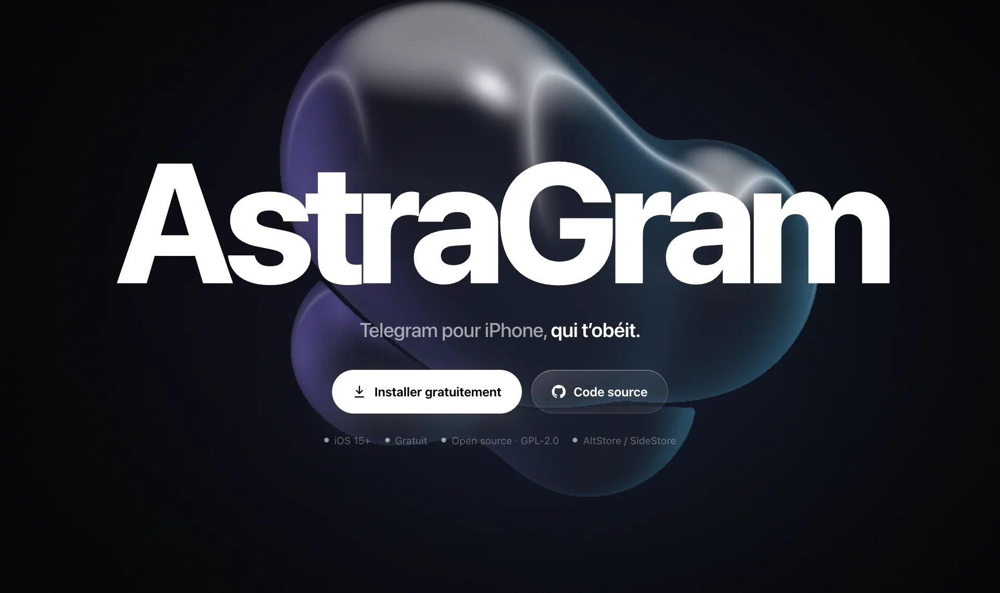
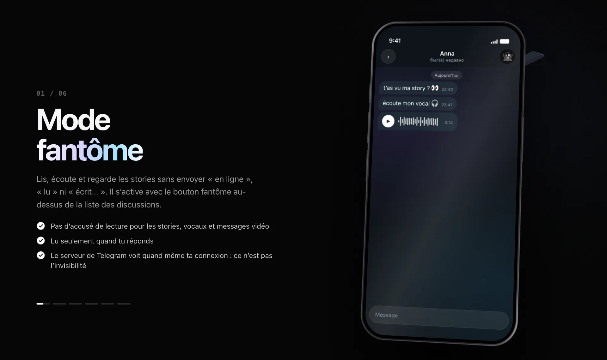
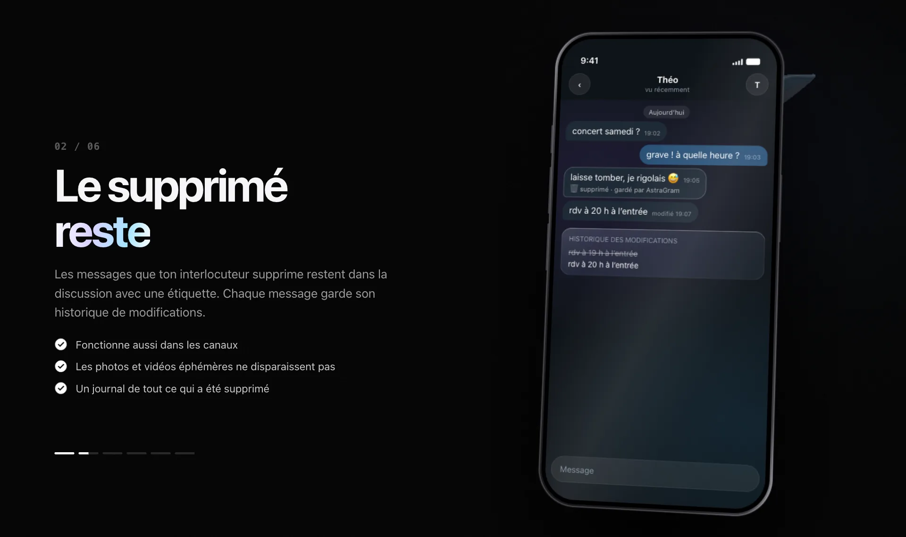
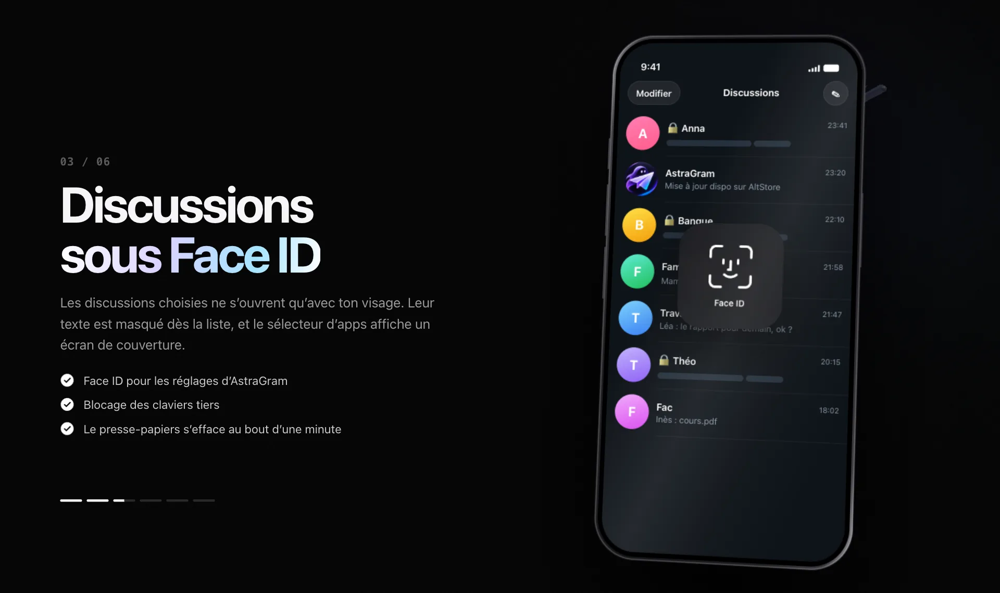
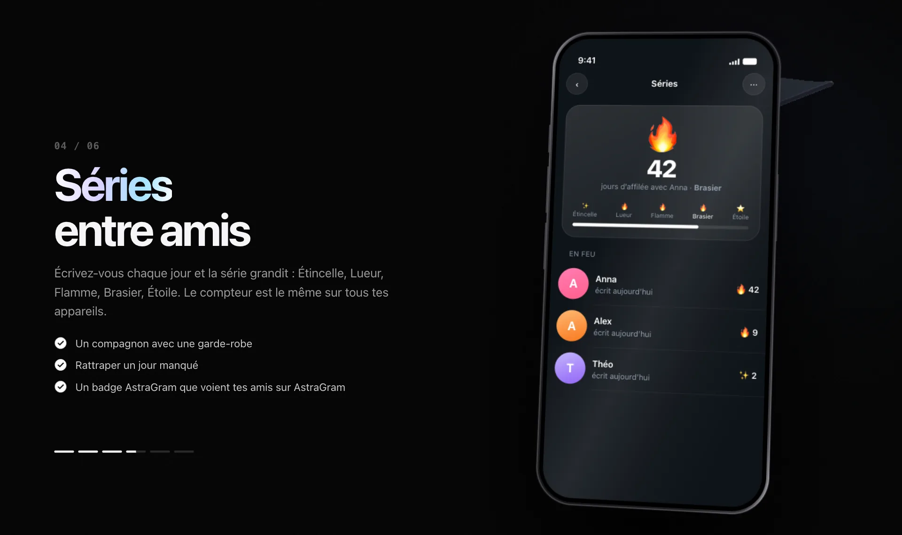
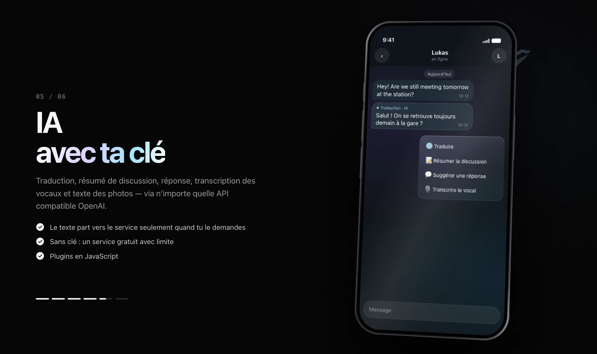
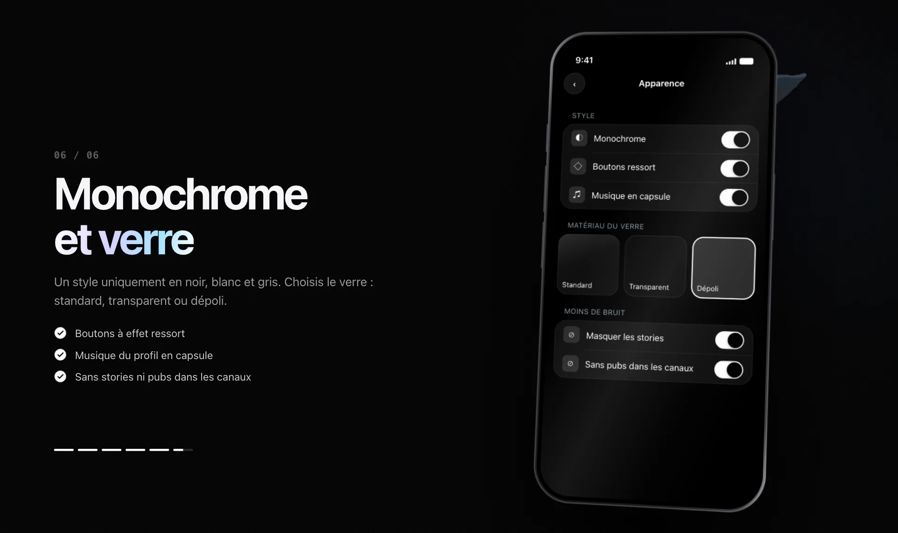
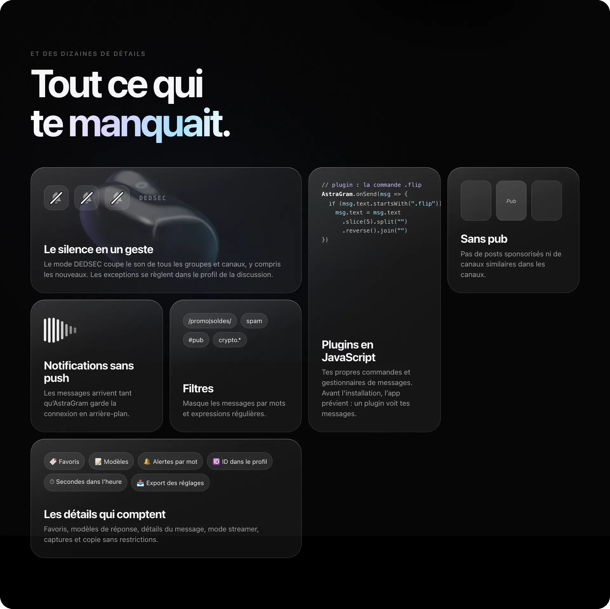

<a href="https://dedsec-reth0.github.io/astragram/?lang=fr"></a>

<p align="center"><a href="README.md">English</a> · <a href="README.ru.md">Русский</a> · <a href="README.uk.md">Українська</a> · <a href="README.es.md">Español</a> · <a href="README.pt.md">Português</a> · <a href="README.de.md">Deutsch</a> · <b>Français</b> · <a href="README.tr.md">Türkçe</a></p>

<h1 align="center">AstraGram</h1>

<p align="center"><b>Telegram pour iPhone, qui t’obéit.</b><br>AstraGram est un client Telegram non officiel et open source pour iPhone : mode fantôme, messages supprimés, discussions sous Face ID, séries, IA et plugins. Gratuit via AltStore et SideStore.</p>

<p align="center">
  <a href="https://dedsec-reth0.github.io/astragram/install/?lang=fr"></a>
  <a href="https://github.com/dedsec-reth0/astragram/releases/latest"></a>
  <a href="https://github.com/dedsec-reth0/astragram/releases"></a>
  
  <a href="LICENSE"></a>
</p>

<p align="center"><a href="https://dedsec-reth0.github.io/astragram/install/?lang=fr"><b>Installer gratuitement</b></a> · <a href="https://dedsec-reth0.github.io/astragram/?lang=fr"><b>Site web</b></a> · <a href="https://t.me/astragram_news"><b>Canal Telegram</b></a> · <a href="https://github.com/dedsec-reth0/astragram/releases/latest"><b>Télécharger l’IPA</b></a></p>

> On a pris Telegram et **retiré** tout ce qui **gêne.** Tu décides d’envoyer ou non **« en ligne »** et **« lu ».** Ce qui est supprimé **reste** chez toi. Le superflu **disparaît.** Et tout le code est **à découvert.**

## Fonctions

<a href="https://dedsec-reth0.github.io/astragram/?lang=fr#features"></a>

<a href="https://dedsec-reth0.github.io/astragram/?lang=fr#features"></a>

<a href="https://dedsec-reth0.github.io/astragram/?lang=fr#features"></a>

<a href="https://dedsec-reth0.github.io/astragram/?lang=fr#features"></a>

<a href="https://dedsec-reth0.github.io/astragram/?lang=fr#features"></a>

<a href="https://dedsec-reth0.github.io/astragram/?lang=fr#features"></a>

## Tout ce qui te manquait.

<a href="https://dedsec-reth0.github.io/astragram/?lang=fr#more"></a>

Écrire un plugin: [astragram/plugins/README.md](astragram/plugins/README.md) · [examples](astragram/plugins/examples)

## Installer

Un geste, et AltStore propose d’ajouter la source AstraGram. Les mises à jour arriveront au même endroit.

<p><a href="https://dedsec-reth0.github.io/astragram/install/?lang=fr"></a> <a href="https://dedsec-reth0.github.io/astragram/install/?lang=fr"></a> <a href="https://github.com/dedsec-reth0/astragram/releases/latest"></a></p>

1. **Installe AltStore ou SideStore** — Ils signent l’app avec ton identifiant Apple. Pas besoin de jailbreak. [Obtenir AltStore](https://altstore.io) · [SideStore](https://sidestore.io)
2. **Ajoute la source AstraGram** — Le bouton « Ouvrir dans AltStore » s’en charge. Ou colle l’adresse à la main.
3. **Touche Free** — AltStore installe AstraGram. Au premier lancement, saisis ton API ID et ton Hash depuis my.telegram.org.

**À la main** — Adresse de la source:

```
https://github.com/dedsec-reth0/astragram/releases/download/sidestore-source/source.json
```

1. Ouvre AltStore → **Browse** → **Sources** → **+**.
2. Colle l’adresse copiée.
3. Trouve AstraGram et touche **Free**.

> [!NOTE]
> Les écrans propres à AstraGram sont en russe et en anglais ; le reste de l’app est l’interface de Telegram, dans toutes ses langues.

### Quel IPA choisir

| | IPA | App ID |
| --- | --- | --- |
| **Standard** | `AstraGram-<version>-<build>.ipa` | Identifiant Apple gratuit. Sans extensions — ni widgets ni Partager. 1 App ID nécessaire. |
| **Full** | `AstraGram-<version>-<build>-full.ipa` | Compte développeur payant. Toutes les extensions. 7 App ID nécessaires. |

### Toutes les versions

Toutes les versions sont dans [Releases](https://github.com/dedsec-reth0/astragram/releases), et la source AltStore les liste toutes, pas seulement la dernière : la nouvelle arrive en mise à jour, les précédentes restent dans l’historique des versions.

### Questions

<details><summary><b>Faut-il un jailbreak ?</b></summary>

Non. AstraGram s’installe avec AltStore ou SideStore, comme n’importe quelle app d’une source.

</details>
<details><summary><b>Pourquoi tous les 7 jours ?</b></summary>

Avec un identifiant Apple gratuit, la signature dure 7 jours. Une fois par semaine, touche « Refresh All » dans AltStore.

</details>
<details><summary><b>Je garde mes données en mettant à jour ?</b></summary>

Oui. Une mise à jour via AltStore garde tes données et ta connexion.

</details>
<details><summary><b>Où trouver l’API ID et le Hash ?</b></summary>

Sur my.telegram.org, dans API development tools. Tu pourras les changer ensuite dans Réglages → AstraGram → API ID et Hash.

</details>
<details><summary><b>Pourquoi les notifications push n’arrivent pas ?</b></summary>

Les serveurs de Telegram n’envoient des push qu’aux apps dont ils connaissent le certificat. « Notifications sans push » dans les réglages d’AstraGram aide en partie.

</details>

## Ne nous crois pas sur parole. Vérifie.

- **Le code est ouvert. Entièrement** — Le code source est sur [GitHub](https://github.com/dedsec-reth0/astragram) sous GPL-2.0, basé sur le code ouvert de Telegram-iOS.
- **C’est GitHub qui compile, pas nous** — Chaque build tourne sur GitHub Actions et son journal est public. Chaque version porte un tag sur le commit dont elle est issue.
- **Les clés API sont à toi** — Au premier lancement, tu saisis ton propre API ID et ton Hash depuis my.telegram.org.

### Compiler depuis les sources

L’app est compilée avec Bazel à partir des sources de Telegram-iOS ; chaque version est taguée sur le commit dont elle est issue.

[astragram/INSTALL.md](astragram/INSTALL.md) — compilation et publication (en russe) · [docs/telegram-ios-build.md](docs/telegram-ios-build.md) — le guide original de Telegram

### Licence

Basé sur [Telegram-iOS](https://github.com/TelegramMessenger/Telegram-iOS), publié sous GPL-2.0. Les modifications de ce dépôt sont sous la même licence : [LICENSE](LICENSE) ; composants tiers : [THIRD-PARTY-NOTICES.md](THIRD-PARTY-NOTICES.md).

---

<p align="center"><a href="https://dedsec-reth0.github.io/astragram/?lang=fr"></a></p>

<p align="center"><sub>AstraGram est un client Telegram non officiel, sans lien avec Telegram ; le nom et le logo de Telegram appartiennent à leur propriétaire.<br>Les versions d’AltStore ne reçoivent pas de notifications push ; le mode fantôme ne cache pas ta connexion au serveur de Telegram.</sub></p>
