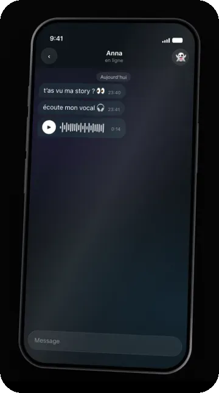
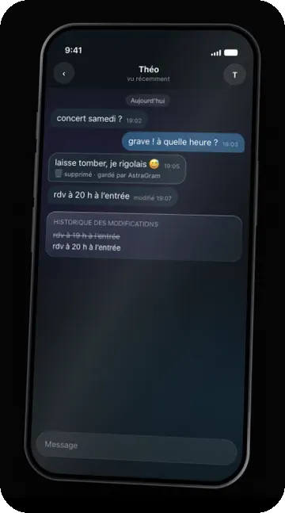
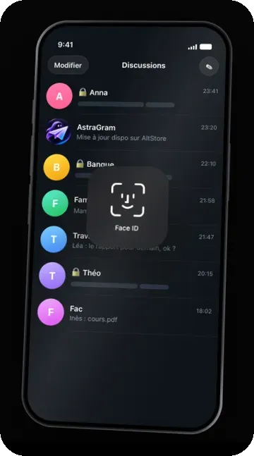
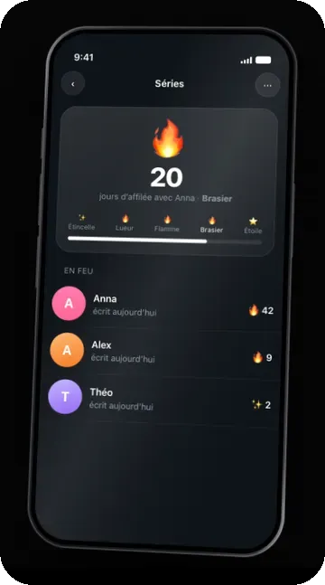
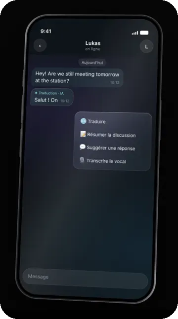
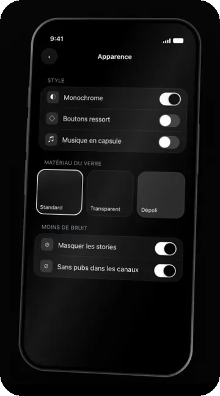

<a href="https://dedsec-reth0.github.io/astragram/?lang=fr"></a>

<p align="center"><a href="README.md">English</a> · <a href="README.ru.md">Русский</a> · <a href="README.uk.md">Українська</a> · <a href="README.es.md">Español</a> · <a href="README.pt.md">Português</a> · <a href="README.de.md">Deutsch</a> · <b>Français</b> · <a href="README.tr.md">Türkçe</a></p>

<p align="center">
  <a href="https://dedsec-reth0.github.io/astragram/install/?lang=fr"></a>
  <a href="https://dedsec-reth0.github.io/astragram/?lang=fr"></a>
  <a href="https://t.me/astragram_news"></a>
</p>

<p align="center">
  <a href="https://github.com/dedsec-reth0/astragram/releases/latest"></a>
  <a href="https://github.com/dedsec-reth0/astragram/releases"></a>
  <a href="https://github.com/dedsec-reth0/astragram/stargazers"></a>
  
  <a href="LICENSE"></a>
</p>

<br>

<p align="center">AstraGram est un client Telegram non officiel et open source pour iPhone : mode fantôme, messages supprimés, discussions sous Face ID, séries, IA et plugins. Gratuit via AltStore et SideStore.</p>

<h3 align="center">On a pris Telegram et <b>retiré</b> tout ce qui <b>gêne.</b> Tu décides d’envoyer ou non <b>« en ligne »</b> et <b>« lu ».</b> Ce qui est supprimé <b>reste</b> chez toi. Le superflu <b>disparaît.</b> Et tout le code est <b>à découvert.</b></h3>

<br>

## Fonctions

<table>
<tr><td width="42%" align="center"><a href="https://dedsec-reth0.github.io/astragram/?lang=fr#features"></a></td><td width="58%" valign="middle"><sub><code>01 / 06</code></sub><h3>Mode fantôme</h3><p>Lis, écoute et regarde les stories sans envoyer « en ligne », « lu » ni « écrit… ». Il s’active avec le bouton fantôme au-dessus de la liste des discussions.</p><ul><li>Pas d’accusé de lecture pour les stories, vocaux et messages vidéo</li><li>Lu seulement quand tu réponds</li><li>Le serveur de Telegram voit quand même ta connexion : ce n’est pas l’invisibilité</li></ul></td></tr>
<tr><td width="58%" valign="middle"><sub><code>02 / 06</code></sub><h3>Le supprimé reste</h3><p>Les messages que ton interlocuteur supprime restent dans la discussion avec une étiquette. Chaque message garde son historique de modifications.</p><ul><li>Fonctionne aussi dans les canaux</li><li>Les photos et vidéos éphémères ne disparaissent pas</li><li>Un journal de tout ce qui a été supprimé</li></ul></td><td width="42%" align="center"><a href="https://dedsec-reth0.github.io/astragram/?lang=fr#features"></a></td></tr>
<tr><td width="42%" align="center"><a href="https://dedsec-reth0.github.io/astragram/?lang=fr#features"></a></td><td width="58%" valign="middle"><sub><code>03 / 06</code></sub><h3>Discussions sous Face ID</h3><p>Les discussions choisies ne s’ouvrent qu’avec ton visage. Leur texte est masqué dès la liste, et le sélecteur d’apps affiche un écran de couverture.</p><ul><li>Face ID pour les réglages d’AstraGram</li><li>Blocage des claviers tiers</li><li>Le presse-papiers s’efface au bout d’une minute</li></ul></td></tr>
<tr><td width="58%" valign="middle"><sub><code>04 / 06</code></sub><h3>Séries entre amis</h3><p>Écrivez-vous chaque jour et la série grandit : Étincelle, Lueur, Flamme, Brasier, Étoile. Le compteur est le même sur tous tes appareils.</p><ul><li>Un compagnon avec une garde-robe</li><li>Rattraper un jour manqué</li><li>Un badge AstraGram que voient tes amis sur AstraGram</li></ul></td><td width="42%" align="center"><a href="https://dedsec-reth0.github.io/astragram/?lang=fr#features"></a></td></tr>
<tr><td width="42%" align="center"><a href="https://dedsec-reth0.github.io/astragram/?lang=fr#features"></a></td><td width="58%" valign="middle"><sub><code>05 / 06</code></sub><h3>IA avec ta clé</h3><p>Traduction, résumé de discussion, réponse, transcription des vocaux et texte des photos — via n’importe quelle API compatible OpenAI.</p><ul><li>Le texte part vers le service seulement quand tu le demandes</li><li>Sans clé : un service gratuit avec limite</li><li>Plugins en JavaScript</li></ul></td></tr>
<tr><td width="58%" valign="middle"><sub><code>06 / 06</code></sub><h3>Monochrome et verre</h3><p>Un style uniquement en noir, blanc et gris. Choisis le verre : standard, transparent ou dépoli.</p><ul><li>Boutons à effet ressort</li><li>Musique du profil en capsule</li><li>Sans stories ni pubs dans les canaux</li></ul></td><td width="42%" align="center"><a href="https://dedsec-reth0.github.io/astragram/?lang=fr#features"></a></td></tr>
</table>

## Tout ce qui te manquait.

<a href="https://dedsec-reth0.github.io/astragram/?lang=fr#more"></a>

Écrire un plugin: [astragram/plugins/README.md](astragram/plugins/README.md) · [examples](astragram/plugins/examples)

## Installer

Un geste, et AltStore propose d’ajouter la source AstraGram. Les mises à jour arriveront au même endroit.

<p><a href="https://dedsec-reth0.github.io/astragram/install/?lang=fr"></a> <a href="https://dedsec-reth0.github.io/astragram/install/?lang=fr"></a> <a href="https://github.com/dedsec-reth0/astragram/releases/latest"></a></p>

<table><tr>
<td width="33%" valign="top"><h1>01</h1><b>Installe AltStore ou SideStore</b><br><sub>Ils signent l’app avec ton identifiant Apple. Pas besoin de jailbreak.<br><a href="https://altstore.io">Obtenir AltStore</a> · <a href="https://sidestore.io">SideStore</a></sub></td>
<td width="33%" valign="top"><h1>02</h1><b>Ajoute la source AstraGram</b><br><sub>Le bouton « Ouvrir dans AltStore » s’en charge. Ou colle l’adresse à la main.</sub></td>
<td width="33%" valign="top"><h1>03</h1><b>Touche Free</b><br><sub>AltStore installe AstraGram. Au premier lancement, saisis ton API ID et ton Hash depuis my.telegram.org.</sub></td>
</tr></table>

**À la main** — Adresse de la source:

```
https://github.com/dedsec-reth0/astragram/releases/download/sidestore-source/source.json
```

1. Ouvre AltStore → **Browse** → **Sources** → **+**.
2. Colle l’adresse copiée.
3. Trouve AstraGram et touche **Free**.

> [!NOTE]
> Les écrans propres à AstraGram sont en russe et en anglais ; le reste de l’app est l’interface de Telegram, dans toutes ses langues.

### Quel IPA choisir

| | IPA | App ID |
| --- | --- | --- |
| **Standard** | `AstraGram-<version>-<build>.ipa` | Identifiant Apple gratuit. Sans extensions — ni widgets ni Partager. 1 App ID nécessaire. |
| **Full** | `AstraGram-<version>-<build>-full.ipa` | Compte développeur payant. Toutes les extensions. 7 App ID nécessaires. |

### Toutes les versions

Toutes les versions sont dans [Releases](https://github.com/dedsec-reth0/astragram/releases), et la source AltStore les liste toutes, pas seulement la dernière : la nouvelle arrive en mise à jour, les précédentes restent dans l’historique des versions.

### Questions

<details><summary><b>Faut-il un jailbreak ?</b></summary>

Non. AstraGram s’installe avec AltStore ou SideStore, comme n’importe quelle app d’une source.

</details>
<details><summary><b>Pourquoi tous les 7 jours ?</b></summary>

Avec un identifiant Apple gratuit, la signature dure 7 jours. Une fois par semaine, touche « Refresh All » dans AltStore.

</details>
<details><summary><b>Je garde mes données en mettant à jour ?</b></summary>

Oui. Une mise à jour via AltStore garde tes données et ta connexion.

</details>
<details><summary><b>Où trouver l’API ID et le Hash ?</b></summary>

Sur my.telegram.org, dans API development tools. Tu pourras les changer ensuite dans Réglages → AstraGram → API ID et Hash.

</details>
<details><summary><b>Pourquoi les notifications push n’arrivent pas ?</b></summary>

Les serveurs de Telegram n’envoient des push qu’aux apps dont ils connaissent le certificat. « Notifications sans push » dans les réglages d’AstraGram aide en partie.

</details>

## Ne nous crois pas sur parole. Vérifie.

<table><tr>
<td width="33%" valign="top"><b>Le code est ouvert. Entièrement</b><br><sub>Le code source est sur <a href="https://github.com/dedsec-reth0/astragram">GitHub</a> sous GPL-2.0, basé sur le code ouvert de Telegram-iOS.</sub></td>
<td width="33%" valign="top"><b>C’est GitHub qui compile, pas nous</b><br><sub>Chaque build tourne sur GitHub Actions et son journal est public. Chaque version porte un tag sur le commit dont elle est issue.</sub></td>
<td width="33%" valign="top"><b>Les clés API sont à toi</b><br><sub>Au premier lancement, tu saisis ton propre API ID et ton Hash depuis my.telegram.org.</sub></td>
</tr></table>

```console
$ git clone https://github.com/dedsec-reth0/astragram
$ gh release view --repo dedsec-reth0/astragram --json tagName,targetCommitish
# la version a été compilée depuis ce commit — vérifie
```

### Compiler depuis les sources

L’app est compilée avec Bazel à partir des sources de Telegram-iOS ; chaque version est taguée sur le commit dont elle est issue.

[astragram/INSTALL.md](astragram/INSTALL.md) — compilation et publication (en russe) · [docs/telegram-ios-build.md](docs/telegram-ios-build.md) — le guide original de Telegram

### Licence

Basé sur [Telegram-iOS](https://github.com/TelegramMessenger/Telegram-iOS), publié sous GPL-2.0. Les modifications de ce dépôt sont sous la même licence : [LICENSE](LICENSE) ; composants tiers : [THIRD-PARTY-NOTICES.md](THIRD-PARTY-NOTICES.md).

---

<p align="center"><a href="https://dedsec-reth0.github.io/astragram/?lang=fr"></a></p>

<p align="center"><sub>AstraGram est un client Telegram non officiel, sans lien avec Telegram ; le nom et le logo de Telegram appartiennent à leur propriétaire.<br>Les versions d’AltStore ne reçoivent pas de notifications push ; le mode fantôme ne cache pas ta connexion au serveur de Telegram.</sub></p>
