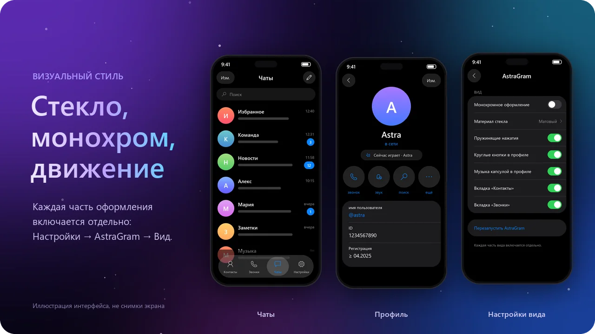

<p align="center">
  
</p>

<h1 align="center">AstraGram для iOS</h1>

<p align="center">
  Telegram для iPhone с режимом призрака, сохранением удалённых сообщений и плагинами.<br>
  Собран из исходников Telegram-iOS, ставится через AltStore, без джейлбрейка.
</p>

<p align="center">
  <a href="https://github.com/dedsec-reth0/astragram/releases/latest"></a>
  <a href="https://github.com/dedsec-reth0/astragram/actions/workflows/build.yml"></a>
  <a href="https://github.com/dedsec-reth0/astragram/releases"></a>
  
</p>

<p align="center">
  <a href="#установка"><b>Установка</b></a> ·
  <a href="#возможности"><b>Возможности</b></a> ·
  <a href="#все-версии"><b>Все версии</b></a> ·
  <a href="#первый-запуск"><b>Первый запуск</b></a> ·
  <a href="#ограничения"><b>Ограничения</b></a> ·
  <a href="#сборка-из-исходников"><b>Сборка</b></a>
</p>

<p align="center">
  
</p>

> [!NOTE]
> Проект в разработке. Сборки выходят часто и проверяются автоматически (сборка, целостность IPA), но не на всех
> устройствах и версиях iOS. Это неофициальный клиент: он не связан с Telegram.

## Установка

Нужен iPhone с iOS 15 или новее и [AltStore](https://altstore.io).

1. Откройте AltStore → **Browse** → **Sources** → **+**.
2. Вставьте адрес источника:

   ```
   https://github.com/dedsec-reth0/astragram/releases/download/sidestore-source/source.json
   ```

3. Откройте **AstraGram** в списке и нажмите **Free**. AltStore подпишет приложение вашим Apple ID.
4. Обновления приходят туда же: когда выходит новая сборка, в AltStore появляется кнопка **Update**.

Можно поставить и вручную: скачайте IPA со страницы [последнего релиза](https://github.com/dedsec-reth0/astragram/releases/latest)
и откройте его в AltStore через **My Apps** → **+**.

| Файл | Для кого | App ID |
| --- | --- | --- |
| `AstraGram-<версия>-<сборка>.ipa` | Бесплатный Apple ID. Без расширений (виджеты, «Поделиться»). | 1 |
| `AstraGram-<версия>-<сборка>-full.ipa` | Платный аккаунт разработчика. Со всеми расширениями. | 7 |

## Все версии

В источнике AltStore перечислены все выпущенные сборки, а не только последняя: у каждой свой номер, дата и список
изменений. Новая сборка приходит как обновление, а прежние остаются в истории версий на странице приложения.

Поставить любую сборку можно и вручную:

1. Откройте [список релизов](https://github.com/dedsec-reth0/astragram/releases) и выберите нужную сборку.
2. Скачайте её IPA.
3. В AltStore: **My Apps** → **+** → выберите файл. При обновлении данные и вход сохраняются; откат на прежнюю сборку на устройстве не проверялся.

Сборки до 103756 выходили одним файлом с расширениями: им нужно 7 App ID.

## Первый запуск

В сборке нет ключей Telegram API: у каждого они свои.

1. Откройте [my.telegram.org](https://my.telegram.org), войдите по номеру и выберите **API development tools**.
2. Создайте приложение и скопируйте **api_id** и **api_hash**.
3. Введите их в AstraGram при первом запуске. Потом их можно сменить: **Настройки → AstraGram → API ID и Hash**.

Все функции AstraGram лежат в **Настройки → AstraGram**. Каждая включается отдельно.

## Возможности

<table>
<tr>
<td width="50%" valign="top">

**Режим призрака**

- не отправлять «в сети», прочтение и «печатает»
- не отмечать просмотр историй, прослушивание голосовых и кружков
- прочитать при ответе, реакции или голосовании
- включается и с иконки на домашнем экране

</td>
<td width="50%" valign="top">

**История сообщений**

- сохранять удалённые сообщения, в том числе в каналах
- оставлять их в чате с меткой
- история правок каждого сообщения
- не сжигать одноразовые фото и видео
- журнал удалённого по всем чатам

</td>
</tr>
<tr>
<td valign="top">

**Чаты**

- фильтры по словам и регулярным выражениям
- скрывать стикеры и GIF других, сообщения заблокированных
- подтверждение перед отправкой стикеров, GIF и сообщений
- закладки, шаблоны, уведомления по словам
- детали сообщения, ID в профиле, секунды во времени

</td>
<td valign="top">

**Меньше лишнего**

- без рекламы в каналах
- без историй над списком чатов
- без похожих каналов и счётчиков на папках
- DEDSEC: тишина всех групп и каналов одной кнопкой
- режим стримера, скриншоты и копирование без запретов

</td>
</tr>
<tr>
<td valign="top">

**AI и плагины**

- AI через любой OpenAI-совместимый API со своим ключом: перевод, пересказ чата, ответ, расшифровка голосовых, текст с фото
- плагины на JavaScript: [как писать](astragram/plugins/README.md), [примеры](astragram/plugins/examples)

</td>
<td valign="top">

**Вид**

- монохромное оформление: только чёрный, белый и серые
- материал стекла: стандартный, прозрачный, матовый
- пружинящий отклик кнопок
- круглые кнопки и музыка капсулой в профиле
- вкладки «Контакты» и «Звонки» по выбору

</td>
</tr>
</table>

Ещё: проверка обновлений из приложения, экспорт и импорт настроек, уведомления без push, перезапуск одной кнопкой.

## Ограничения

- **Подпись на 7 дней.** С бесплатным Apple ID приложение нужно обновлять в AltStore раз в неделю (**Refresh All**).
- **Push-уведомления.** Серверы Telegram шлют push только приложениям с известным им сертификатом, поэтому при
  закрытом приложении уведомления не приходят. Частично помогает **Настройки → AstraGram → Уведомления без push**.
- **Перезапуск.** iOS не даёт приложению открыть себя заново: кнопка перезапуска закрывает AstraGram и оставляет
  уведомление, по которому он открывается.
- **Режим призрака не всесилен.** Собеседник не видит прочтения, пока вы сами его не отправите, но сервер Telegram
  знает о вашем подключении.

## Сборка из исходников

Сборка идёт на GitHub Actions: каждый push в `master` запускает [Build AstraGram](.github/workflows/build.yml), а по
окончании релиз и источник AltStore обновляются сами.

- [astragram/INSTALL.md](astragram/INSTALL.md) — как устроена сборка и публикация;
- [docs/telegram-ios-build.md](docs/telegram-ios-build.md) — исходная инструкция Telegram по сборке в Xcode.

## Лицензия

Основано на [Telegram-iOS](https://github.com/TelegramMessenger/Telegram-iOS), исходный код которого опубликован под
GPL-2.0. Изменения этого репозитория распространяются на тех же условиях. Название и логотип Telegram принадлежат их
владельцу.
