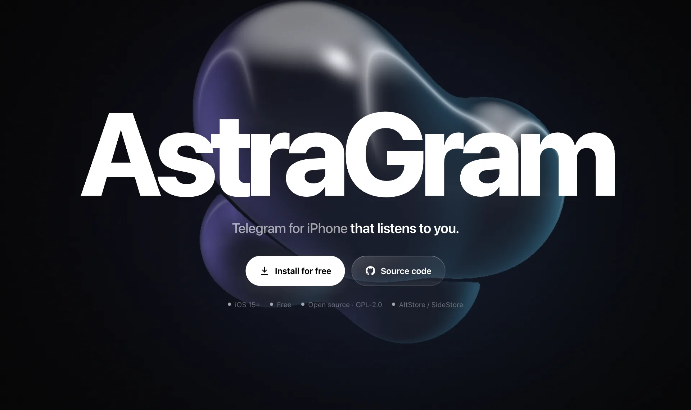
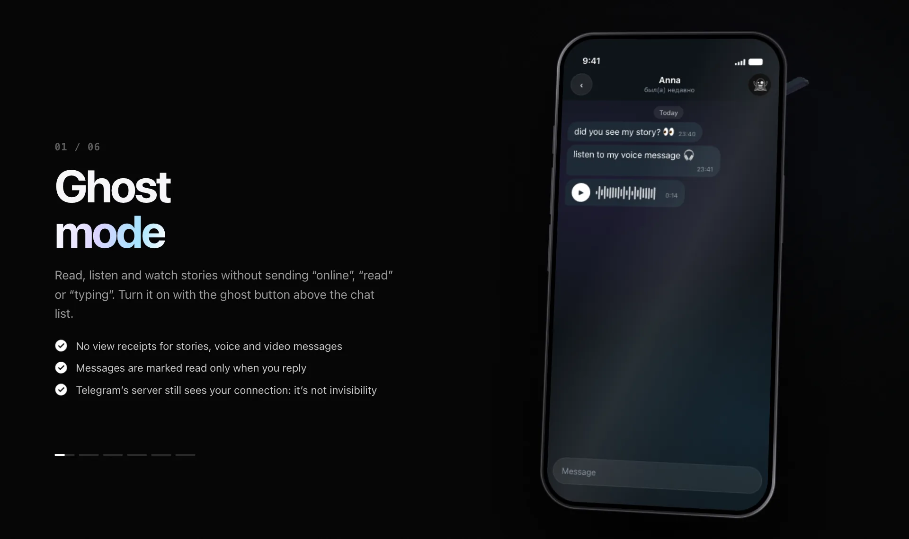
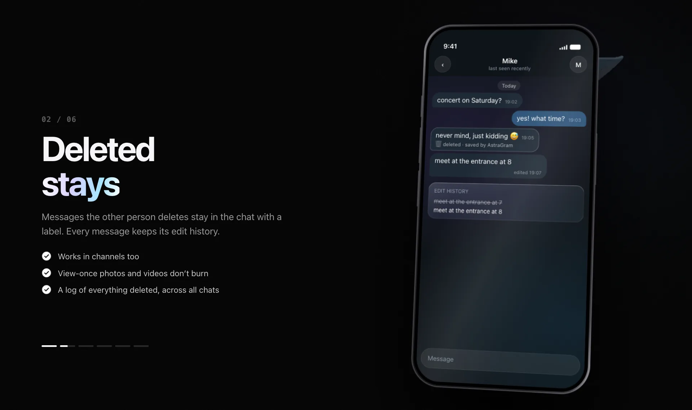
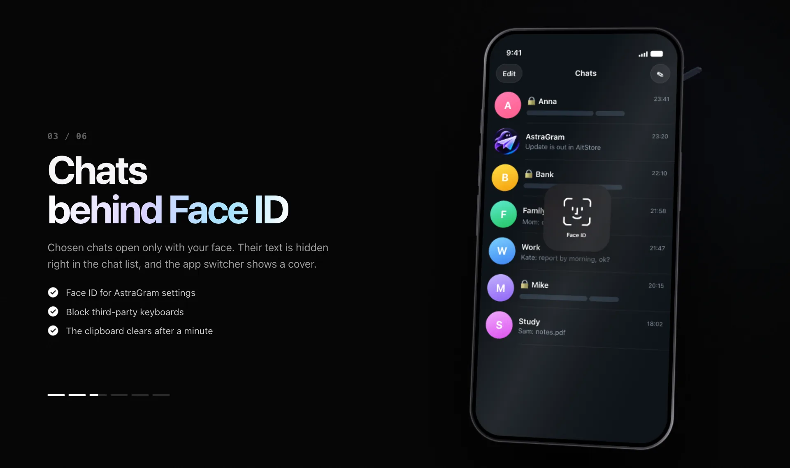
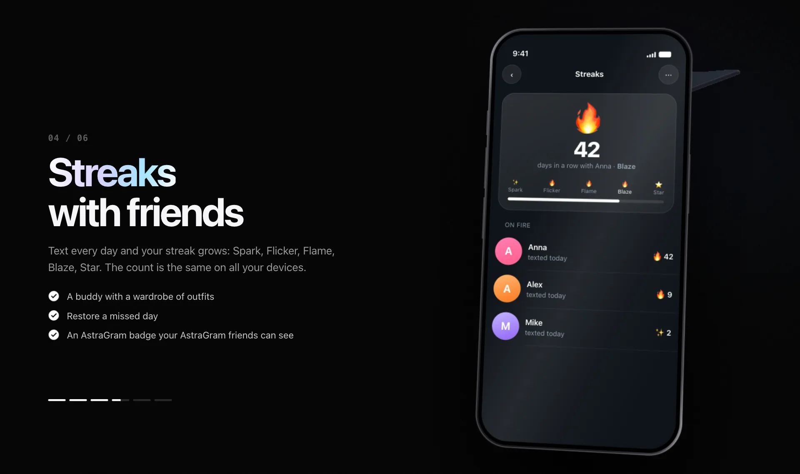
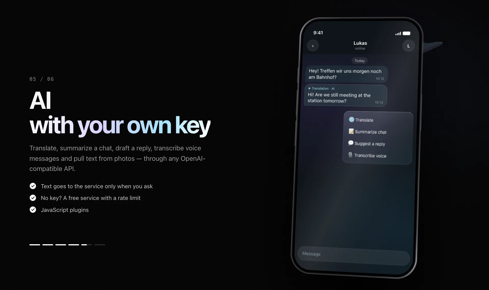
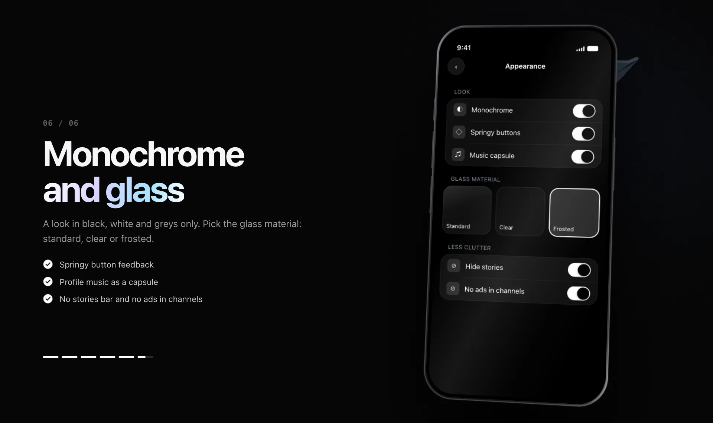
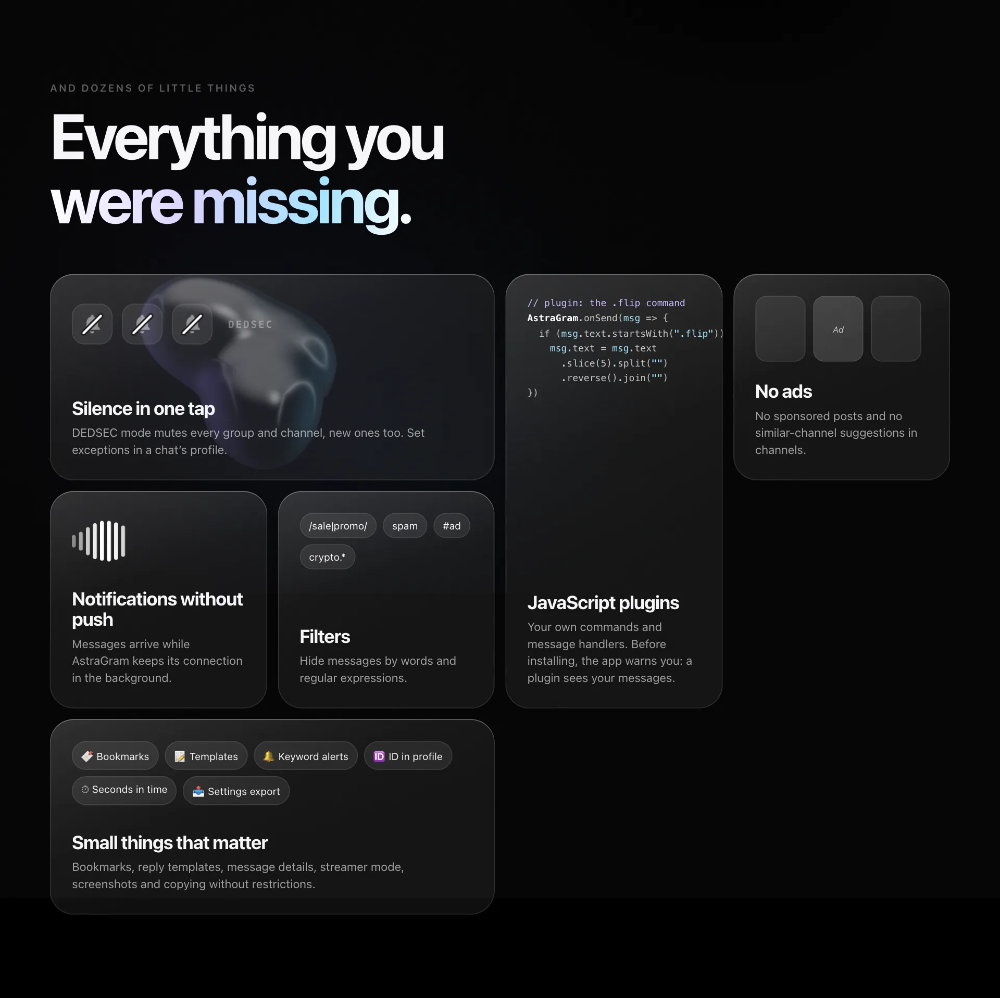

<a href="https://dedsec-reth0.github.io/astragram/?lang=en"></a>

<p align="center"><b>English</b> · <a href="README.ru.md">Русский</a> · <a href="README.uk.md">Українська</a> · <a href="README.es.md">Español</a> · <a href="README.pt.md">Português</a> · <a href="README.de.md">Deutsch</a> · <a href="README.fr.md">Français</a> · <a href="README.tr.md">Türkçe</a></p>

<h1 align="center">AstraGram</h1>

<p align="center"><b>Telegram for iPhone that listens to you.</b><br>AstraGram is an open-source, unofficial Telegram client for iPhone: ghost mode, deleted messages, Face ID chats, streaks, AI and plugins. Free via AltStore and SideStore.</p>

<p align="center">
  <a href="https://dedsec-reth0.github.io/astragram/install/?lang=en"></a>
  <a href="https://github.com/dedsec-reth0/astragram/releases/latest"></a>
  <a href="https://github.com/dedsec-reth0/astragram/releases"></a>
  
  <a href="LICENSE"></a>
</p>

<p align="center"><a href="https://dedsec-reth0.github.io/astragram/install/?lang=en"><b>Install for free</b></a> · <a href="https://dedsec-reth0.github.io/astragram/?lang=en"><b>Website</b></a> · <a href="https://t.me/astragram_news"><b>Telegram channel</b></a> · <a href="https://github.com/dedsec-reth0/astragram/releases/latest"><b>Download IPA</b></a></p>

> We took Telegram and **removed** everything that **gets in the way.** You decide whether to send **“online”** and **“read”.** Deleted messages **stay** with you. Clutter **disappears.** And all the code is **in plain sight.**

## Features

<a href="https://dedsec-reth0.github.io/astragram/?lang=en#features"></a>

<a href="https://dedsec-reth0.github.io/astragram/?lang=en#features"></a>

<a href="https://dedsec-reth0.github.io/astragram/?lang=en#features"></a>

<a href="https://dedsec-reth0.github.io/astragram/?lang=en#features"></a>

<a href="https://dedsec-reth0.github.io/astragram/?lang=en#features"></a>

<a href="https://dedsec-reth0.github.io/astragram/?lang=en#features"></a>

## Everything you were missing.

<a href="https://dedsec-reth0.github.io/astragram/?lang=en#more"></a>

How to write a plugin: [astragram/plugins/README.md](astragram/plugins/README.md) · [examples](astragram/plugins/examples)

## Install

One tap, and AltStore offers to add the AstraGram source. Updates will arrive there too.

<p><a href="https://dedsec-reth0.github.io/astragram/install/?lang=en"></a> <a href="https://dedsec-reth0.github.io/astragram/install/?lang=en"></a> <a href="https://github.com/dedsec-reth0/astragram/releases/latest"></a></p>

1. **Install AltStore or SideStore** — They sign the app with your Apple ID. No jailbreak needed. [Get AltStore](https://altstore.io) · [SideStore](https://sidestore.io)
2. **Add the AstraGram source** — The “Open in AltStore” button does it for you. Or paste the address by hand.
3. **Tap Free** — AltStore installs AstraGram. On first launch, enter your own API ID and Hash from my.telegram.org.

**By hand** — Source address:

```
https://github.com/dedsec-reth0/astragram/releases/download/sidestore-source/source.json
```

1. Open AltStore → **Browse** → **Sources** → **+**.
2. Paste the copied address.
3. Find AstraGram and tap **Free**.

> [!NOTE]
> AstraGram’s own screens are in Russian and English; the rest of the app is Telegram’s interface in any of its languages.

### Which IPA to pick

| | IPA | App ID |
| --- | --- | --- |
| **Standard** | `AstraGram-<version>-<build>.ipa` | Free Apple ID. No extensions — no widgets or Share. Needs 1 App ID. |
| **Full** | `AstraGram-<version>-<build>-full.ipa` | Paid developer account. All extensions included. Needs 7 App IDs. |

### All versions

Every build is in [Releases](https://github.com/dedsec-reth0/astragram/releases), and the AltStore source lists all of them, not only the latest: a new build arrives as an update, earlier ones stay in the version history.

### Questions

<details><summary><b>Do I need a jailbreak?</b></summary>

No. AstraGram installs through AltStore or SideStore, like any app from a source.

</details>
<details><summary><b>Why every 7 days?</b></summary>

With a free Apple ID the signature lasts 7 days. Once a week, tap “Refresh All” in AltStore.

</details>
<details><summary><b>Do I keep my data when I update?</b></summary>

Yes. Updating through AltStore keeps your data and your login.

</details>
<details><summary><b>Where do I get an API ID and Hash?</b></summary>

At my.telegram.org, under API development tools. You can change them later in Settings → AstraGram → API ID and Hash.

</details>
<details><summary><b>Why don’t push notifications arrive?</b></summary>

Telegram’s servers send push only to apps with a certificate they know. “Notifications without push” in AstraGram settings helps in part.

</details>

## Don’t take our word. Check it yourself.

- **The code is open. All of it** — The source is on [GitHub](https://github.com/dedsec-reth0/astragram) under GPL-2.0, built on Telegram-iOS’s open code.
- **GitHub builds it, not us** — Every build runs on GitHub Actions, and its log is public. Each release is tagged on the commit it was built from.
- **The API keys are yours** — On first launch you enter your own API ID and Hash from my.telegram.org.

### Building from source

The app is built with Bazel from the Telegram-iOS sources; each release is tagged on the commit it was built from.

[astragram/INSTALL.md](astragram/INSTALL.md) — building and publishing (in Russian) · [docs/telegram-ios-build.md](docs/telegram-ios-build.md) — Telegram’s original guide

### License

Based on [Telegram-iOS](https://github.com/TelegramMessenger/Telegram-iOS), published under GPL-2.0. The changes here are under the same license: [LICENSE](LICENSE), third-party components: [THIRD-PARTY-NOTICES.md](THIRD-PARTY-NOTICES.md).

---

<p align="center"><a href="https://dedsec-reth0.github.io/astragram/?lang=en"></a></p>

<p align="center"><sub>AstraGram is an unofficial Telegram client and is not affiliated with Telegram; the Telegram name and logo belong to their owner.<br>Builds from AltStore don’t get push notifications; ghost mode doesn’t hide your connection from Telegram’s server.</sub></p>
