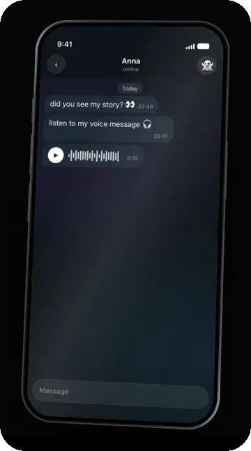
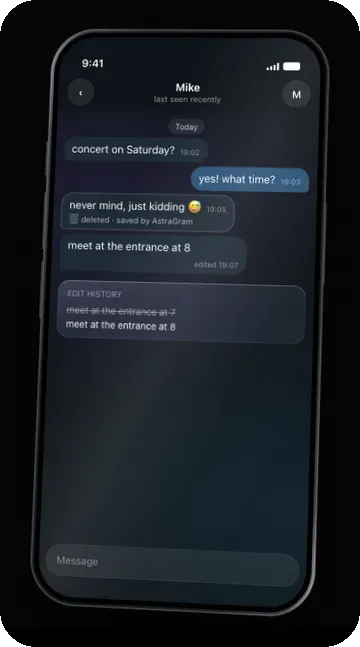
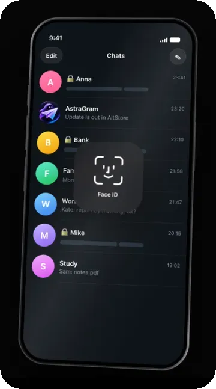
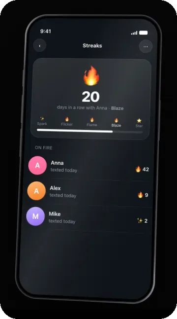
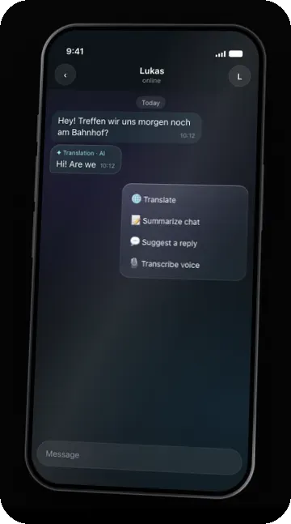
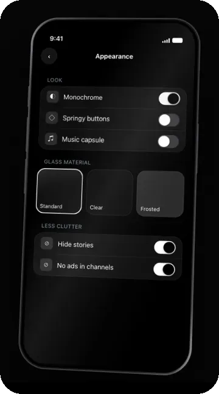

<a href="https://dedsec-reth0.github.io/astragram/?lang=en"></a>

<p align="center"><b>English</b> · <a href="README.ru.md">Русский</a> · <a href="README.uk.md">Українська</a> · <a href="README.es.md">Español</a> · <a href="README.pt.md">Português</a> · <a href="README.de.md">Deutsch</a> · <a href="README.fr.md">Français</a> · <a href="README.tr.md">Türkçe</a></p>

<p align="center">
  <a href="https://dedsec-reth0.github.io/astragram/install/?lang=en"></a>
  <a href="https://dedsec-reth0.github.io/astragram/?lang=en"></a>
  <a href="https://t.me/astragram_news"></a>
</p>

<p align="center">
  <a href="https://github.com/dedsec-reth0/astragram/releases/latest"></a>
  <a href="https://github.com/dedsec-reth0/astragram/releases"></a>
  <a href="https://github.com/dedsec-reth0/astragram/stargazers"></a>
  
  <a href="LICENSE"></a>
</p>

<br>

<p align="center">AstraGram is an open-source, unofficial Telegram client for iPhone: ghost mode, deleted messages, Face ID chats, streaks, AI and plugins. Free via AltStore and SideStore.</p>

<h3 align="center">We took Telegram and <b>removed</b> everything that <b>gets in the way.</b> You decide whether to send <b>“online”</b> and <b>“read”.</b> Deleted messages <b>stay</b> with you. Clutter <b>disappears.</b> And all the code is <b>in plain sight.</b></h3>

<br>

## Features

<table>
<tr><td width="42%" align="center"><a href="https://dedsec-reth0.github.io/astragram/?lang=en#features"></a></td><td width="58%" valign="middle"><sub><code>01 / 06</code></sub><h3>Ghost mode</h3><p>Read, listen and watch stories without sending “online”, “read” or “typing”. Turn it on with the ghost button above the chat list.</p><ul><li>No view receipts for stories, voice and video messages</li><li>Messages are marked read only when you reply</li><li>Telegram’s server still sees your connection: it’s not invisibility</li></ul></td></tr>
<tr><td width="58%" valign="middle"><sub><code>02 / 06</code></sub><h3>Deleted stays</h3><p>Messages the other person deletes stay in the chat with a label. Every message keeps its edit history.</p><ul><li>Works in channels too</li><li>View-once photos and videos don’t burn</li><li>A log of everything deleted, across all chats</li></ul></td><td width="42%" align="center"><a href="https://dedsec-reth0.github.io/astragram/?lang=en#features"></a></td></tr>
<tr><td width="42%" align="center"><a href="https://dedsec-reth0.github.io/astragram/?lang=en#features"></a></td><td width="58%" valign="middle"><sub><code>03 / 06</code></sub><h3>Chats behind Face ID</h3><p>Chosen chats open only with your face. Their text is hidden right in the chat list, and the app switcher shows a cover.</p><ul><li>Face ID for AstraGram settings</li><li>Block third-party keyboards</li><li>The clipboard clears after a minute</li></ul></td></tr>
<tr><td width="58%" valign="middle"><sub><code>04 / 06</code></sub><h3>Streaks with friends</h3><p>Text every day and your streak grows: Spark, Flicker, Flame, Blaze, Star. The count is the same on all your devices.</p><ul><li>A buddy with a wardrobe of outfits</li><li>Restore a missed day</li><li>An AstraGram badge your AstraGram friends can see</li></ul></td><td width="42%" align="center"><a href="https://dedsec-reth0.github.io/astragram/?lang=en#features"></a></td></tr>
<tr><td width="42%" align="center"><a href="https://dedsec-reth0.github.io/astragram/?lang=en#features"></a></td><td width="58%" valign="middle"><sub><code>05 / 06</code></sub><h3>AI with your own key</h3><p>Translate, summarize a chat, draft a reply, transcribe voice messages and pull text from photos — through any OpenAI-compatible API.</p><ul><li>Text goes to the service only when you ask</li><li>No key? A free service with a rate limit</li><li>JavaScript plugins</li></ul></td></tr>
<tr><td width="58%" valign="middle"><sub><code>06 / 06</code></sub><h3>Monochrome and glass</h3><p>A look in black, white and greys only. Pick the glass material: standard, clear or frosted.</p><ul><li>Springy button feedback</li><li>Profile music as a capsule</li><li>No stories bar and no ads in channels</li></ul></td><td width="42%" align="center"><a href="https://dedsec-reth0.github.io/astragram/?lang=en#features"></a></td></tr>
</table>

## Everything you were missing.

<a href="https://dedsec-reth0.github.io/astragram/?lang=en#more"></a>

How to write a plugin: [astragram/plugins/README.md](astragram/plugins/README.md) · [examples](astragram/plugins/examples)

## Install

One tap, and AltStore offers to add the AstraGram source. Updates will arrive there too.

<p><a href="https://dedsec-reth0.github.io/astragram/install/?lang=en"></a> <a href="https://dedsec-reth0.github.io/astragram/install/?lang=en"></a> <a href="https://github.com/dedsec-reth0/astragram/releases/latest"></a></p>

<table><tr>
<td width="33%" valign="top"><h1>01</h1><b>Install AltStore or SideStore</b><br><sub>They sign the app with your Apple ID. No jailbreak needed.<br><a href="https://altstore.io">Get AltStore</a> · <a href="https://sidestore.io">SideStore</a></sub></td>
<td width="33%" valign="top"><h1>02</h1><b>Add the AstraGram source</b><br><sub>The “Open in AltStore” button does it for you. Or paste the address by hand.</sub></td>
<td width="33%" valign="top"><h1>03</h1><b>Tap Free</b><br><sub>AltStore installs AstraGram. On first launch, enter your own API ID and Hash from my.telegram.org.</sub></td>
</tr></table>

**By hand** — Source address:

```
https://github.com/dedsec-reth0/astragram/releases/download/sidestore-source/source.json
```

1. Open AltStore → **Browse** → **Sources** → **+**.
2. Paste the copied address.
3. Find AstraGram and tap **Free**.

> [!NOTE]
> AstraGram’s own screens are in Russian and English; the rest of the app is Telegram’s interface in any of its languages.

### Which IPA to pick

| | IPA | App ID |
| --- | --- | --- |
| **Standard** | `AstraGram-<version>-<build>.ipa` | Free Apple ID. No extensions — no widgets or Share. Needs 1 App ID. |
| **Full** | `AstraGram-<version>-<build>-full.ipa` | Paid developer account. All extensions included. Needs 7 App IDs. |

### All versions

Every build is in [Releases](https://github.com/dedsec-reth0/astragram/releases), and the AltStore source lists all of them, not only the latest: a new build arrives as an update, earlier ones stay in the version history.

### Questions

<details><summary><b>Do I need a jailbreak?</b></summary>

No. AstraGram installs through AltStore or SideStore, like any app from a source.

</details>
<details><summary><b>Why every 7 days?</b></summary>

With a free Apple ID the signature lasts 7 days. Once a week, tap “Refresh All” in AltStore.

</details>
<details><summary><b>Do I keep my data when I update?</b></summary>

Yes. Updating through AltStore keeps your data and your login.

</details>
<details><summary><b>Where do I get an API ID and Hash?</b></summary>

At my.telegram.org, under API development tools. You can change them later in Settings → AstraGram → API ID and Hash.

</details>
<details><summary><b>Why don’t push notifications arrive?</b></summary>

Telegram’s servers send push only to apps with a certificate they know. “Notifications without push” in AstraGram settings helps in part.

</details>

## Don’t take our word. Check it yourself.

<table><tr>
<td width="33%" valign="top"><b>The code is open. All of it</b><br><sub>The source is on <a href="https://github.com/dedsec-reth0/astragram">GitHub</a> under GPL-2.0, built on Telegram-iOS’s open code.</sub></td>
<td width="33%" valign="top"><b>GitHub builds it, not us</b><br><sub>Every build runs on GitHub Actions, and its log is public. Each release is tagged on the commit it was built from.</sub></td>
<td width="33%" valign="top"><b>The API keys are yours</b><br><sub>On first launch you enter your own API ID and Hash from my.telegram.org.</sub></td>
</tr></table>

```console
$ git clone https://github.com/dedsec-reth0/astragram
$ gh release view --repo dedsec-reth0/astragram --json tagName,targetCommitish
# the release was built from this commit — check it yourself
```

### Building from source

The app is built with Bazel from the Telegram-iOS sources; each release is tagged on the commit it was built from.

[astragram/INSTALL.md](astragram/INSTALL.md) — building and publishing (in Russian) · [docs/telegram-ios-build.md](docs/telegram-ios-build.md) — Telegram’s original guide

### License

Based on [Telegram-iOS](https://github.com/TelegramMessenger/Telegram-iOS), published under GPL-2.0. The changes here are under the same license: [LICENSE](LICENSE), third-party components: [THIRD-PARTY-NOTICES.md](THIRD-PARTY-NOTICES.md).

---

<p align="center"><a href="https://dedsec-reth0.github.io/astragram/?lang=en"></a></p>

<p align="center"><sub>AstraGram is an unofficial Telegram client and is not affiliated with Telegram; the Telegram name and logo belong to their owner.<br>Builds from AltStore don’t get push notifications; ghost mode doesn’t hide your connection from Telegram’s server.</sub></p>
