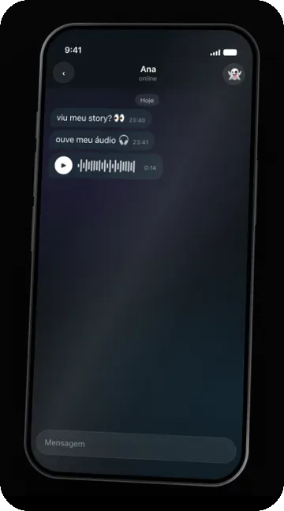
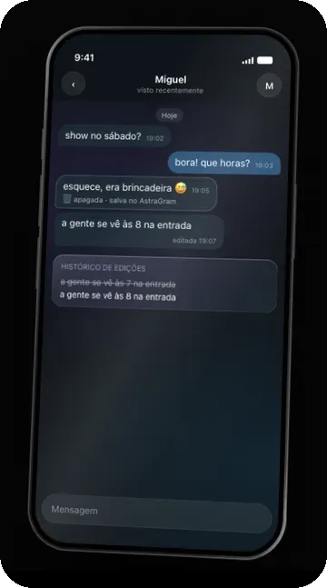
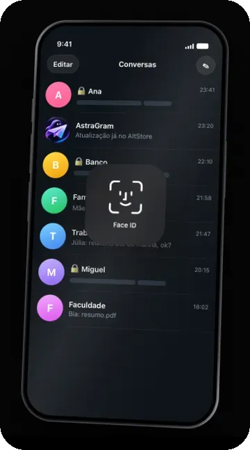
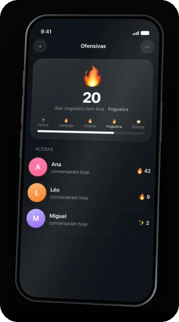
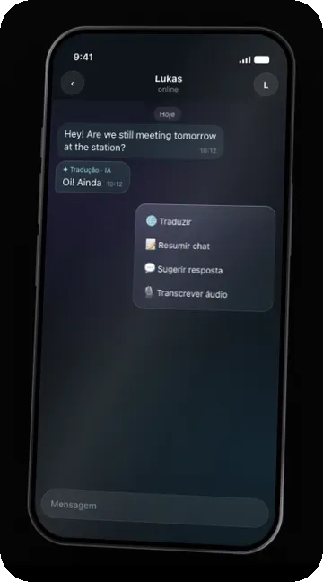
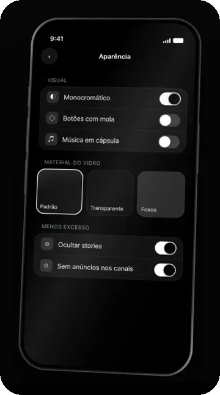

<a href="https://dedsec-reth0.github.io/astragram/?lang=pt"></a>

<p align="center"><a href="README.md">English</a> · <a href="README.ru.md">Русский</a> · <a href="README.uk.md">Українська</a> · <a href="README.es.md">Español</a> · <b>Português</b> · <a href="README.de.md">Deutsch</a> · <a href="README.fr.md">Français</a> · <a href="README.tr.md">Türkçe</a></p>

<p align="center">
  <a href="https://dedsec-reth0.github.io/astragram/install/?lang=pt"></a>
  <a href="https://dedsec-reth0.github.io/astragram/?lang=pt"></a>
  <a href="https://t.me/astragram_news"></a>
</p>

<p align="center">
  <a href="https://github.com/dedsec-reth0/astragram/releases/latest"></a>
  <a href="https://github.com/dedsec-reth0/astragram/releases"></a>
  <a href="https://github.com/dedsec-reth0/astragram/stargazers"></a>
  
  <a href="LICENSE"></a>
</p>

<br>

<p align="center">AstraGram é um cliente não oficial do Telegram para iPhone, de código aberto: modo fantasma, mensagens apagadas, chats com Face ID, ofensivas, IA e plugins. Grátis pelo AltStore e SideStore.</p>

<h3 align="center">Pegamos o Telegram e <b>tiramos</b> tudo o que <b>atrapalha.</b> Você decide se envia <b>“online”</b> e <b>“lida”.</b> O que foi apagado <b>fica</b> com você. O excesso <b>some.</b> E todo o código fica <b>à vista.</b></h3>

<br>

## Recursos

<table>
<tr><td width="42%" align="center"><a href="https://dedsec-reth0.github.io/astragram/?lang=pt#features"></a></td><td width="58%" valign="middle"><sub><code>01 / 06</code></sub><h3>Modo fantasma</h3><p>Leia, ouça e veja stories sem enviar “online”, “lida” ou “digitando”. Liga com o botão do fantasma acima da lista de chats.</p><ul><li>Sem confirmação de visualização de stories, áudios e vídeos redondos</li><li>A mensagem só fica lida quando você responde</li><li>O servidor do Telegram ainda vê sua conexão: não é invisibilidade</li></ul></td></tr>
<tr><td width="58%" valign="middle"><sub><code>02 / 06</code></sub><h3>O apagado fica</h3><p>Mensagens que a outra pessoa apaga ficam no chat com uma marca. Cada mensagem guarda seu histórico de edições.</p><ul><li>Funciona também em canais</li><li>Fotos e vídeos de visualização única não somem</li><li>Um registro de tudo o que foi apagado em todos os chats</li></ul></td><td width="42%" align="center"><a href="https://dedsec-reth0.github.io/astragram/?lang=pt#features"></a></td></tr>
<tr><td width="42%" align="center"><a href="https://dedsec-reth0.github.io/astragram/?lang=pt#features"></a></td><td width="58%" valign="middle"><sub><code>03 / 06</code></sub><h3>Chats com Face ID</h3><p>Os chats escolhidos só abrem com o seu rosto. O texto deles fica oculto já na lista de chats, e o seletor de apps mostra uma capa.</p><ul><li>Face ID para os ajustes do AstraGram</li><li>Bloqueio de teclados de terceiros</li><li>A área de transferência é limpa após um minuto</li></ul></td></tr>
<tr><td width="58%" valign="middle"><sub><code>04 / 06</code></sub><h3>Ofensivas com amigos</h3><p>Converse todo dia e a ofensiva cresce: Faísca, Lampejo, Chama, Fogueira, Estrela. A contagem é a mesma em todos os seus aparelhos.</p><ul><li>Um mascote com guarda-roupa</li><li>Recupere um dia perdido</li><li>Um selo do AstraGram que seus amigos com AstraGram veem</li></ul></td><td width="42%" align="center"><a href="https://dedsec-reth0.github.io/astragram/?lang=pt#features"></a></td></tr>
<tr><td width="42%" align="center"><a href="https://dedsec-reth0.github.io/astragram/?lang=pt#features"></a></td><td width="58%" valign="middle"><sub><code>05 / 06</code></sub><h3>IA com sua chave</h3><p>Tradução, resumo do chat, resposta, transcrição de áudios e texto de fotos — por qualquer API compatível com a OpenAI.</p><ul><li>O texto vai para o serviço só quando você pede</li><li>Sem chave? Um serviço gratuito com limite</li><li>Plugins em JavaScript</li></ul></td></tr>
<tr><td width="58%" valign="middle"><sub><code>06 / 06</code></sub><h3>Monocromático e vidro</h3><p>Visual só em preto, branco e cinzas. Escolha o material do vidro: padrão, transparente ou fosco.</p><ul><li>Botões com efeito de mola</li><li>Música do perfil em cápsula</li><li>Sem stories e sem anúncios nos canais</li></ul></td><td width="42%" align="center"><a href="https://dedsec-reth0.github.io/astragram/?lang=pt#features"></a></td></tr>
</table>

## Tudo o que faltava.

<a href="https://dedsec-reth0.github.io/astragram/?lang=pt#more"></a>

Como escrever um plugin: [astragram/plugins/README.md](astragram/plugins/README.md) · [examples](astragram/plugins/examples)

## Instalar

Um toque e o AltStore oferece adicionar a fonte do AstraGram. As atualizações também chegam por lá.

<p><a href="https://dedsec-reth0.github.io/astragram/install/?lang=pt"></a> <a href="https://dedsec-reth0.github.io/astragram/install/?lang=pt"></a> <a href="https://github.com/dedsec-reth0/astragram/releases/latest"></a></p>

<table><tr>
<td width="33%" valign="top"><h1>01</h1><b>Instale o AltStore ou o SideStore</b><br><sub>Eles assinam o app com o seu Apple ID. Não precisa de jailbreak.<br><a href="https://altstore.io">Baixar o AltStore</a> · <a href="https://sidestore.io">SideStore</a></sub></td>
<td width="33%" valign="top"><h1>02</h1><b>Adicione a fonte do AstraGram</b><br><sub>O botão “Abrir no AltStore” faz isso por você. Ou cole o endereço manualmente.</sub></td>
<td width="33%" valign="top"><h1>03</h1><b>Toque em Free</b><br><sub>O AltStore instala o AstraGram. Na primeira abertura, informe seu API ID e Hash do my.telegram.org.</sub></td>
</tr></table>

**Manualmente** — Endereço da fonte:

```
https://github.com/dedsec-reth0/astragram/releases/download/sidestore-source/source.json
```

1. Abra o AltStore → **Browse** → **Sources** → **+**.
2. Cole o endereço copiado.
3. Encontre o AstraGram e toque em **Free**.

> [!NOTE]
> As telas próprias do AstraGram estão em russo e inglês; o resto do app é a interface do Telegram em qualquer um dos idiomas dele.

### Qual IPA escolher

| | IPA | App ID |
| --- | --- | --- |
| **Padrão** | `AstraGram-<version>-<build>.ipa` | Apple ID gratuito. Sem extensões — sem widgets nem Compartilhar. Precisa de 1 App ID. |
| **Full** | `AstraGram-<version>-<build>-full.ipa` | Conta de desenvolvedor paga. Com todas as extensões. Precisa de 7 App IDs. |

### Todas as versões

Todas as compilações estão em [Releases](https://github.com/dedsec-reth0/astragram/releases), e a fonte do AltStore mostra todas, não só a mais recente: a nova chega como atualização e as anteriores ficam no histórico de versões.

### Perguntas

<details><summary><b>Preciso de jailbreak?</b></summary>

Não. O AstraGram é instalado pelo AltStore ou SideStore, como qualquer app de uma fonte.

</details>
<details><summary><b>Por que a cada 7 dias?</b></summary>

Com um Apple ID gratuito a assinatura vale 7 dias. Uma vez por semana, toque em “Refresh All” no AltStore.

</details>
<details><summary><b>Meus dados ficam ao atualizar?</b></summary>

Sim. Ao atualizar pelo AltStore, seus dados e o login são mantidos.

</details>
<details><summary><b>Onde consigo o API ID e o Hash?</b></summary>

No my.telegram.org, em API development tools. Depois dá para trocar em Ajustes → AstraGram → API ID e Hash.

</details>
<details><summary><b>Por que as notificações push não chegam?</b></summary>

Os servidores do Telegram só enviam push para apps com um certificado conhecido. “Notificações sem push” nos ajustes do AstraGram ajuda em parte.

</details>

## Não acredite na palavra. Confira você.

<table><tr>
<td width="33%" valign="top"><b>O código é aberto. Todo</b><br><sub>O código-fonte está no <a href="https://github.com/dedsec-reth0/astragram">GitHub</a> sob a GPL-2.0, com base no código aberto do Telegram-iOS.</sub></td>
<td width="33%" valign="top"><b>Quem compila é o GitHub, não nós</b><br><sub>Cada compilação roda no GitHub Actions e o registro é público. Cada versão tem uma tag no commit de onde foi compilada.</sub></td>
<td width="33%" valign="top"><b>As chaves da API são suas</b><br><sub>Na primeira abertura você informa seu próprio API ID e Hash do my.telegram.org.</sub></td>
</tr></table>

```console
$ git clone https://github.com/dedsec-reth0/astragram
$ gh release view --repo dedsec-reth0/astragram --json tagName,targetCommitish
# a versão foi compilada deste commit — confira você
```

### Compilar a partir do código

O app é compilado com Bazel a partir do código do Telegram-iOS; cada versão tem uma tag no commit de onde foi compilada.

[astragram/INSTALL.md](astragram/INSTALL.md) — compilação e publicação (em russo) · [docs/telegram-ios-build.md](docs/telegram-ios-build.md) — o guia original do Telegram

### Licença

Baseado no [Telegram-iOS](https://github.com/TelegramMessenger/Telegram-iOS), publicado sob GPL-2.0. As mudanças deste repositório seguem a mesma licença: [LICENSE](LICENSE); componentes de terceiros: [THIRD-PARTY-NOTICES.md](THIRD-PARTY-NOTICES.md).

---

<p align="center"><a href="https://dedsec-reth0.github.io/astragram/?lang=pt"></a></p>

<p align="center"><sub>AstraGram é um cliente não oficial do Telegram e não tem vínculo com o Telegram; o nome e o logotipo do Telegram pertencem ao seu dono.<br>Versões do AltStore não recebem notificações push; o modo fantasma não esconde sua conexão do servidor do Telegram.</sub></p>
