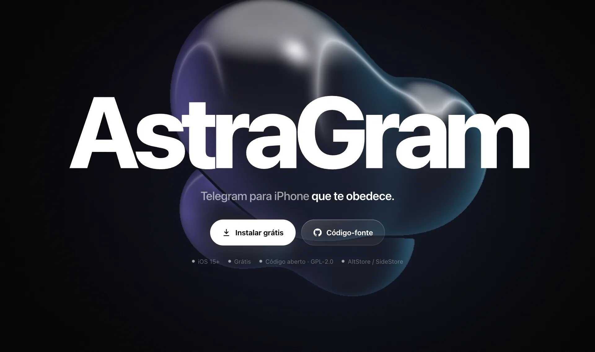
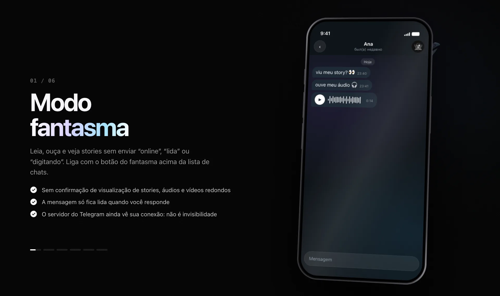
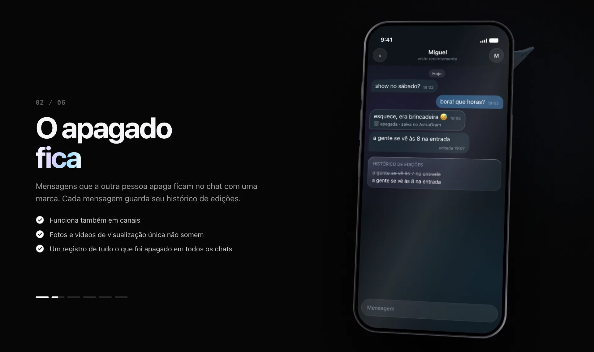
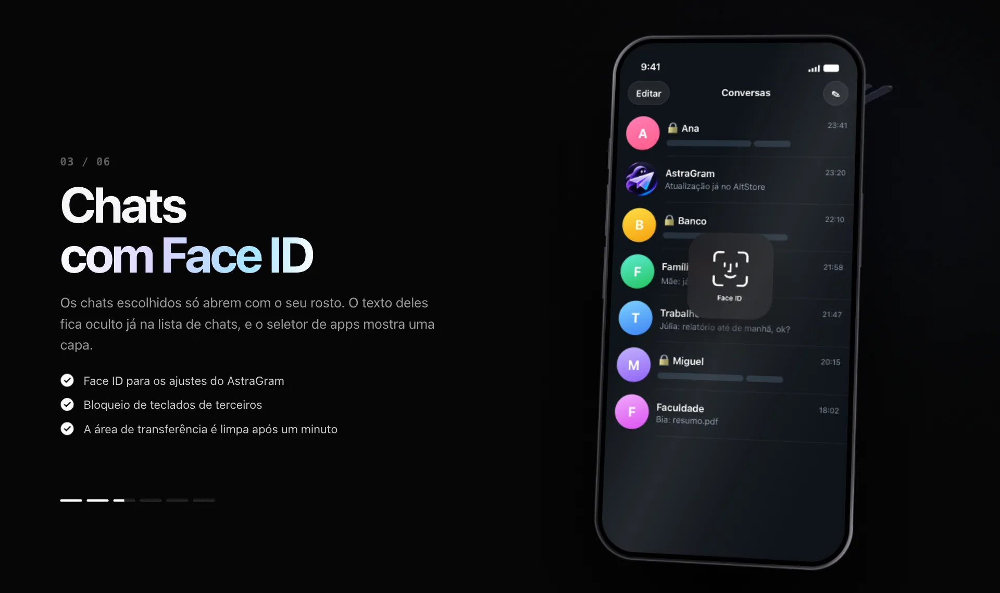
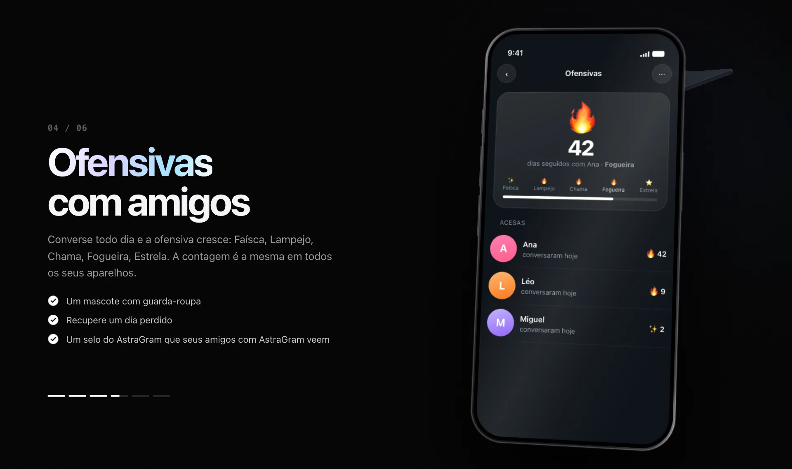
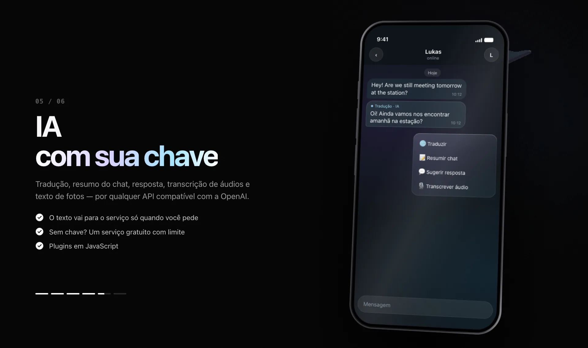
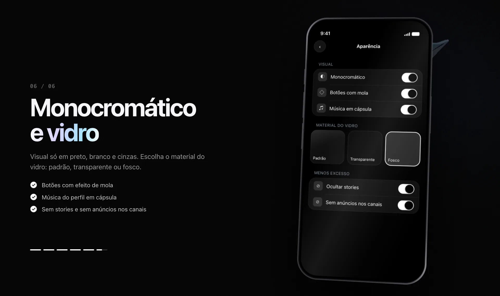
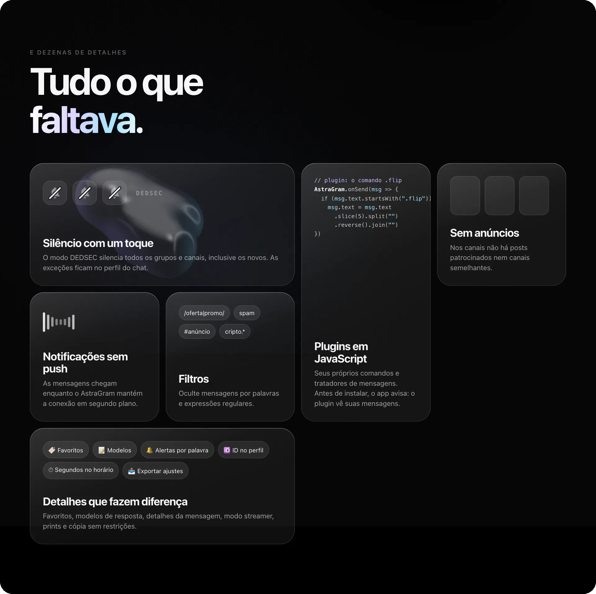

<a href="https://dedsec-reth0.github.io/astragram/?lang=pt"></a>

<p align="center"><a href="README.md">English</a> · <a href="README.ru.md">Русский</a> · <a href="README.uk.md">Українська</a> · <a href="README.es.md">Español</a> · <b>Português</b> · <a href="README.de.md">Deutsch</a> · <a href="README.fr.md">Français</a> · <a href="README.tr.md">Türkçe</a></p>

<h1 align="center">AstraGram</h1>

<p align="center"><b>Telegram para iPhone que te obedece.</b><br>AstraGram é um cliente não oficial do Telegram para iPhone, de código aberto: modo fantasma, mensagens apagadas, chats com Face ID, ofensivas, IA e plugins. Grátis pelo AltStore e SideStore.</p>

<p align="center">
  <a href="https://dedsec-reth0.github.io/astragram/install/?lang=pt"></a>
  <a href="https://github.com/dedsec-reth0/astragram/releases/latest"></a>
  <a href="https://github.com/dedsec-reth0/astragram/releases"></a>
  
  <a href="LICENSE"></a>
</p>

<p align="center"><a href="https://dedsec-reth0.github.io/astragram/install/?lang=pt"><b>Instalar grátis</b></a> · <a href="https://dedsec-reth0.github.io/astragram/?lang=pt"><b>Site</b></a> · <a href="https://t.me/astragram_news"><b>Canal no Telegram</b></a> · <a href="https://github.com/dedsec-reth0/astragram/releases/latest"><b>Baixar IPA</b></a></p>

> Pegamos o Telegram e **tiramos** tudo o que **atrapalha.** Você decide se envia **“online”** e **“lida”.** O que foi apagado **fica** com você. O excesso **some.** E todo o código fica **à vista.**

## Recursos

<a href="https://dedsec-reth0.github.io/astragram/?lang=pt#features"></a>

<a href="https://dedsec-reth0.github.io/astragram/?lang=pt#features"></a>

<a href="https://dedsec-reth0.github.io/astragram/?lang=pt#features"></a>

<a href="https://dedsec-reth0.github.io/astragram/?lang=pt#features"></a>

<a href="https://dedsec-reth0.github.io/astragram/?lang=pt#features"></a>

<a href="https://dedsec-reth0.github.io/astragram/?lang=pt#features"></a>

## Tudo o que faltava.

<a href="https://dedsec-reth0.github.io/astragram/?lang=pt#more"></a>

Como escrever um plugin: [astragram/plugins/README.md](astragram/plugins/README.md) · [examples](astragram/plugins/examples)

## Instalar

Um toque e o AltStore oferece adicionar a fonte do AstraGram. As atualizações também chegam por lá.

<p><a href="https://dedsec-reth0.github.io/astragram/install/?lang=pt"></a> <a href="https://dedsec-reth0.github.io/astragram/install/?lang=pt"></a> <a href="https://github.com/dedsec-reth0/astragram/releases/latest"></a></p>

1. **Instale o AltStore ou o SideStore** — Eles assinam o app com o seu Apple ID. Não precisa de jailbreak. [Baixar o AltStore](https://altstore.io) · [SideStore](https://sidestore.io)
2. **Adicione a fonte do AstraGram** — O botão “Abrir no AltStore” faz isso por você. Ou cole o endereço manualmente.
3. **Toque em Free** — O AltStore instala o AstraGram. Na primeira abertura, informe seu API ID e Hash do my.telegram.org.

**Manualmente** — Endereço da fonte:

```
https://github.com/dedsec-reth0/astragram/releases/download/sidestore-source/source.json
```

1. Abra o AltStore → **Browse** → **Sources** → **+**.
2. Cole o endereço copiado.
3. Encontre o AstraGram e toque em **Free**.

> [!NOTE]
> As telas próprias do AstraGram estão em russo e inglês; o resto do app é a interface do Telegram em qualquer um dos idiomas dele.

### Qual IPA escolher

| | IPA | App ID |
| --- | --- | --- |
| **Padrão** | `AstraGram-<version>-<build>.ipa` | Apple ID gratuito. Sem extensões — sem widgets nem Compartilhar. Precisa de 1 App ID. |
| **Full** | `AstraGram-<version>-<build>-full.ipa` | Conta de desenvolvedor paga. Com todas as extensões. Precisa de 7 App IDs. |

### Todas as versões

Todas as compilações estão em [Releases](https://github.com/dedsec-reth0/astragram/releases), e a fonte do AltStore mostra todas, não só a mais recente: a nova chega como atualização e as anteriores ficam no histórico de versões.

### Perguntas

<details><summary><b>Preciso de jailbreak?</b></summary>

Não. O AstraGram é instalado pelo AltStore ou SideStore, como qualquer app de uma fonte.

</details>
<details><summary><b>Por que a cada 7 dias?</b></summary>

Com um Apple ID gratuito a assinatura vale 7 dias. Uma vez por semana, toque em “Refresh All” no AltStore.

</details>
<details><summary><b>Meus dados ficam ao atualizar?</b></summary>

Sim. Ao atualizar pelo AltStore, seus dados e o login são mantidos.

</details>
<details><summary><b>Onde consigo o API ID e o Hash?</b></summary>

No my.telegram.org, em API development tools. Depois dá para trocar em Ajustes → AstraGram → API ID e Hash.

</details>
<details><summary><b>Por que as notificações push não chegam?</b></summary>

Os servidores do Telegram só enviam push para apps com um certificado conhecido. “Notificações sem push” nos ajustes do AstraGram ajuda em parte.

</details>

## Não acredite na palavra. Confira você.

- **O código é aberto. Todo** — O código-fonte está no [GitHub](https://github.com/dedsec-reth0/astragram) sob a GPL-2.0, com base no código aberto do Telegram-iOS.
- **Quem compila é o GitHub, não nós** — Cada compilação roda no GitHub Actions e o registro é público. Cada versão tem uma tag no commit de onde foi compilada.
- **As chaves da API são suas** — Na primeira abertura você informa seu próprio API ID e Hash do my.telegram.org.

### Compilar a partir do código

O app é compilado com Bazel a partir do código do Telegram-iOS; cada versão tem uma tag no commit de onde foi compilada.

[astragram/INSTALL.md](astragram/INSTALL.md) — compilação e publicação (em russo) · [docs/telegram-ios-build.md](docs/telegram-ios-build.md) — o guia original do Telegram

### Licença

Baseado no [Telegram-iOS](https://github.com/TelegramMessenger/Telegram-iOS), publicado sob GPL-2.0. As mudanças deste repositório seguem a mesma licença: [LICENSE](LICENSE); componentes de terceiros: [THIRD-PARTY-NOTICES.md](THIRD-PARTY-NOTICES.md).

---

<p align="center"><a href="https://dedsec-reth0.github.io/astragram/?lang=pt"></a></p>

<p align="center"><sub>AstraGram é um cliente não oficial do Telegram e não tem vínculo com o Telegram; o nome e o logotipo do Telegram pertencem ao seu dono.<br>Versões do AltStore não recebem notificações push; o modo fantasma não esconde sua conexão do servidor do Telegram.</sub></p>
