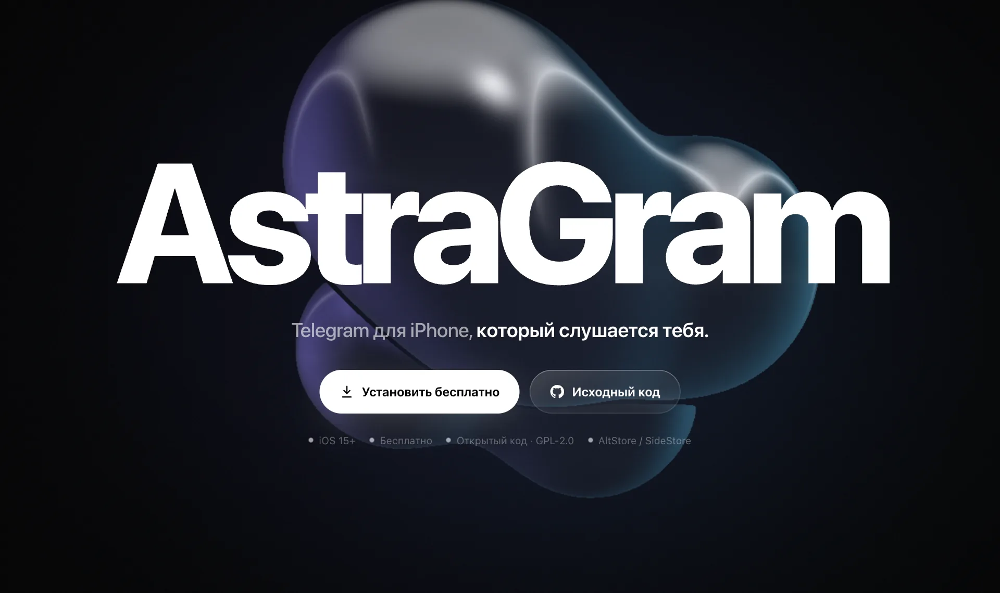
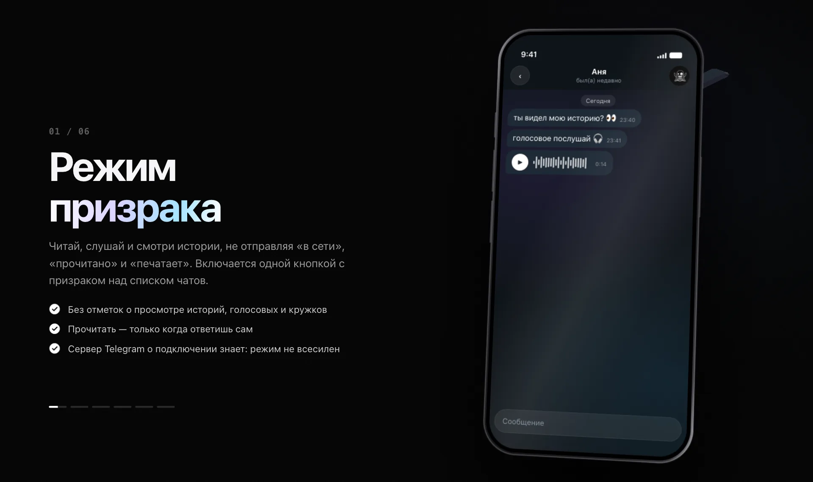
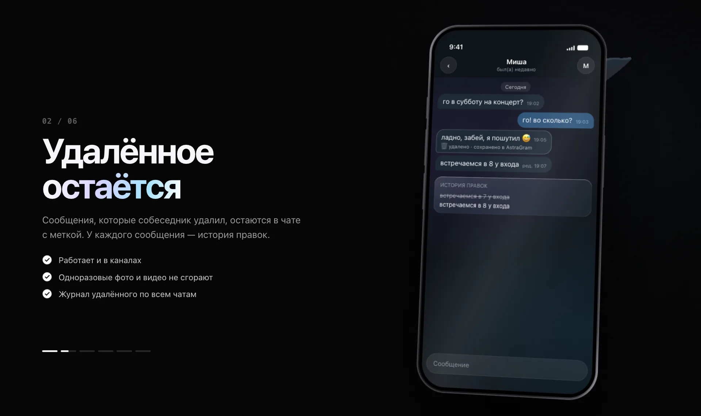
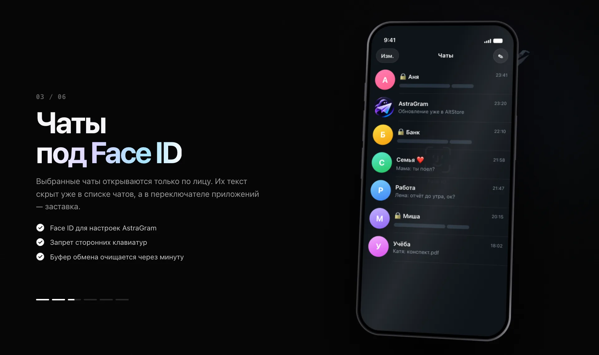
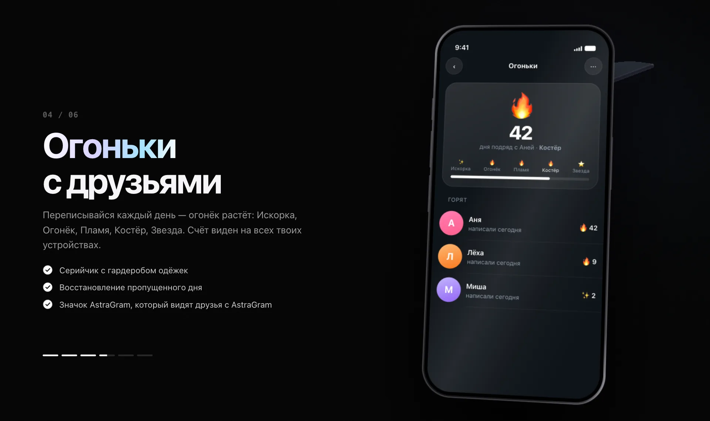
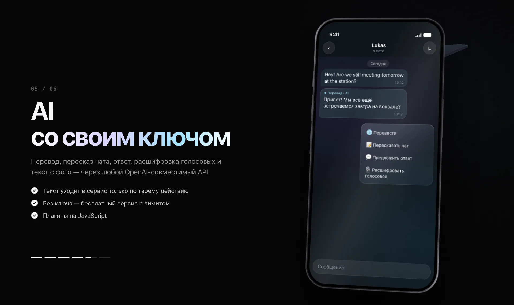
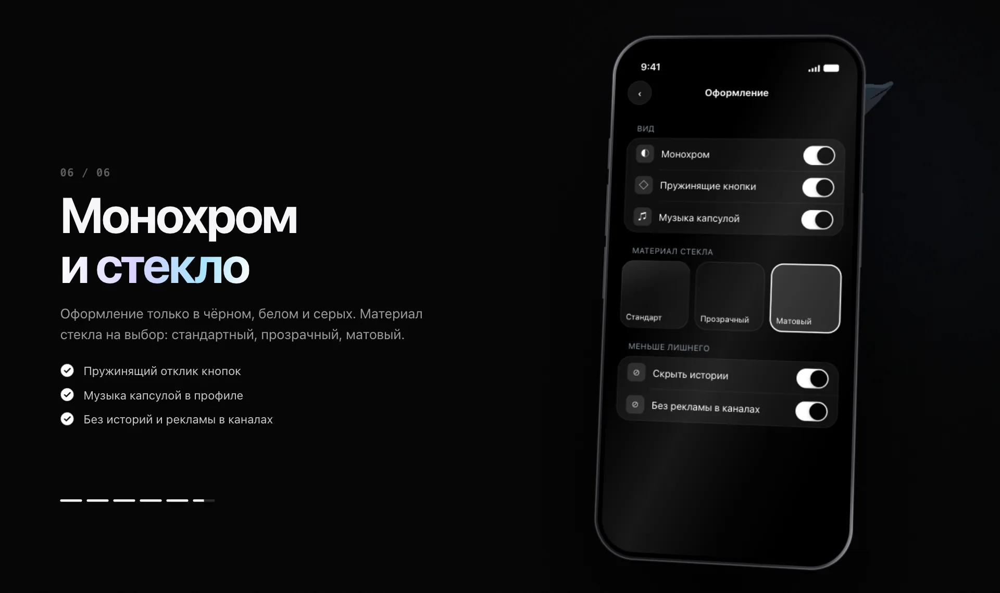

<a href="https://dedsec-reth0.github.io/astragram/?lang=ru"></a>

<p align="center"><a href="README.md">English</a> · <b>Русский</b> · <a href="README.uk.md">Українська</a> · <a href="README.es.md">Español</a> · <a href="README.pt.md">Português</a> · <a href="README.de.md">Deutsch</a> · <a href="README.fr.md">Français</a> · <a href="README.tr.md">Türkçe</a></p>

<h1 align="center">AstraGram</h1>

<p align="center"><b>Telegram для iPhone, который слушается тебя.</b><br>AstraGram — неофициальный клиент Telegram для iPhone с открытым кодом: режим призрака, удалённые сообщения, чаты под Face ID, огоньки, AI и плагины. Бесплатно через AltStore и SideStore.</p>

<p align="center">
  <a href="https://dedsec-reth0.github.io/astragram/install/?lang=ru"></a>
  <a href="https://github.com/dedsec-reth0/astragram/releases/latest"></a>
  <a href="https://github.com/dedsec-reth0/astragram/releases"></a>
  
  <a href="LICENSE"></a>
</p>

<p align="center"><a href="https://dedsec-reth0.github.io/astragram/install/?lang=ru"><b>Установить бесплатно</b></a> · <a href="https://dedsec-reth0.github.io/astragram/?lang=ru"><b>Сайт</b></a> · <a href="https://t.me/astragram_news"><b>Канал в Telegram</b></a> · <a href="https://github.com/dedsec-reth0/astragram/releases/latest"><b>Скачать IPA</b></a></p>

> Мы взяли Telegram и **убрали** всё, что **мешает.** Ты решаешь, отправлять ли **«в сети»** и **«прочитано».** Удалённое **остаётся** у тебя. Лишнее **исчезает.** А весь код — **на виду.**

## Возможности

<a href="https://dedsec-reth0.github.io/astragram/?lang=ru#features"></a>

<a href="https://dedsec-reth0.github.io/astragram/?lang=ru#features"></a>

<a href="https://dedsec-reth0.github.io/astragram/?lang=ru#features"></a>

<a href="https://dedsec-reth0.github.io/astragram/?lang=ru#features"></a>

<a href="https://dedsec-reth0.github.io/astragram/?lang=ru#features"></a>

<a href="https://dedsec-reth0.github.io/astragram/?lang=ru#features"></a>

## Всё, чего тебе не хватало.

<a href="https://dedsec-reth0.github.io/astragram/?lang=ru#more"></a>

Как написать плагин: [astragram/plugins/README.md](astragram/plugins/README.md) · [examples](astragram/plugins/examples)

## Установить

Одно нажатие — и AltStore предложит добавить источник AstraGram. Обновления потом будут приходить туда же.

<p><a href="https://dedsec-reth0.github.io/astragram/install/?lang=ru"></a> <a href="https://dedsec-reth0.github.io/astragram/install/?lang=ru"></a> <a href="https://github.com/dedsec-reth0/astragram/releases/latest"></a></p>

1. **Поставь AltStore или SideStore** — Они подписывают приложение твоим Apple ID. Джейлбрейк не нужен. [Скачать AltStore](https://altstore.io) · [SideStore](https://sidestore.io)
2. **Добавь источник AstraGram** — Кнопка «Открыть в AltStore» сделает это сама. Или вставь адрес вручную.
3. **Нажми Free** — AltStore установит AstraGram. При первом запуске введи свои API ID и Hash с my.telegram.org.

**Вручную** — Адрес источника:

```
https://github.com/dedsec-reth0/astragram/releases/download/sidestore-source/source.json
```

1. Открой AltStore → **Browse** → **Sources** → **+**.
2. Вставь скопированный адрес.
3. Найди AstraGram и нажми **Free**.

> [!NOTE]
> Собственные экраны AstraGram — на русском и английском; остальное приложение — интерфейс Telegram на любом его языке.

### Какой IPA выбрать

| | IPA | App ID |
| --- | --- | --- |
| **Обычный** | `AstraGram-<version>-<build>.ipa` | Бесплатный Apple ID. Без расширений — виджетов и «Поделиться». Нужен 1 App ID. |
| **Full** | `AstraGram-<version>-<build>-full.ipa` | Платный аккаунт разработчика. Со всеми расширениями. Нужно 7 App ID. |

### Все версии

Все сборки лежат в [Releases](https://github.com/dedsec-reth0/astragram/releases), и источник AltStore показывает их все, а не только последнюю: новая приходит обновлением, прежние остаются в истории версий.

### Вопросы

<details><summary><b>Нужен ли джейлбрейк?</b></summary>

Нет. AstraGram ставится через AltStore или SideStore, как любое приложение из источника.

</details>
<details><summary><b>Почему раз в 7 дней?</b></summary>

С бесплатным Apple ID подпись действует 7 дней. Раз в неделю нажимай в AltStore «Refresh All».

</details>
<details><summary><b>Сохранятся ли данные при обновлении?</b></summary>

Да. При обновлении через AltStore данные и вход сохраняются.

</details>
<details><summary><b>Где взять API ID и Hash?</b></summary>

На my.telegram.org, в разделе API development tools. Потом их можно сменить: Настройки → AstraGram → API ID и Hash.

</details>
<details><summary><b>Почему не приходят push-уведомления?</b></summary>

Серверы Telegram шлют push только приложениям с известным им сертификатом. Частично помогает «Уведомления без push» в настройках AstraGram.

</details>

## Не верь на слово. Проверь сам.

- **Код открыт. Весь** — Исходники лежат на [GitHub](https://github.com/dedsec-reth0/astragram) под лицензией GPL-2.0. Основа — открытый код Telegram-iOS.
- **Собирает GitHub, не мы** — Каждая сборка идёт на GitHub Actions — её журнал видно всем. Релиз помечен тегом на коммит, из которого собран.
- **Ключи API — твои** — При первом запуске ты вводишь свои API ID и Hash с my.telegram.org.

### Сборка из исходников

Приложение собирается Bazel из исходников Telegram-iOS; каждый релиз помечен тегом на коммите, из которого собран.

[astragram/INSTALL.md](astragram/INSTALL.md) — как устроены сборка и публикация · [docs/telegram-ios-build.md](docs/telegram-ios-build.md) — оригинальная инструкция Telegram

### Лицензия

Основано на [Telegram-iOS](https://github.com/TelegramMessenger/Telegram-iOS) под GPL-2.0. Изменения в этом репозитории — на тех же условиях: [LICENSE](LICENSE), сторонние компоненты — [THIRD-PARTY-NOTICES.md](THIRD-PARTY-NOTICES.md).

---

<p align="center"><a href="https://dedsec-reth0.github.io/astragram/?lang=ru"></a></p>

<p align="center"><sub>AstraGram — неофициальный клиент Telegram. С Telegram не связан; название и логотип Telegram принадлежат их владельцу.<br>Push-уведомления в сборках из AltStore не приходят; режим призрака не скрывает подключение от сервера Telegram.</sub></p>
