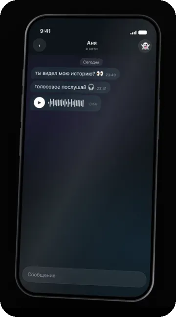
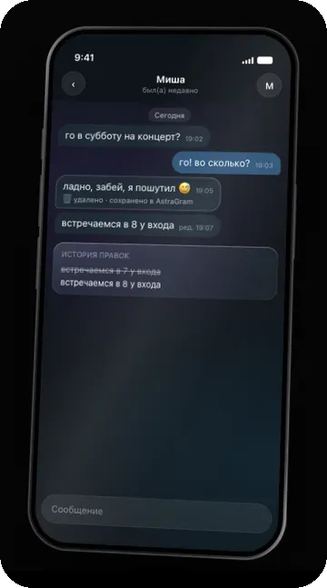
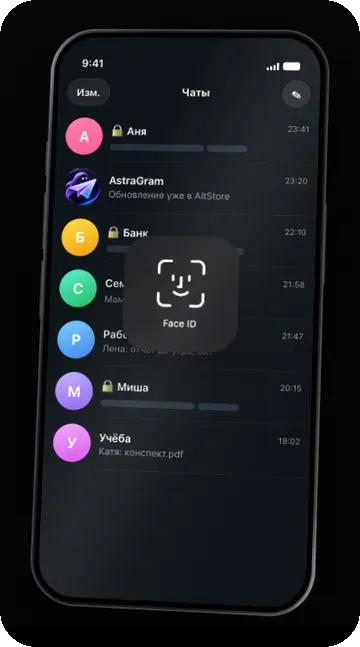
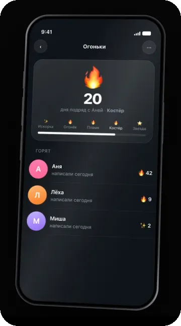
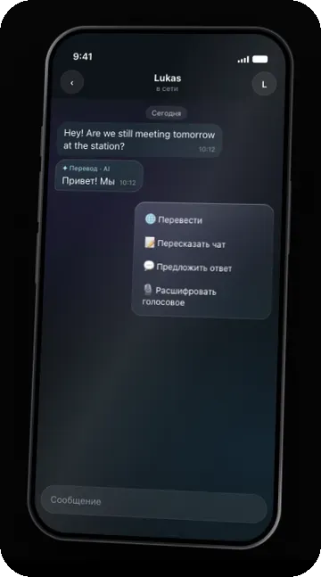
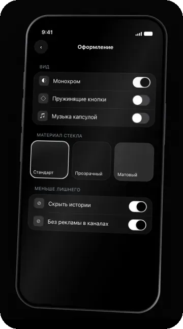
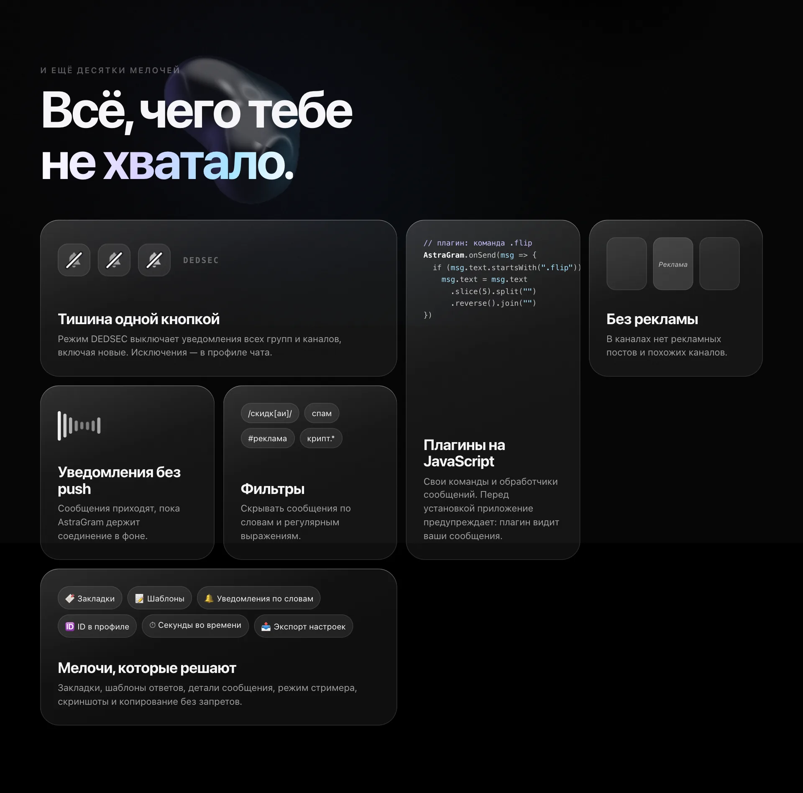

<a href="https://dedsec-reth0.github.io/astragram/?lang=ru"></a>

<p align="center"><a href="README.md">English</a> · <b>Русский</b> · <a href="README.uk.md">Українська</a> · <a href="README.es.md">Español</a> · <a href="README.pt.md">Português</a> · <a href="README.de.md">Deutsch</a> · <a href="README.fr.md">Français</a> · <a href="README.tr.md">Türkçe</a></p>

<p align="center">
  <a href="https://dedsec-reth0.github.io/astragram/install/?lang=ru"></a>
  <a href="https://dedsec-reth0.github.io/astragram/?lang=ru"></a>
  <a href="https://t.me/astragram_news"></a>
</p>

<p align="center">
  <a href="https://github.com/dedsec-reth0/astragram/releases/latest"></a>
  <a href="https://github.com/dedsec-reth0/astragram/releases"></a>
  <a href="https://github.com/dedsec-reth0/astragram/stargazers"></a>
  
  <a href="LICENSE"></a>
</p>

<br>

<p align="center">AstraGram — неофициальный клиент Telegram для iPhone с открытым кодом: режим призрака, удалённые сообщения, чаты под Face ID, огоньки, AI и плагины. Бесплатно через AltStore и SideStore.</p>

<h3 align="center">Мы взяли Telegram и <b>убрали</b> всё, что <b>мешает.</b> Ты решаешь, отправлять ли <b>«в сети»</b> и <b>«прочитано».</b> Удалённое <b>остаётся</b> у тебя. Лишнее <b>исчезает.</b> А весь код — <b>на виду.</b></h3>

<br>

## Возможности

<table>
<tr><td width="42%" align="center"><a href="https://dedsec-reth0.github.io/astragram/?lang=ru#features"></a></td><td width="58%" valign="middle"><sub><code>01 / 06</code></sub><h3>Режим призрака</h3><p>Читай, слушай и смотри истории, не отправляя «в сети», «прочитано» и «печатает». Включается одной кнопкой с призраком над списком чатов.</p><ul><li>Без отметок о просмотре историй, голосовых и кружков</li><li>Прочитать — только когда ответишь сам</li><li>Сервер Telegram о подключении знает: режим не всесилен</li></ul></td></tr>
<tr><td width="58%" valign="middle"><sub><code>02 / 06</code></sub><h3>Удалённое остаётся</h3><p>Сообщения, которые собеседник удалил, остаются в чате с меткой. У каждого сообщения — история правок.</p><ul><li>Работает и в каналах</li><li>Одноразовые фото и видео не сгорают</li><li>Журнал удалённого по всем чатам</li></ul></td><td width="42%" align="center"><a href="https://dedsec-reth0.github.io/astragram/?lang=ru#features"></a></td></tr>
<tr><td width="42%" align="center"><a href="https://dedsec-reth0.github.io/astragram/?lang=ru#features"></a></td><td width="58%" valign="middle"><sub><code>03 / 06</code></sub><h3>Чаты под Face ID</h3><p>Выбранные чаты открываются только по лицу. Их текст скрыт уже в списке чатов, а в переключателе приложений — заставка.</p><ul><li>Face ID для настроек AstraGram</li><li>Запрет сторонних клавиатур</li><li>Буфер обмена очищается через минуту</li></ul></td></tr>
<tr><td width="58%" valign="middle"><sub><code>04 / 06</code></sub><h3>Огоньки с друзьями</h3><p>Переписывайся каждый день — огонёк растёт: Искорка, Огонёк, Пламя, Костёр, Звезда. Счёт виден на всех твоих устройствах.</p><ul><li>Серийчик с гардеробом одёжек</li><li>Восстановление пропущенного дня</li><li>Значок AstraGram, который видят друзья с AstraGram</li></ul></td><td width="42%" align="center"><a href="https://dedsec-reth0.github.io/astragram/?lang=ru#features"></a></td></tr>
<tr><td width="42%" align="center"><a href="https://dedsec-reth0.github.io/astragram/?lang=ru#features"></a></td><td width="58%" valign="middle"><sub><code>05 / 06</code></sub><h3>AI со своим ключом</h3><p>Перевод, пересказ чата, ответ, расшифровка голосовых и текст с фото — через любой OpenAI-совместимый API.</p><ul><li>Текст уходит в сервис только по твоему действию</li><li>Без ключа — бесплатный сервис с лимитом</li><li>Плагины на JavaScript</li></ul></td></tr>
<tr><td width="58%" valign="middle"><sub><code>06 / 06</code></sub><h3>Монохром и стекло</h3><p>Оформление только в чёрном, белом и серых. Материал стекла на выбор: стандартный, прозрачный, матовый.</p><ul><li>Пружинящий отклик кнопок</li><li>Музыка капсулой в профиле</li><li>Без историй и рекламы в каналах</li></ul></td><td width="42%" align="center"><a href="https://dedsec-reth0.github.io/astragram/?lang=ru#features"></a></td></tr>
</table>

## Всё, чего тебе не хватало.

<a href="https://dedsec-reth0.github.io/astragram/?lang=ru#more"></a>

Как написать плагин: [astragram/plugins/README.md](astragram/plugins/README.md) · [examples](astragram/plugins/examples)

## Установить

Одно нажатие — и AltStore предложит добавить источник AstraGram. Обновления потом будут приходить туда же.

<p><a href="https://dedsec-reth0.github.io/astragram/install/?lang=ru"></a> <a href="https://dedsec-reth0.github.io/astragram/install/?lang=ru"></a> <a href="https://github.com/dedsec-reth0/astragram/releases/latest"></a></p>

<table><tr>
<td width="33%" valign="top"><h1>01</h1><b>Поставь AltStore или SideStore</b><br><sub>Они подписывают приложение твоим Apple ID. Джейлбрейк не нужен.<br><a href="https://altstore.io">Скачать AltStore</a> · <a href="https://sidestore.io">SideStore</a></sub></td>
<td width="33%" valign="top"><h1>02</h1><b>Добавь источник AstraGram</b><br><sub>Кнопка «Открыть в AltStore» сделает это сама. Или вставь адрес вручную.</sub></td>
<td width="33%" valign="top"><h1>03</h1><b>Нажми Free</b><br><sub>AltStore установит AstraGram. При первом запуске введи свои API ID и Hash с my.telegram.org.</sub></td>
</tr></table>

**Вручную** — Адрес источника:

```
https://github.com/dedsec-reth0/astragram/releases/download/sidestore-source/source.json
```

1. Открой AltStore → **Browse** → **Sources** → **+**.
2. Вставь скопированный адрес.
3. Найди AstraGram и нажми **Free**.

> [!NOTE]
> Собственные экраны AstraGram — на русском и английском; остальное приложение — интерфейс Telegram на любом его языке.

### Какой IPA выбрать

| | IPA | App ID |
| --- | --- | --- |
| **Обычный** | `AstraGram-<version>-<build>.ipa` | Бесплатный Apple ID. Без расширений — виджетов и «Поделиться». Нужен 1 App ID. |
| **Full** | `AstraGram-<version>-<build>-full.ipa` | Платный аккаунт разработчика. Со всеми расширениями. Нужно 7 App ID. |

### Все версии

Все сборки лежат в [Releases](https://github.com/dedsec-reth0/astragram/releases), и источник AltStore показывает их все, а не только последнюю: новая приходит обновлением, прежние остаются в истории версий.

### Вопросы

<details><summary><b>Нужен ли джейлбрейк?</b></summary>

Нет. AstraGram ставится через AltStore или SideStore, как любое приложение из источника.

</details>
<details><summary><b>Почему раз в 7 дней?</b></summary>

С бесплатным Apple ID подпись действует 7 дней. Раз в неделю нажимай в AltStore «Refresh All».

</details>
<details><summary><b>Сохранятся ли данные при обновлении?</b></summary>

Да. При обновлении через AltStore данные и вход сохраняются.

</details>
<details><summary><b>Где взять API ID и Hash?</b></summary>

На my.telegram.org, в разделе API development tools. Потом их можно сменить: Настройки → AstraGram → API ID и Hash.

</details>
<details><summary><b>Почему не приходят push-уведомления?</b></summary>

Серверы Telegram шлют push только приложениям с известным им сертификатом. Частично помогает «Уведомления без push» в настройках AstraGram.

</details>

## Не верь на слово. Проверь сам.

<table><tr>
<td width="33%" valign="top"><b>Код открыт. Весь</b><br><sub>Исходники лежат на <a href="https://github.com/dedsec-reth0/astragram">GitHub</a> под лицензией GPL-2.0. Основа — открытый код Telegram-iOS.</sub></td>
<td width="33%" valign="top"><b>Собирает GitHub, не мы</b><br><sub>Каждая сборка идёт на GitHub Actions — её журнал видно всем. Релиз помечен тегом на коммит, из которого собран.</sub></td>
<td width="33%" valign="top"><b>Ключи API — твои</b><br><sub>При первом запуске ты вводишь свои API ID и Hash с my.telegram.org.</sub></td>
</tr></table>

```console
$ git clone https://github.com/dedsec-reth0/astragram
$ gh release view --repo dedsec-reth0/astragram --json tagName,targetCommitish
# релиз собран из этого коммита — проверь сам
```

### Сборка из исходников

Приложение собирается Bazel из исходников Telegram-iOS; каждый релиз помечен тегом на коммите, из которого собран.

[astragram/INSTALL.md](astragram/INSTALL.md) — как устроены сборка и публикация · [docs/telegram-ios-build.md](docs/telegram-ios-build.md) — оригинальная инструкция Telegram

### Лицензия

Основано на [Telegram-iOS](https://github.com/TelegramMessenger/Telegram-iOS) под GPL-2.0. Изменения в этом репозитории — на тех же условиях: [LICENSE](LICENSE), сторонние компоненты — [THIRD-PARTY-NOTICES.md](THIRD-PARTY-NOTICES.md).

---

<p align="center"><a href="https://dedsec-reth0.github.io/astragram/?lang=ru"></a></p>

<p align="center"><sub>AstraGram — неофициальный клиент Telegram. С Telegram не связан; название и логотип Telegram принадлежат их владельцу.<br>Push-уведомления в сборках из AltStore не приходят; режим призрака не скрывает подключение от сервера Telegram.</sub></p>
