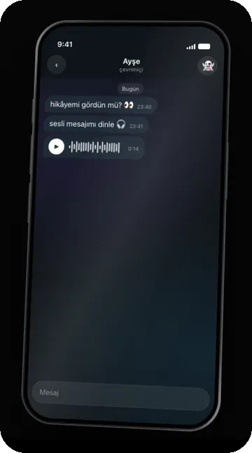
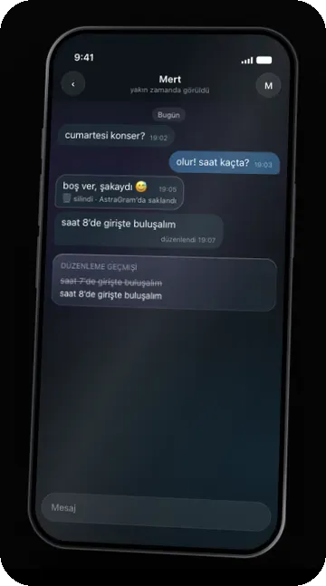
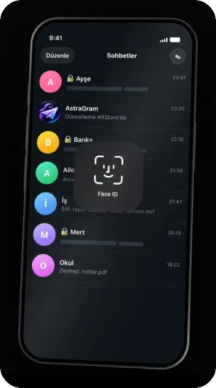
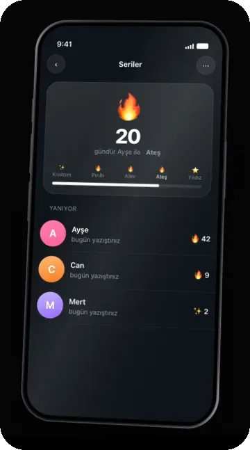
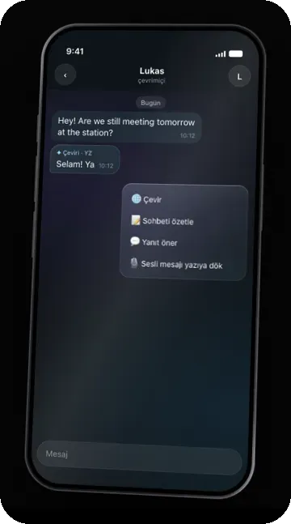
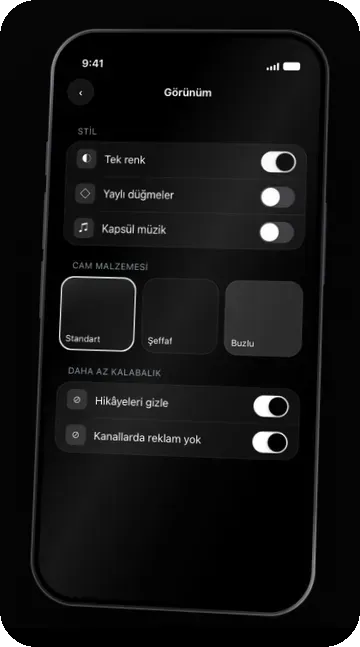

<a href="https://dedsec-reth0.github.io/astragram/?lang=tr"></a>

<p align="center"><a href="README.md">English</a> · <a href="README.ru.md">Русский</a> · <a href="README.uk.md">Українська</a> · <a href="README.es.md">Español</a> · <a href="README.pt.md">Português</a> · <a href="README.de.md">Deutsch</a> · <a href="README.fr.md">Français</a> · <b>Türkçe</b></p>

<p align="center">
  <a href="https://dedsec-reth0.github.io/astragram/install/?lang=tr"></a>
  <a href="https://dedsec-reth0.github.io/astragram/?lang=tr"></a>
  <a href="https://t.me/astragram_news"></a>
</p>

<p align="center">
  <a href="https://github.com/dedsec-reth0/astragram/releases/latest"></a>
  <a href="https://github.com/dedsec-reth0/astragram/releases"></a>
  <a href="https://github.com/dedsec-reth0/astragram/stargazers"></a>
  
  <a href="LICENSE"></a>
</p>

<br>

<p align="center">AstraGram, iPhone için açık kaynaklı, resmî olmayan bir Telegram istemcisi: hayalet modu, silinen mesajlar, Face ID ile sohbetler, seriler, yapay zekâ ve eklentiler. AltStore ve SideStore ile ücretsiz.</p>

<h3 align="center">Telegram’ı aldık ve <b>engel olan</b> her şeyi <b>kaldırdık.</b> <b>“Çevrimiçi”</b> ve <b>“okundu”</b> gönderilip gönderilmeyeceğine sen karar verirsin. Silinenler <b>sende kalır.</b> Fazlalıklar <b>kaybolur.</b> Ve kodun tamamı <b>ortada.</b></h3>

<br>

## Özellikler

<table>
<tr><td width="42%" align="center"><a href="https://dedsec-reth0.github.io/astragram/?lang=tr#features"></a></td><td width="58%" valign="middle"><sub><code>01 / 06</code></sub><h3>Hayalet modu</h3><p>“Çevrimiçi”, “okundu” ve “yazıyor” göndermeden oku, dinle, hikâyeleri izle. Sohbet listesinin üstündeki hayalet düğmesiyle açılır.</p><ul><li>Hikâye, sesli ve görüntülü mesajlarda görüldü bilgisi yok</li><li>Okundu bilgisi yalnızca sen yanıtlayınca gider</li><li>Telegram sunucusu bağlantını yine görür: görünmezlik değildir</li></ul></td></tr>
<tr><td width="58%" valign="middle"><sub><code>02 / 06</code></sub><h3>Silinenler kalır</h3><p>Karşı tarafın sildiği mesajlar sohbette bir etiketle kalır. Her mesajın düzenleme geçmişi saklanır.</p><ul><li>Kanallarda da çalışır</li><li>Tek seferlik fotoğraf ve videolar yanmaz</li><li>Tüm sohbetlerde silinenlerin kaydı</li></ul></td><td width="42%" align="center"><a href="https://dedsec-reth0.github.io/astragram/?lang=tr#features"></a></td></tr>
<tr><td width="42%" align="center"><a href="https://dedsec-reth0.github.io/astragram/?lang=tr#features"></a></td><td width="58%" valign="middle"><sub><code>03 / 06</code></sub><h3>Face ID ile sohbetler</h3><p>Seçtiğin sohbetler yalnızca yüzünle açılır. Metinleri sohbet listesinde bile gizlenir, uygulama değiştiricide bir kapak görünür.</p><ul><li>AstraGram ayarları için Face ID</li><li>Üçüncü taraf klavyeleri engelleme</li><li>Pano bir dakika sonra temizlenir</li></ul></td></tr>
<tr><td width="58%" valign="middle"><sub><code>04 / 06</code></sub><h3>Arkadaşlarla seriler</h3><p>Her gün yazışın, seri büyüsün: Kıvılcım, Pırıltı, Alev, Ateş, Yıldız. Sayaç tüm cihazlarında aynıdır.</p><ul><li>Gardırobu olan bir dost</li><li>Kaçırılan bir günü geri getirme</li><li>AstraGram kullanan arkadaşlarının gördüğü AstraGram rozeti</li></ul></td><td width="42%" align="center"><a href="https://dedsec-reth0.github.io/astragram/?lang=tr#features"></a></td></tr>
<tr><td width="42%" align="center"><a href="https://dedsec-reth0.github.io/astragram/?lang=tr#features"></a></td><td width="58%" valign="middle"><sub><code>05 / 06</code></sub><h3>Kendi anahtarınla yapay zekâ</h3><p>Çeviri, sohbet özeti, yanıt önerisi, sesli mesaj dökümü ve fotoğraftan metin — OpenAI uyumlu herhangi bir API ile.</p><ul><li>Metin servise yalnızca sen isteyince gider</li><li>Anahtar yoksa sınırlı ücretsiz bir servis</li><li>JavaScript eklentileri</li></ul></td></tr>
<tr><td width="58%" valign="middle"><sub><code>06 / 06</code></sub><h3>Tek renk ve cam</h3><p>Yalnızca siyah, beyaz ve gri tonlarında bir görünüm. Cam malzemesini seç: standart, şeffaf veya buzlu.</p><ul><li>Yaylı düğme tepkisi</li><li>Profilde kapsül müzik</li><li>Kanallarda hikâye ve reklam yok</li></ul></td><td width="42%" align="center"><a href="https://dedsec-reth0.github.io/astragram/?lang=tr#features"></a></td></tr>
</table>

## Eksikliğini çektiğin her şey.

<a href="https://dedsec-reth0.github.io/astragram/?lang=tr#more"></a>

Eklenti nasıl yazılır: [astragram/plugins/README.md](astragram/plugins/README.md) · [examples](astragram/plugins/examples)

## Yükle

Tek dokunuşla AltStore, AstraGram kaynağını eklemeyi önerir. Güncellemeler de oraya gelir.

<p><a href="https://dedsec-reth0.github.io/astragram/install/?lang=tr"></a> <a href="https://dedsec-reth0.github.io/astragram/install/?lang=tr"></a> <a href="https://github.com/dedsec-reth0/astragram/releases/latest"></a></p>

<table><tr>
<td width="33%" valign="top"><h1>01</h1><b>AltStore veya SideStore’u yükle</b><br><sub>Uygulamayı senin Apple kimliğinle imzalarlar. Jailbreak gerekmez.<br><a href="https://altstore.io">AltStore’u indir</a> · <a href="https://sidestore.io">SideStore</a></sub></td>
<td width="33%" valign="top"><h1>02</h1><b>AstraGram kaynağını ekle</b><br><sub>“AltStore’da aç” düğmesi bunu senin için yapar. Ya da adresi elle yapıştır.</sub></td>
<td width="33%" valign="top"><h1>03</h1><b>Free’ye dokun</b><br><sub>AltStore, AstraGram’ı yükler. İlk açılışta my.telegram.org’dan aldığın API ID ve Hash’i gir.</sub></td>
</tr></table>

**Elle** — Kaynak adresi:

```
https://github.com/dedsec-reth0/astragram/releases/download/sidestore-source/source.json
```

1. AltStore → **Browse** → **Sources** → **+** yolunu aç.
2. Kopyalanan adresi yapıştır.
3. AstraGram’ı bul ve **Free**’ye dokun.

> [!NOTE]
> AstraGram’ın kendi ekranları Rusça ve İngilizcedir; uygulamanın geri kalanı Telegram’ın arayüzüdür ve tüm dillerinde çalışır.

### Hangi IPA’yı seçmeli

| | IPA | App ID |
| --- | --- | --- |
| **Standart** | `AstraGram-<version>-<build>.ipa` | Ücretsiz Apple kimliği. Uzantı yok — widget ve Paylaş yok. 1 App ID gerekir. |
| **Full** | `AstraGram-<version>-<build>-full.ipa` | Ücretli geliştirici hesabı. Tüm uzantılar dahil. 7 App ID gerekir. |

### Tüm sürümler

Tüm derlemeler [Releases](https://github.com/dedsec-reth0/astragram/releases) sayfasında; AltStore kaynağı yalnızca sonuncuyu değil hepsini listeler: yenisi güncelleme olarak gelir, öncekiler sürüm geçmişinde kalır.

### Sorular

<details><summary><b>Jailbreak gerekir mi?</b></summary>

Hayır. AstraGram, kaynaktaki her uygulama gibi AltStore veya SideStore ile yüklenir.

</details>
<details><summary><b>Neden 7 günde bir?</b></summary>

Ücretsiz Apple kimliğiyle imza 7 gün geçerlidir. Haftada bir AltStore’da “Refresh All”a dokun.

</details>
<details><summary><b>Güncellerken verilerim kalır mı?</b></summary>

Evet. AltStore ile güncellerken verilerin ve oturumun korunur.

</details>
<details><summary><b>API ID ve Hash nereden alınır?</b></summary>

my.telegram.org’da, API development tools bölümünden. Sonra Ayarlar → AstraGram → API ID ve Hash’ten değiştirebilirsin.

</details>
<details><summary><b>Push bildirimleri neden gelmiyor?</b></summary>

Telegram sunucuları push’u yalnızca tanıdıkları sertifikaya sahip uygulamalara gönderir. AstraGram ayarlarındaki “Push olmadan bildirim” kısmen yardımcı olur.

</details>

## Sözümüze güvenme. Kendin kontrol et.

<table><tr>
<td width="33%" valign="top"><b>Kod açık. Tamamı</b><br><sub>Kaynak kodu GPL-2.0 lisansıyla <a href="https://github.com/dedsec-reth0/astragram">GitHub</a>’da; temeli Telegram-iOS’un açık kodu.</sub></td>
<td width="33%" valign="top"><b>Derleyen GitHub, biz değiliz</b><br><sub>Her derleme GitHub Actions’ta çalışır ve kaydı herkese açıktır. Her sürüm, derlendiği commit’e etiketlenir.</sub></td>
<td width="33%" valign="top"><b>API anahtarları senin</b><br><sub>İlk açılışta my.telegram.org’dan aldığın kendi API ID ve Hash’ini girersin.</sub></td>
</tr></table>

```console
$ git clone https://github.com/dedsec-reth0/astragram
$ gh release view --repo dedsec-reth0/astragram --json tagName,targetCommitish
# sürüm bu commit’ten derlendi — kendin kontrol et
```

### Kaynaktan derleme

Uygulama, Telegram-iOS kaynak kodundan Bazel ile derlenir; her sürüm, derlendiği commit üzerinde etiketlenir.

[astragram/INSTALL.md](astragram/INSTALL.md) — derleme ve yayınlama (Rusça) · [docs/telegram-ios-build.md](docs/telegram-ios-build.md) — Telegram’ın orijinal kılavuzu

### Lisans

GPL-2.0 ile yayımlanan [Telegram-iOS](https://github.com/TelegramMessenger/Telegram-iOS) tabanlıdır. Bu depodaki değişiklikler aynı lisansla dağıtılır: [LICENSE](LICENSE); üçüncü taraf bileşenler: [THIRD-PARTY-NOTICES.md](THIRD-PARTY-NOTICES.md).

---

<p align="center"><a href="https://dedsec-reth0.github.io/astragram/?lang=tr"></a></p>

<p align="center"><sub>AstraGram resmî olmayan bir Telegram istemcisidir ve Telegram ile bağlantılı değildir; Telegram adı ve logosu sahibine aittir.<br>AltStore sürümleri push bildirimi almaz; hayalet modu bağlantını Telegram sunucusundan gizlemez.</sub></p>
