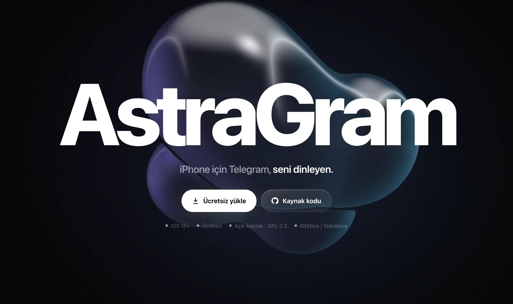
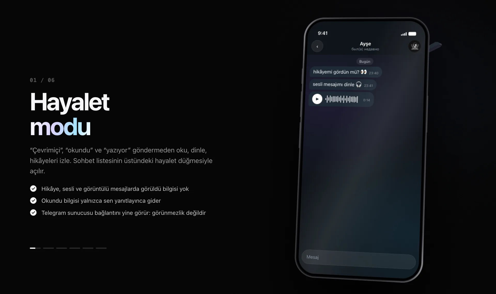
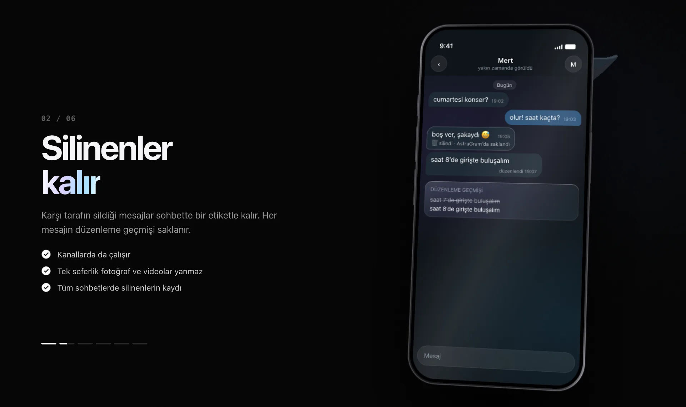
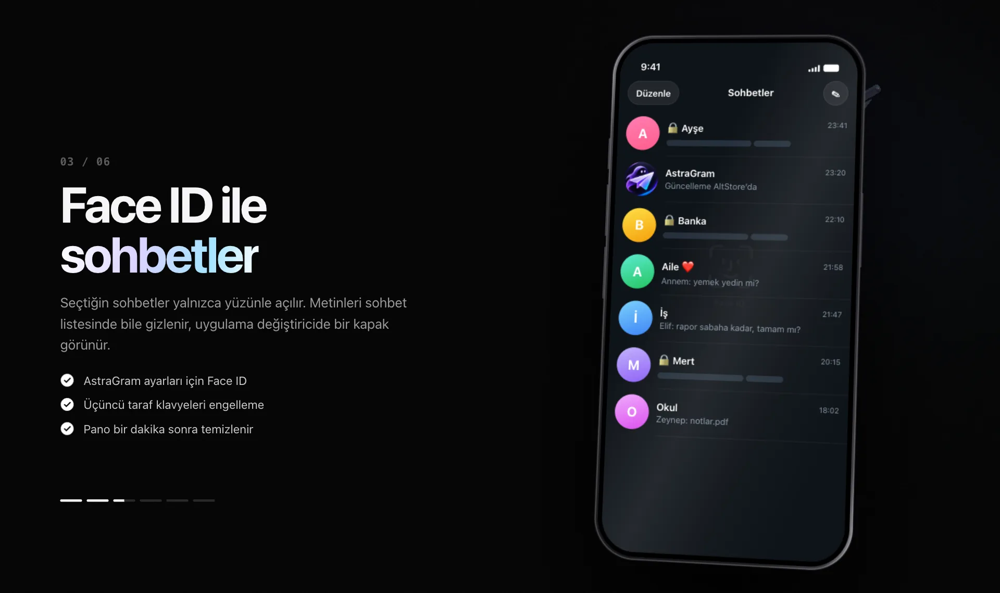
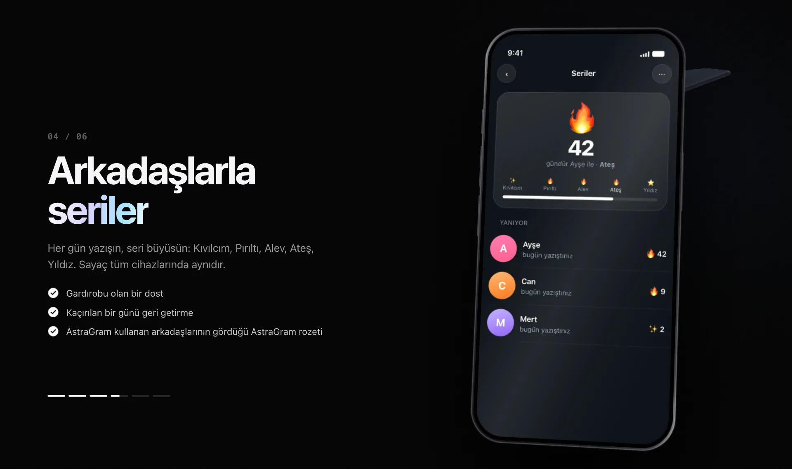
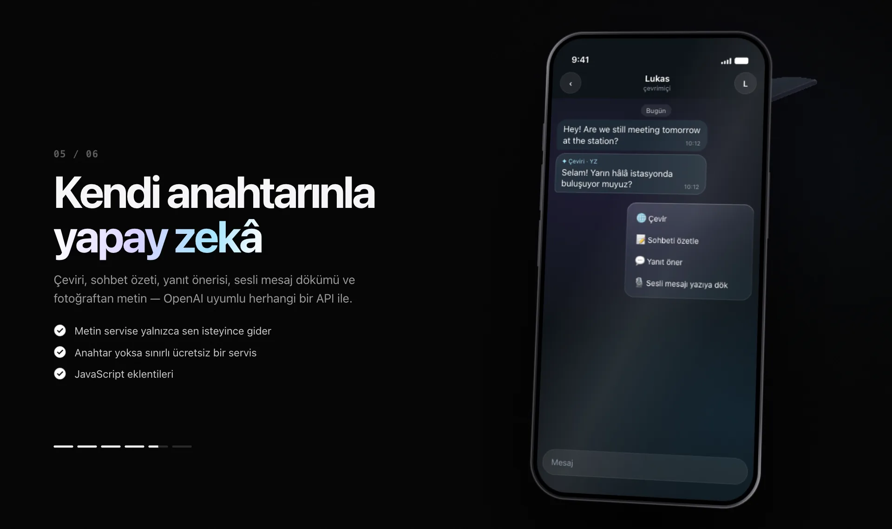
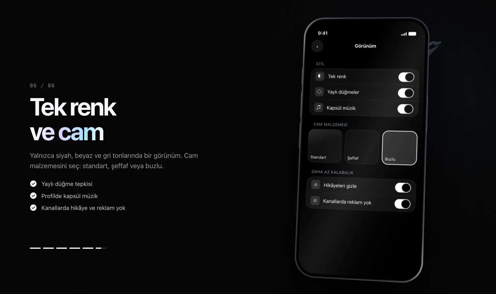
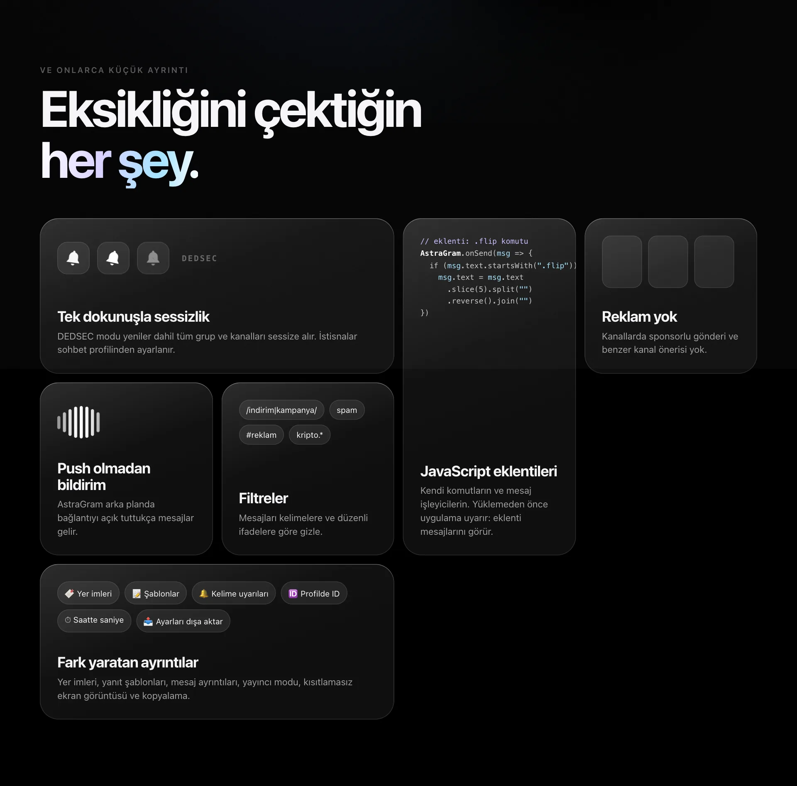

<a href="https://dedsec-reth0.github.io/astragram/?lang=tr"></a>

<p align="center"><a href="README.md">English</a> · <a href="README.ru.md">Русский</a> · <a href="README.uk.md">Українська</a> · <a href="README.es.md">Español</a> · <a href="README.pt.md">Português</a> · <a href="README.de.md">Deutsch</a> · <a href="README.fr.md">Français</a> · <b>Türkçe</b></p>

<h1 align="center">AstraGram</h1>

<p align="center"><b>iPhone için Telegram, seni dinleyen.</b><br>AstraGram, iPhone için açık kaynaklı, resmî olmayan bir Telegram istemcisi: hayalet modu, silinen mesajlar, Face ID ile sohbetler, seriler, yapay zekâ ve eklentiler. AltStore ve SideStore ile ücretsiz.</p>

<p align="center">
  <a href="https://dedsec-reth0.github.io/astragram/install/?lang=tr"></a>
  <a href="https://github.com/dedsec-reth0/astragram/releases/latest"></a>
  <a href="https://github.com/dedsec-reth0/astragram/releases"></a>
  
  <a href="LICENSE"></a>
</p>

<p align="center"><a href="https://dedsec-reth0.github.io/astragram/install/?lang=tr"><b>Ücretsiz yükle</b></a> · <a href="https://dedsec-reth0.github.io/astragram/?lang=tr"><b>Web sitesi</b></a> · <a href="https://t.me/astragram_news"><b>Telegram kanalı</b></a> · <a href="https://github.com/dedsec-reth0/astragram/releases/latest"><b>IPA indir</b></a></p>

> Telegram’ı aldık ve **engel olan** her şeyi **kaldırdık.** **“Çevrimiçi”** ve **“okundu”** gönderilip gönderilmeyeceğine sen karar verirsin. Silinenler **sende kalır.** Fazlalıklar **kaybolur.** Ve kodun tamamı **ortada.**

## Özellikler

<a href="https://dedsec-reth0.github.io/astragram/?lang=tr#features"></a>

<a href="https://dedsec-reth0.github.io/astragram/?lang=tr#features"></a>

<a href="https://dedsec-reth0.github.io/astragram/?lang=tr#features"></a>

<a href="https://dedsec-reth0.github.io/astragram/?lang=tr#features"></a>

<a href="https://dedsec-reth0.github.io/astragram/?lang=tr#features"></a>

<a href="https://dedsec-reth0.github.io/astragram/?lang=tr#features"></a>

## Eksikliğini çektiğin her şey.

<a href="https://dedsec-reth0.github.io/astragram/?lang=tr#more"></a>

Eklenti nasıl yazılır: [astragram/plugins/README.md](astragram/plugins/README.md) · [examples](astragram/plugins/examples)

## Yükle

Tek dokunuşla AltStore, AstraGram kaynağını eklemeyi önerir. Güncellemeler de oraya gelir.

<p><a href="https://dedsec-reth0.github.io/astragram/install/?lang=tr"></a> <a href="https://dedsec-reth0.github.io/astragram/install/?lang=tr"></a> <a href="https://github.com/dedsec-reth0/astragram/releases/latest"></a></p>

1. **AltStore veya SideStore’u yükle** — Uygulamayı senin Apple kimliğinle imzalarlar. Jailbreak gerekmez. [AltStore’u indir](https://altstore.io) · [SideStore](https://sidestore.io)
2. **AstraGram kaynağını ekle** — “AltStore’da aç” düğmesi bunu senin için yapar. Ya da adresi elle yapıştır.
3. **Free’ye dokun** — AltStore, AstraGram’ı yükler. İlk açılışta my.telegram.org’dan aldığın API ID ve Hash’i gir.

**Elle** — Kaynak adresi:

```
https://github.com/dedsec-reth0/astragram/releases/download/sidestore-source/source.json
```

1. AltStore → **Browse** → **Sources** → **+** yolunu aç.
2. Kopyalanan adresi yapıştır.
3. AstraGram’ı bul ve **Free**’ye dokun.

> [!NOTE]
> AstraGram’ın kendi ekranları Rusça ve İngilizcedir; uygulamanın geri kalanı Telegram’ın arayüzüdür ve tüm dillerinde çalışır.

### Hangi IPA’yı seçmeli

| | IPA | App ID |
| --- | --- | --- |
| **Standart** | `AstraGram-<version>-<build>.ipa` | Ücretsiz Apple kimliği. Uzantı yok — widget ve Paylaş yok. 1 App ID gerekir. |
| **Full** | `AstraGram-<version>-<build>-full.ipa` | Ücretli geliştirici hesabı. Tüm uzantılar dahil. 7 App ID gerekir. |

### Tüm sürümler

Tüm derlemeler [Releases](https://github.com/dedsec-reth0/astragram/releases) sayfasında; AltStore kaynağı yalnızca sonuncuyu değil hepsini listeler: yenisi güncelleme olarak gelir, öncekiler sürüm geçmişinde kalır.

### Sorular

<details><summary><b>Jailbreak gerekir mi?</b></summary>

Hayır. AstraGram, kaynaktaki her uygulama gibi AltStore veya SideStore ile yüklenir.

</details>
<details><summary><b>Neden 7 günde bir?</b></summary>

Ücretsiz Apple kimliğiyle imza 7 gün geçerlidir. Haftada bir AltStore’da “Refresh All”a dokun.

</details>
<details><summary><b>Güncellerken verilerim kalır mı?</b></summary>

Evet. AltStore ile güncellerken verilerin ve oturumun korunur.

</details>
<details><summary><b>API ID ve Hash nereden alınır?</b></summary>

my.telegram.org’da, API development tools bölümünden. Sonra Ayarlar → AstraGram → API ID ve Hash’ten değiştirebilirsin.

</details>
<details><summary><b>Push bildirimleri neden gelmiyor?</b></summary>

Telegram sunucuları push’u yalnızca tanıdıkları sertifikaya sahip uygulamalara gönderir. AstraGram ayarlarındaki “Push olmadan bildirim” kısmen yardımcı olur.

</details>

## Sözümüze güvenme. Kendin kontrol et.

- **Kod açık. Tamamı** — Kaynak kodu GPL-2.0 lisansıyla [GitHub](https://github.com/dedsec-reth0/astragram)’da; temeli Telegram-iOS’un açık kodu.
- **Derleyen GitHub, biz değiliz** — Her derleme GitHub Actions’ta çalışır ve kaydı herkese açıktır. Her sürüm, derlendiği commit’e etiketlenir.
- **API anahtarları senin** — İlk açılışta my.telegram.org’dan aldığın kendi API ID ve Hash’ini girersin.

### Kaynaktan derleme

Uygulama, Telegram-iOS kaynak kodundan Bazel ile derlenir; her sürüm, derlendiği commit üzerinde etiketlenir.

[astragram/INSTALL.md](astragram/INSTALL.md) — derleme ve yayınlama (Rusça) · [docs/telegram-ios-build.md](docs/telegram-ios-build.md) — Telegram’ın orijinal kılavuzu

### Lisans

GPL-2.0 ile yayımlanan [Telegram-iOS](https://github.com/TelegramMessenger/Telegram-iOS) tabanlıdır. Bu depodaki değişiklikler aynı lisansla dağıtılır: [LICENSE](LICENSE); üçüncü taraf bileşenler: [THIRD-PARTY-NOTICES.md](THIRD-PARTY-NOTICES.md).

---

<p align="center"><a href="https://dedsec-reth0.github.io/astragram/?lang=tr"></a></p>

<p align="center"><sub>AstraGram resmî olmayan bir Telegram istemcisidir ve Telegram ile bağlantılı değildir; Telegram adı ve logosu sahibine aittir.<br>AltStore sürümleri push bildirimi almaz; hayalet modu bağlantını Telegram sunucusundan gizlemez.</sub></p>
