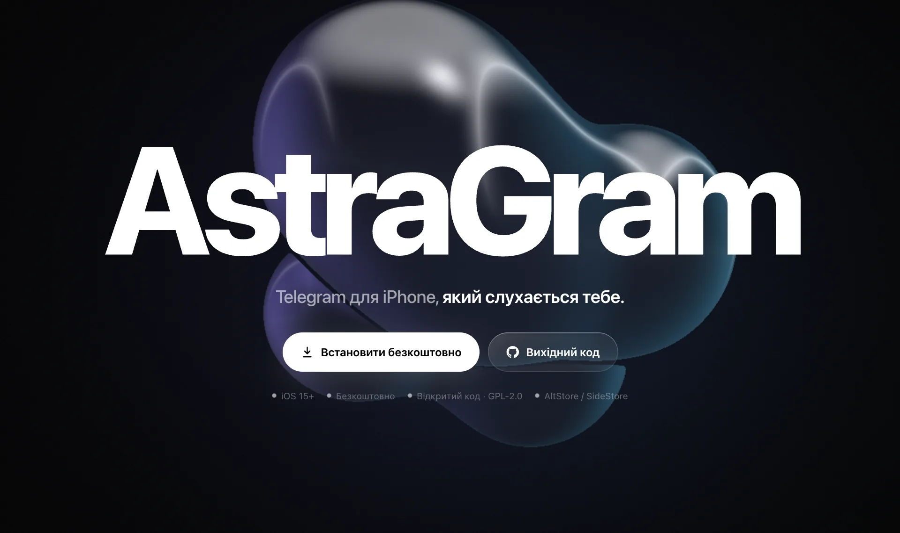
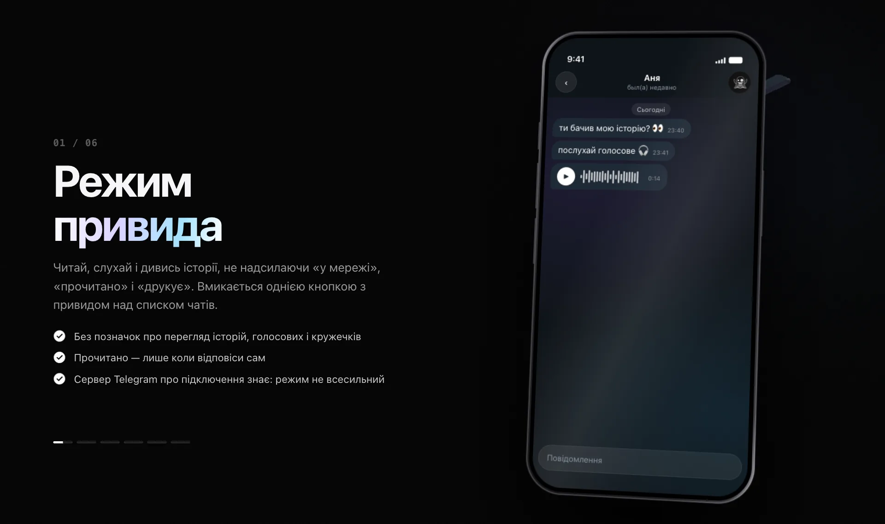
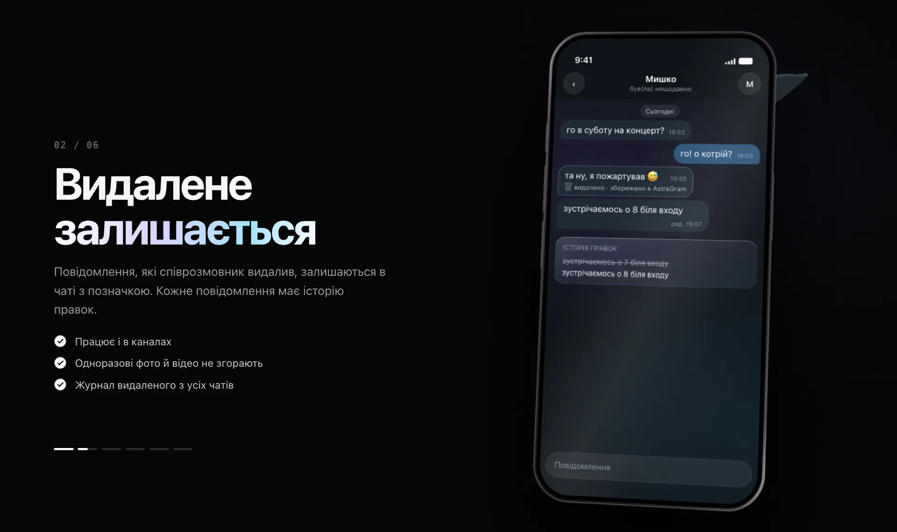
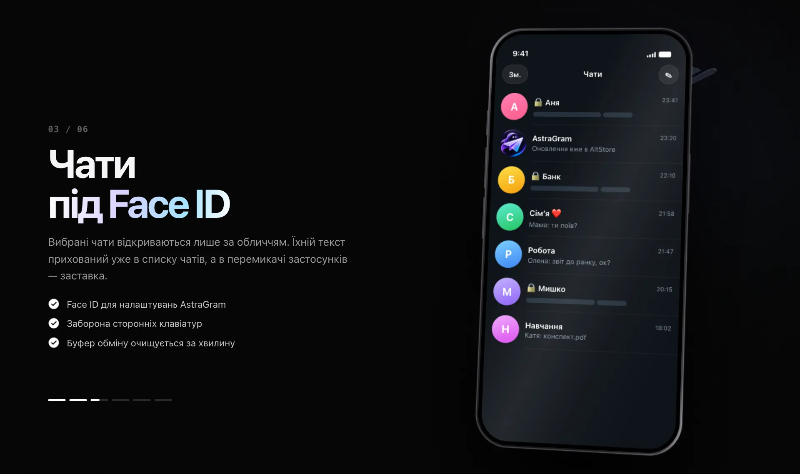
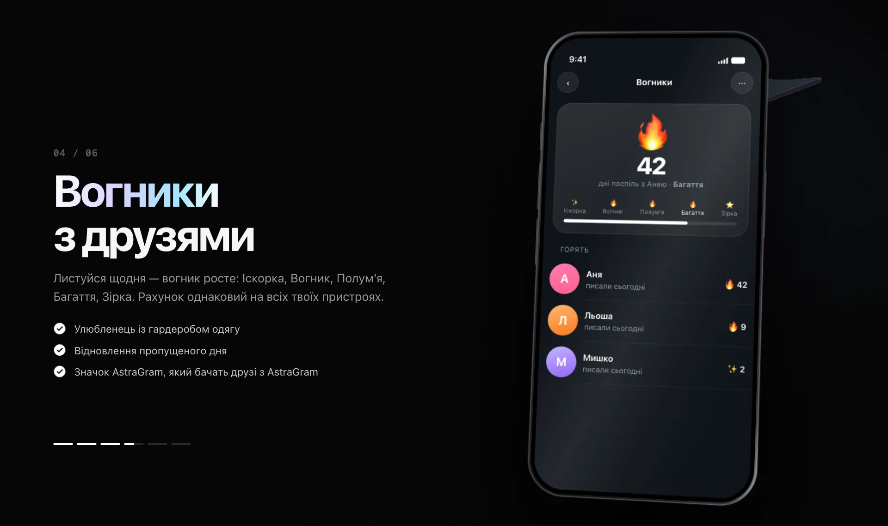
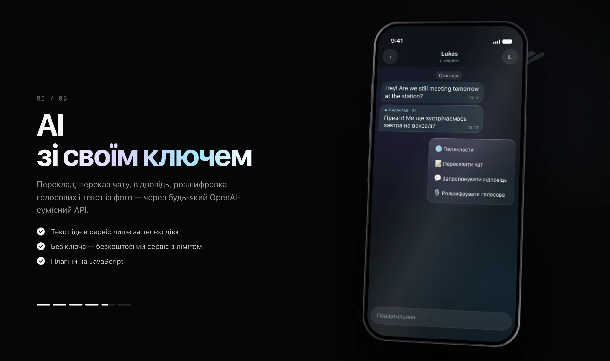
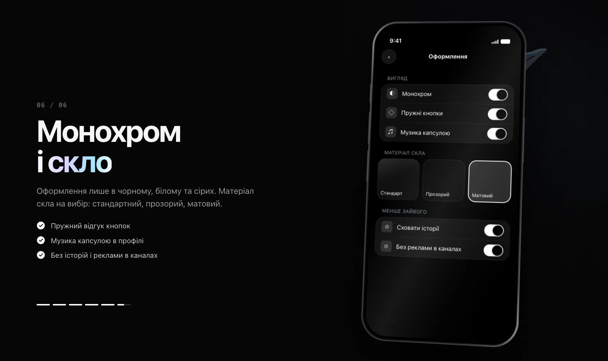
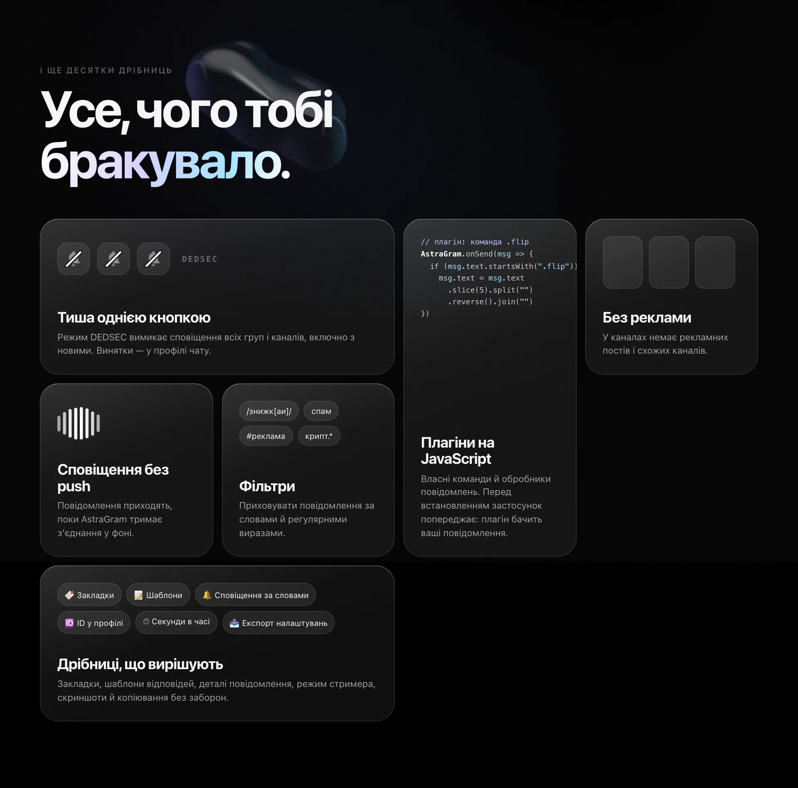

<a href="https://dedsec-reth0.github.io/astragram/?lang=uk"></a>

<p align="center"><a href="README.md">English</a> · <a href="README.ru.md">Русский</a> · <b>Українська</b> · <a href="README.es.md">Español</a> · <a href="README.pt.md">Português</a> · <a href="README.de.md">Deutsch</a> · <a href="README.fr.md">Français</a> · <a href="README.tr.md">Türkçe</a></p>

<h1 align="center">AstraGram</h1>

<p align="center"><b>Telegram для iPhone, який слухається тебе.</b><br>AstraGram — неофіційний клієнт Telegram для iPhone з відкритим кодом: режим привида, видалені повідомлення, чати під Face ID, вогники, AI і плагіни. Безкоштовно через AltStore і SideStore.</p>

<p align="center">
  <a href="https://dedsec-reth0.github.io/astragram/install/?lang=uk"></a>
  <a href="https://github.com/dedsec-reth0/astragram/releases/latest"></a>
  <a href="https://github.com/dedsec-reth0/astragram/releases"></a>
  
  <a href="LICENSE"></a>
</p>

<p align="center"><a href="https://dedsec-reth0.github.io/astragram/install/?lang=uk"><b>Встановити безкоштовно</b></a> · <a href="https://dedsec-reth0.github.io/astragram/?lang=uk"><b>Сайт</b></a> · <a href="https://t.me/astragram_news"><b>Канал у Telegram</b></a> · <a href="https://github.com/dedsec-reth0/astragram/releases/latest"><b>Завантажити IPA</b></a></p>

> Ми взяли Telegram і **прибрали** все, що **заважає.** Ти вирішуєш, чи надсилати **«у мережі»** і **«прочитано».** Видалене **залишається** в тебе. Зайве **зникає.** А весь код — **на виду.**

## Можливості

<a href="https://dedsec-reth0.github.io/astragram/?lang=uk#features"></a>

<a href="https://dedsec-reth0.github.io/astragram/?lang=uk#features"></a>

<a href="https://dedsec-reth0.github.io/astragram/?lang=uk#features"></a>

<a href="https://dedsec-reth0.github.io/astragram/?lang=uk#features"></a>

<a href="https://dedsec-reth0.github.io/astragram/?lang=uk#features"></a>

<a href="https://dedsec-reth0.github.io/astragram/?lang=uk#features"></a>

## Усе, чого тобі бракувало.

<a href="https://dedsec-reth0.github.io/astragram/?lang=uk#more"></a>

Як написати плагін: [astragram/plugins/README.md](astragram/plugins/README.md) · [examples](astragram/plugins/examples)

## Встановити

Одне натискання — і AltStore запропонує додати джерело AstraGram. Оновлення потім приходитимуть туди ж.

<p><a href="https://dedsec-reth0.github.io/astragram/install/?lang=uk"></a> <a href="https://dedsec-reth0.github.io/astragram/install/?lang=uk"></a> <a href="https://github.com/dedsec-reth0/astragram/releases/latest"></a></p>

1. **Встанови AltStore або SideStore** — Вони підписують застосунок твоїм Apple ID. Джейлбрейк не потрібен. [Завантажити AltStore](https://altstore.io) · [SideStore](https://sidestore.io)
2. **Додай джерело AstraGram** — Кнопка «Відкрити в AltStore» зробить це сама. Або встав адресу вручну.
3. **Натисни Free** — AltStore встановить AstraGram. Під час першого запуску введи свої API ID і Hash з my.telegram.org.

**Вручну** — Адреса джерела:

```
https://github.com/dedsec-reth0/astragram/releases/download/sidestore-source/source.json
```

1. Відкрий AltStore → **Browse** → **Sources** → **+**.
2. Встав скопійовану адресу.
3. Знайди AstraGram і натисни **Free**.

> [!NOTE]
> Власні екрани AstraGram — російською та англійською; решта застосунку — інтерфейс Telegram будь-якою його мовою.

### Який IPA обрати

| | IPA | App ID |
| --- | --- | --- |
| **Звичайний** | `AstraGram-<version>-<build>.ipa` | Безкоштовний Apple ID. Без розширень — віджетів і «Поділитися». Потрібен 1 App ID. |
| **Full** | `AstraGram-<version>-<build>-full.ipa` | Платний акаунт розробника. З усіма розширеннями. Потрібно 7 App ID. |

### Усі версії

Усі збірки лежать у [Releases](https://github.com/dedsec-reth0/astragram/releases), а джерело AltStore показує їх усі, а не лише останню: нова приходить оновленням, попередні лишаються в історії версій.

### Питання

<details><summary><b>Чи потрібен джейлбрейк?</b></summary>

Ні. AstraGram встановлюється через AltStore або SideStore, як будь-який застосунок із джерела.

</details>
<details><summary><b>Чому раз на 7 днів?</b></summary>

З безкоштовним Apple ID підпис діє 7 днів. Раз на тиждень натискай в AltStore «Refresh All».

</details>
<details><summary><b>Чи збережуться дані під час оновлення?</b></summary>

Так. Під час оновлення через AltStore дані та вхід зберігаються.

</details>
<details><summary><b>Де взяти API ID і Hash?</b></summary>

На my.telegram.org, у розділі API development tools. Потім їх можна змінити: Налаштування → AstraGram → API ID і Hash.

</details>
<details><summary><b>Чому не приходять push-сповіщення?</b></summary>

Сервери Telegram надсилають push лише застосункам із відомим їм сертифікатом. Частково допомагає «Сповіщення без push» у налаштуваннях AstraGram.

</details>

## Не вір на слово. Перевір сам.

- **Код відкритий. Увесь** — Вихідний код лежить на [GitHub](https://github.com/dedsec-reth0/astragram) під ліцензією GPL-2.0. Основа — відкритий код Telegram-iOS.
- **Збирає GitHub, а не ми** — Кожна збірка йде на GitHub Actions — її журнал бачать усі. Реліз позначений тегом на коміт, з якого зібраний.
- **Ключі API — твої** — Під час першого запуску ти вводиш свої API ID і Hash з my.telegram.org.

### Збірка з вихідного коду

Застосунок збирається Bazel з вихідного коду Telegram-iOS; кожен реліз позначено тегом на коміті, з якого його зібрано.

[astragram/INSTALL.md](astragram/INSTALL.md) — збірка й публікація (російською) · [docs/telegram-ios-build.md](docs/telegram-ios-build.md) — оригінальна інструкція Telegram

### Ліцензія

Засновано на [Telegram-iOS](https://github.com/TelegramMessenger/Telegram-iOS) під GPL-2.0. Зміни в цьому репозиторії — на тих самих умовах: [LICENSE](LICENSE), сторонні компоненти — [THIRD-PARTY-NOTICES.md](THIRD-PARTY-NOTICES.md).

---

<p align="center"><a href="https://dedsec-reth0.github.io/astragram/?lang=uk"></a></p>

<p align="center"><sub>AstraGram — неофіційний клієнт Telegram. Не пов’язаний із Telegram; назва й логотип Telegram належать їхньому власнику.<br>Push-сповіщення у збірках з AltStore не приходять; режим привида не приховує підключення від сервера Telegram.</sub></p>
