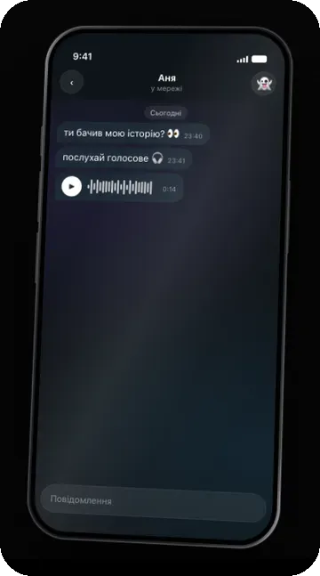
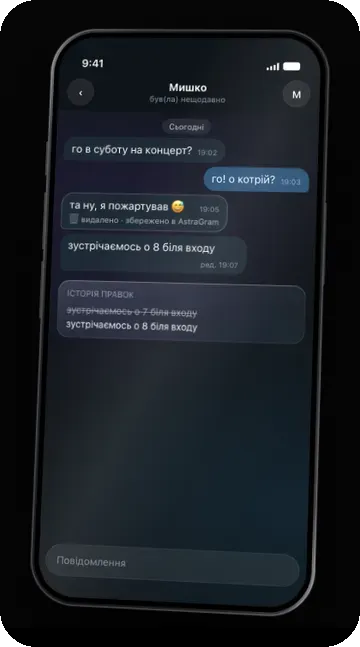
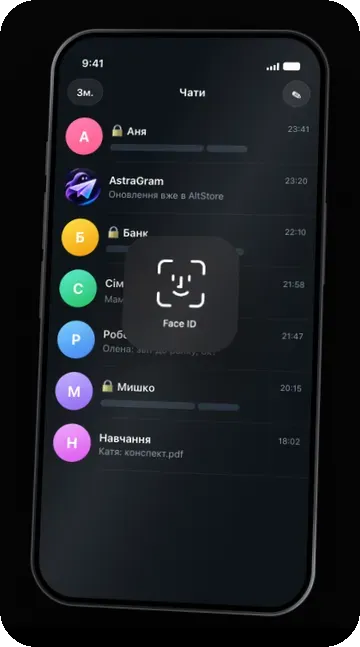
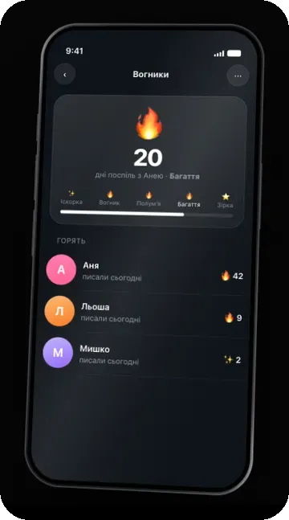
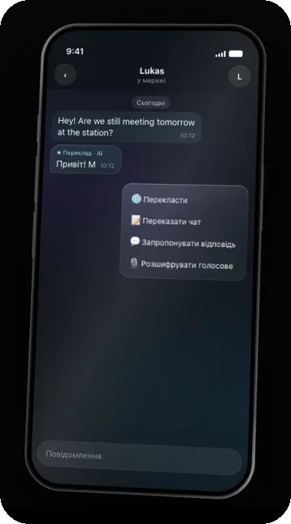
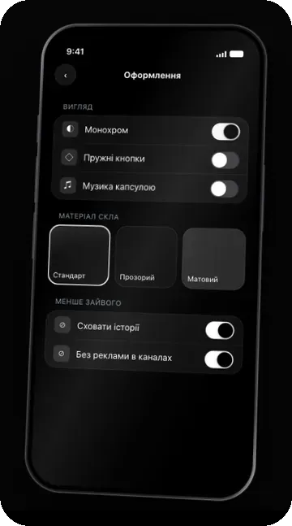

<a href="https://dedsec-reth0.github.io/astragram/?lang=uk"></a>

<p align="center"><a href="README.md">English</a> · <a href="README.ru.md">Русский</a> · <b>Українська</b> · <a href="README.es.md">Español</a> · <a href="README.pt.md">Português</a> · <a href="README.de.md">Deutsch</a> · <a href="README.fr.md">Français</a> · <a href="README.tr.md">Türkçe</a></p>

<p align="center">
  <a href="https://dedsec-reth0.github.io/astragram/install/?lang=uk"></a>
  <a href="https://dedsec-reth0.github.io/astragram/?lang=uk"></a>
  <a href="https://t.me/astragram_news"></a>
</p>

<p align="center">
  <a href="https://github.com/dedsec-reth0/astragram/releases/latest"></a>
  <a href="https://github.com/dedsec-reth0/astragram/releases"></a>
  <a href="https://github.com/dedsec-reth0/astragram/stargazers"></a>
  
  <a href="LICENSE"></a>
</p>

<br>

<p align="center">AstraGram — неофіційний клієнт Telegram для iPhone з відкритим кодом: режим привида, видалені повідомлення, чати під Face ID, вогники, AI і плагіни. Безкоштовно через AltStore і SideStore.</p>

<h3 align="center">Ми взяли Telegram і <b>прибрали</b> все, що <b>заважає.</b> Ти вирішуєш, чи надсилати <b>«у мережі»</b> і <b>«прочитано».</b> Видалене <b>залишається</b> в тебе. Зайве <b>зникає.</b> А весь код — <b>на виду.</b></h3>

<br>

## Можливості

<table>
<tr><td width="42%" align="center"><a href="https://dedsec-reth0.github.io/astragram/?lang=uk#features"></a></td><td width="58%" valign="middle"><sub><code>01 / 06</code></sub><h3>Режим привида</h3><p>Читай, слухай і дивись історії, не надсилаючи «у мережі», «прочитано» і «друкує». Вмикається однією кнопкою з привидом над списком чатів.</p><ul><li>Без позначок про перегляд історій, голосових і кружечків</li><li>Прочитано — лише коли відповіси сам</li><li>Сервер Telegram про підключення знає: режим не всесильний</li></ul></td></tr>
<tr><td width="58%" valign="middle"><sub><code>02 / 06</code></sub><h3>Видалене залишається</h3><p>Повідомлення, які співрозмовник видалив, залишаються в чаті з позначкою. Кожне повідомлення має історію правок.</p><ul><li>Працює і в каналах</li><li>Одноразові фото й відео не згорають</li><li>Журнал видаленого з усіх чатів</li></ul></td><td width="42%" align="center"><a href="https://dedsec-reth0.github.io/astragram/?lang=uk#features"></a></td></tr>
<tr><td width="42%" align="center"><a href="https://dedsec-reth0.github.io/astragram/?lang=uk#features"></a></td><td width="58%" valign="middle"><sub><code>03 / 06</code></sub><h3>Чати під Face ID</h3><p>Вибрані чати відкриваються лише за обличчям. Їхній текст прихований уже в списку чатів, а в перемикачі застосунків — заставка.</p><ul><li>Face ID для налаштувань AstraGram</li><li>Заборона сторонніх клавіатур</li><li>Буфер обміну очищується за хвилину</li></ul></td></tr>
<tr><td width="58%" valign="middle"><sub><code>04 / 06</code></sub><h3>Вогники з друзями</h3><p>Листуйся щодня — вогник росте: Іскорка, Вогник, Полум’я, Багаття, Зірка. Рахунок однаковий на всіх твоїх пристроях.</p><ul><li>Улюбленець із гардеробом одягу</li><li>Відновлення пропущеного дня</li><li>Значок AstraGram, який бачать друзі з AstraGram</li></ul></td><td width="42%" align="center"><a href="https://dedsec-reth0.github.io/astragram/?lang=uk#features"></a></td></tr>
<tr><td width="42%" align="center"><a href="https://dedsec-reth0.github.io/astragram/?lang=uk#features"></a></td><td width="58%" valign="middle"><sub><code>05 / 06</code></sub><h3>AI зі своїм ключем</h3><p>Переклад, переказ чату, відповідь, розшифровка голосових і текст із фото — через будь-який OpenAI-сумісний API.</p><ul><li>Текст іде в сервіс лише за твоєю дією</li><li>Без ключа — безкоштовний сервіс з лімітом</li><li>Плагіни на JavaScript</li></ul></td></tr>
<tr><td width="58%" valign="middle"><sub><code>06 / 06</code></sub><h3>Монохром і скло</h3><p>Оформлення лише в чорному, білому та сірих. Матеріал скла на вибір: стандартний, прозорий, матовий.</p><ul><li>Пружний відгук кнопок</li><li>Музика капсулою в профілі</li><li>Без історій і реклами в каналах</li></ul></td><td width="42%" align="center"><a href="https://dedsec-reth0.github.io/astragram/?lang=uk#features"></a></td></tr>
</table>

## Усе, чого тобі бракувало.

<a href="https://dedsec-reth0.github.io/astragram/?lang=uk#more"></a>

Як написати плагін: [astragram/plugins/README.md](astragram/plugins/README.md) · [examples](astragram/plugins/examples)

## Встановити

Одне натискання — і AltStore запропонує додати джерело AstraGram. Оновлення потім приходитимуть туди ж.

<p><a href="https://dedsec-reth0.github.io/astragram/install/?lang=uk"></a> <a href="https://dedsec-reth0.github.io/astragram/install/?lang=uk"></a> <a href="https://github.com/dedsec-reth0/astragram/releases/latest"></a></p>

<table><tr>
<td width="33%" valign="top"><h1>01</h1><b>Встанови AltStore або SideStore</b><br><sub>Вони підписують застосунок твоїм Apple ID. Джейлбрейк не потрібен.<br><a href="https://altstore.io">Завантажити AltStore</a> · <a href="https://sidestore.io">SideStore</a></sub></td>
<td width="33%" valign="top"><h1>02</h1><b>Додай джерело AstraGram</b><br><sub>Кнопка «Відкрити в AltStore» зробить це сама. Або встав адресу вручну.</sub></td>
<td width="33%" valign="top"><h1>03</h1><b>Натисни Free</b><br><sub>AltStore встановить AstraGram. Під час першого запуску введи свої API ID і Hash з my.telegram.org.</sub></td>
</tr></table>

**Вручну** — Адреса джерела:

```
https://github.com/dedsec-reth0/astragram/releases/download/sidestore-source/source.json
```

1. Відкрий AltStore → **Browse** → **Sources** → **+**.
2. Встав скопійовану адресу.
3. Знайди AstraGram і натисни **Free**.

> [!NOTE]
> Власні екрани AstraGram — російською та англійською; решта застосунку — інтерфейс Telegram будь-якою його мовою.

### Який IPA обрати

| | IPA | App ID |
| --- | --- | --- |
| **Звичайний** | `AstraGram-<version>-<build>.ipa` | Безкоштовний Apple ID. Без розширень — віджетів і «Поділитися». Потрібен 1 App ID. |
| **Full** | `AstraGram-<version>-<build>-full.ipa` | Платний акаунт розробника. З усіма розширеннями. Потрібно 7 App ID. |

### Усі версії

Усі збірки лежать у [Releases](https://github.com/dedsec-reth0/astragram/releases), а джерело AltStore показує їх усі, а не лише останню: нова приходить оновленням, попередні лишаються в історії версій.

### Питання

<details><summary><b>Чи потрібен джейлбрейк?</b></summary>

Ні. AstraGram встановлюється через AltStore або SideStore, як будь-який застосунок із джерела.

</details>
<details><summary><b>Чому раз на 7 днів?</b></summary>

З безкоштовним Apple ID підпис діє 7 днів. Раз на тиждень натискай в AltStore «Refresh All».

</details>
<details><summary><b>Чи збережуться дані під час оновлення?</b></summary>

Так. Під час оновлення через AltStore дані та вхід зберігаються.

</details>
<details><summary><b>Де взяти API ID і Hash?</b></summary>

На my.telegram.org, у розділі API development tools. Потім їх можна змінити: Налаштування → AstraGram → API ID і Hash.

</details>
<details><summary><b>Чому не приходять push-сповіщення?</b></summary>

Сервери Telegram надсилають push лише застосункам із відомим їм сертифікатом. Частково допомагає «Сповіщення без push» у налаштуваннях AstraGram.

</details>

## Не вір на слово. Перевір сам.

<table><tr>
<td width="33%" valign="top"><b>Код відкритий. Увесь</b><br><sub>Вихідний код лежить на <a href="https://github.com/dedsec-reth0/astragram">GitHub</a> під ліцензією GPL-2.0. Основа — відкритий код Telegram-iOS.</sub></td>
<td width="33%" valign="top"><b>Збирає GitHub, а не ми</b><br><sub>Кожна збірка йде на GitHub Actions — її журнал бачать усі. Реліз позначений тегом на коміт, з якого зібраний.</sub></td>
<td width="33%" valign="top"><b>Ключі API — твої</b><br><sub>Під час першого запуску ти вводиш свої API ID і Hash з my.telegram.org.</sub></td>
</tr></table>

```console
$ git clone https://github.com/dedsec-reth0/astragram
$ gh release view --repo dedsec-reth0/astragram --json tagName,targetCommitish
# реліз зібрано з цього коміту — перевір сам
```

### Збірка з вихідного коду

Застосунок збирається Bazel з вихідного коду Telegram-iOS; кожен реліз позначено тегом на коміті, з якого його зібрано.

[astragram/INSTALL.md](astragram/INSTALL.md) — збірка й публікація (російською) · [docs/telegram-ios-build.md](docs/telegram-ios-build.md) — оригінальна інструкція Telegram

### Ліцензія

Засновано на [Telegram-iOS](https://github.com/TelegramMessenger/Telegram-iOS) під GPL-2.0. Зміни в цьому репозиторії — на тих самих умовах: [LICENSE](LICENSE), сторонні компоненти — [THIRD-PARTY-NOTICES.md](THIRD-PARTY-NOTICES.md).

---

<p align="center"><a href="https://dedsec-reth0.github.io/astragram/?lang=uk"></a></p>

<p align="center"><sub>AstraGram — неофіційний клієнт Telegram. Не пов’язаний із Telegram; назва й логотип Telegram належать їхньому власнику.<br>Push-сповіщення у збірках з AltStore не приходять; режим привида не приховує підключення від сервера Telegram.</sub></p>
